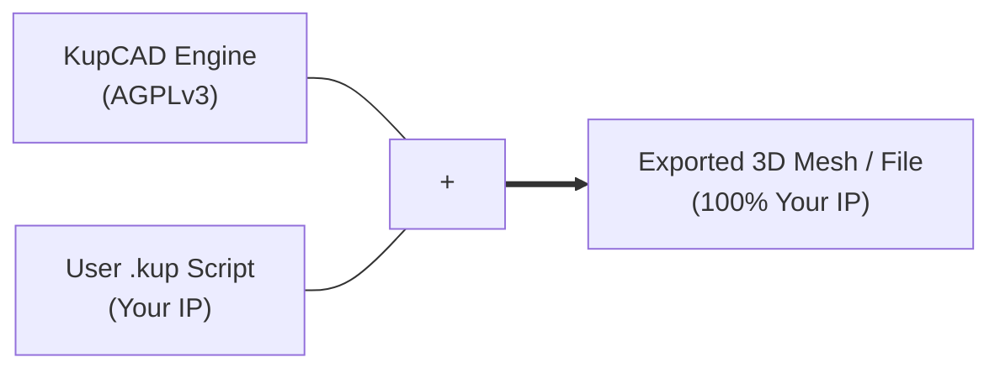

## KupCAD Contributor License Agreement (CLA) Summary

To ensure KupCAD remains a healthy open-source project while sustaining long-term development through commercial licensing, all contributors must sign a lightweight **Individual Contributor License Agreement (CLA)** before Pull Requests can be merged.

### Why Do We Require a CLA?

KupCAD operates under a **dual-licensing model** (AGPLv3 for open-source users, and a Commercial License for proprietary/SaaS integrations). To offer a commercial license, the maintainer needs the right to license every part of KupCAD's own code under both. The CLA gives that right for your contributions while you keep their copyright: it is a license, not a transfer of ownership.

The full text is in [.github/CLA.md](.github/CLA.md), based on the Apache Software Foundation's Individual Contributor License Agreement. CLA Assistant asks you to sign it on your first pull request, and it covers your later ones too.

---

### What the CLA Means for You

* **You Keep Copyright Ownership:** You continue to own the copyright to your contributions. You are free to use, distribute, or license your own code elsewhere.
* **Non-Exclusive License to the Maintainer:** You grant KupCAD's maintainer, and any successor (such as a company formed to run KupCAD), a perpetual, worldwide, non-exclusive, royalty-free, irrevocable license to use, modify, sublicense and distribute your contributions under any license terms, including AGPLv3 and commercial licenses.
* **Patent Protection:** You grant a patent license covering your contributions, so the community and commercial users are protected from patent claims regarding your code. It ends for anyone who sues claiming KupCAD infringes a patent.
* **Your Right to Contribute:** You confirm that your contributions are your original creation, that your employer (or anyone else with rights to your work) has allowed them, and that you have reviewed any part an AI tool produced. Third-party code goes in a separate contribution, marked with its source and license.

> **TL;DR:** You retain ownership of your code, but you grant KupCAD's maintainer permission to distribute it under both AGPLv3 and Commercial licenses.

---

## KupCAD Licensing FAQ

### 1. What license is KupCAD released under?

KupCAD is **dual-licensed**:

* **AGPLv3 (GNU Affero General Public License v3.0):** Free for any use, commercial use included, on its terms: if you distribute KupCAD, or a modified version of it, or let people use a modified version over a network, you share its source under the AGPLv3 too.
* **Commercial License:** Designed for organizations embedding KupCAD into closed-source software, proprietary cloud/SaaS backends, or environments with strict AGPL compliance policies.

---

### 2. Do I own the 3D models (STL, 3MF, STEP) exported by KupCAD?

**Yes, 100%.**

The AGPLv3 license applies strictly to the **KupCAD compiler and engine source code**, not to the output geometry generated by executing your scripts.

> **Explicit Output Exemption:** 3D meshes, 2D vector profiles, and export files generated by running KupCAD code are the sole intellectual property of the user and are **not** subject to the AGPLv3 copyleft terms.

Shapes made with `text()` come from the fonts KupCAD bundles (Roboto, Roboto Mono, Roboto Serif, Allerta Stencil, and KupCAD Symbols, a subset of Noto's symbol fonts). Their licenses, the Apache License 2.0 and the SIL Open Font License 1.1, put no conditions on what you make with them.

---

### 3. Can I use KupCAD to design hardware products for commercial sale?

**Yes.** Designing, manufacturing, and selling physical products or selling original `.kup` script files does not require a commercial license. Your 3D models and designs belong entirely to you.

---

### 4. Do I need a commercial license to write closed-source `.kup` scripts?

**No.** Writing `.kup` scripts is similar to writing Python or C scripts—it does not make your script code an AGPL derivative work, provided you are simply executing your script with an unmodified KupCAD binary.

---

### 5. When DO I need a Commercial License?

You require a Commercial License if you plan to:

* **Embed the Engine in Closed-Source Apps:** Integrate KupCAD directly into proprietary desktop applications, CAD plugins, or mobile apps without publishing your application under AGPLv3.
* **Run a Modified Cloud Service / SaaS Backend:** Host KupCAD on a server to offer online CAD rendering, slice processing, or parametric geometry generation without releasing your modified server code under AGPLv3.
* **Comply with Corporate Policy:** Use KupCAD within an enterprise environment whose legal policies strictly prohibit the use of AGPL-licensed software.
* **Access Enterprise Support & SLAs:** Require dedicated technical support, guaranteed bug-fix turnarounds, or custom feature development.

---

### 6. Why did KupCAD choose AGPLv3 instead of MIT or Apache 2.0?

Permissive licenses like MIT or Apache 2.0 allow large cloud providers or proprietary vendors to take an engine, wrap it in a paid cloud backend, and profit from it without contributing improvements back to the community.

AGPLv3 ensures that anyone extending or hosting the core engine must give back to the open-source ecosystem, keeping KupCAD fair, open, and sustainable for everyone.

---

### 7. Does a Commercial License cover the third-party code inside KupCAD?

KupCAD bundles open-source libraries and fonts, listed with their licenses in [core/THIRD_PARTY_NOTICES.md](core/THIRD_PARTY_NOTICES.md). A Commercial License covers KupCAD's own code; each bundled component stays under its own license, in commercial builds as in AGPL ones. All of them allow commercial and closed-source use:

* **Permissive** (Apache-2.0, MIT, BSD, public domain): Manifold, Draco, oneTBB, lsp-kit, the Zig standard library, SQLite and the fonts. Their notices ship with KupCAD, and nothing more is asked.
* **MPL-2.0** (Eigen, and the font parser tatfi): its copyleft covers only those libraries' own files, not KupCAD's or yours. Those files, and any changes made to them, stay MPL-2.0 with their source available, which KupCAD's repository provides.
