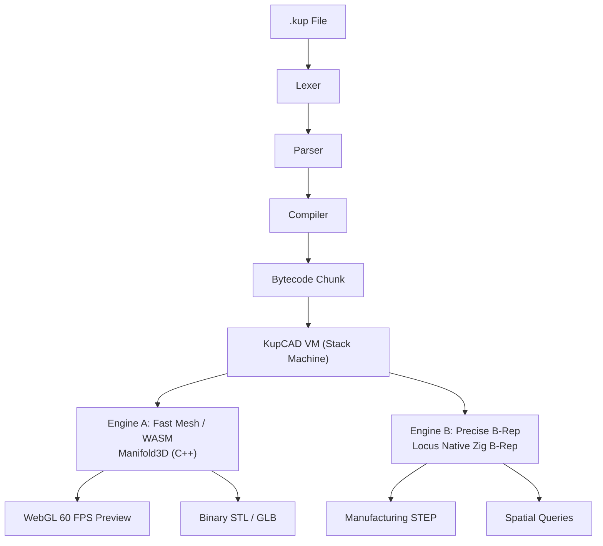

# KupCAD Language & Architecture Specification

**Version:** 1.0.0

**Core Runtime:** Custom Zig Bytecode VM (`VM`) + Manifold3D (Mesh/Preview) + Locus Native B-Rep (STEP/Analytical)

**Syntax Paradigm:** Ruby-inspired, Expression-based, Method-chaining OOP

## 1. Syntax & Core Concepts

KupCAD (`.kup`) is a high-level, expression-based parametric CAD language executing on a custom stack-based VM. Every shape is a `Shape`: a `Solid`, a `Sketch` or a `Path`, made by its constructors (`cube`, `square`, `line`, or as class methods, `Solid.cube`). Every operation returns a new shape, enabling fluid method-chaining.

### 3D Primitives & Assemblies

Primitives accept intelligent keyword arguments, including native support for rounded corners and chamfers directly during instantiation. Every built-in shape and geometry method checks its keywords: a misspelt or unsupported one is an `ArgumentError` naming the keywords it accepts, never silently ignored. A keyword overrides the same option given positionally: `cube(5, z: 3)` is 5 × 5 × 3. A `polyhedron`'s faces list each face's corners in order, counter-clockwise seen from outside, three or more (a quad, an n-gon): a face of more than three is cut into triangles on its own plane, along its inside when it is concave, the same for both engines. A box's sizes can be one Array, as OpenSCAD writes them: `cube([40, 30, 3])`, `cube([40, 30, 3], true)` centred, `cube(size: [40, 30, 3])`, and `square([20, 10])`. An outline fills whichever way it runs, clockwise too, by the even-odd rule, so a self-crossing one (a bow tie) fills both its lobes; so does a Path's `close`. `regular_polygon(6, across_flats: 10)` is sized by its flats, a nut's wrench size, instead of its corners (`r:`), for an even number of sides. `polygon(points, round_r: 2)` rounds each corner of its outline, a concave one too, by the arc of radius 2 that touches both sides, and `polygon(points, chamfer: 1)` cuts each off by the line between the points 1 back along each side; the arcs stay arcs in a drawing, as `square(round_r:)`'s do. A corner the outline doubles back at, or a side too short for what the corners at its ends take of it, is a `ValueError` naming the point (`polygon: the side from point 0 is 10 long, too short for the corners at its ends, which take 12 of it (round_r = 6)`), and so is a point repeating the one before it; the outlines of `paths:` aren't rounded yet. Two keywords for one option are an `ArgumentError`, not one silently ignored: `r:`, `d:` and `radius:` (`cylinder takes r or d, not both`), `r1:` and `d1:`, `r2:` and `d2:`, `size:` with `x:`, `y:` or `z:`, and `round_r:` with `chamfer:` (a corner is rounded or cut).

```ruby
# Native 3D primitives with built-in filleting
base_box = cube(x: 50, y: 30, z: 20, round_r: 2.0, center: true)
cyl = cylinder(r: 5, h: 40, chamfer: 1.0)
ring = torus(major_r: 10.0, minor_r: 2.0)
custom = polyhedron(points: [[0,0,0], [10,0,0], [0,10,0], [0,0,10]],
                    faces: [[0,2,1], [0,1,3], [0,3,2], [1,2,3]])

# Method-chained transformations & CSG booleans
housing = base_box
  .translate(z: 10)
  .difference(cyl)

# Grouping parts into structured, named assemblies
final_part = assemble(name: "HousingAssembly", parts: [housing, ring])

```

**`sides:` or `segments:`.** `sides:` is a faceted shape: `cylinder(d: 8, h: 5, sides: 6)` is a hexagonal prism (a nut trap), `circle(r: 5, sides: 6)` a hexagon, and `cylinder(r1:, r2:, sides:)` a frustum; the first corner lies on +x. It is the same on both engines. `segments:` only says how finely a round shape is drawn, overriding the resolution (`CAD.config`) for that call: the mesh engine draws a cylinder with that many facets, while the exact B-Rep engine keeps it round. Use `sides:` whenever the facets are the design; giving both is an `ArgumentError`, and a sphere has no `sides:`.

### Parts list (`named`, `bom`)

An assembly's parts list counts its Solids by part: a copy of a part placed elsewhere (`translate`, `rotate`) is the same part again. `named` gives a part the name the list shows, and `material(density:)` (g/cm³) its mass:

```ruby
bolt = cylinder(r: 1.5, h: 20).material(color: "#888888", density: 7.85).named("M3 bolt")
plate = cube(x: 40, y: 30, z: 3).named("plate")
bolts = [[5, 5], [35, 5], [5, 25], [35, 25]].map { |p| bolt.translate(p[0], p[1], 0) }
mount = assemble(name: "Mount", parts: [plate] + bolts)

mount.bom   # [{name: "plate", count: 1, volume: 3600, size: [40, 30, 3], density: nil, mass: nil},
            #  {name: "M3 bolt", count: 4, volume: 107.0, size: [2.7, 2.9, 20], density: 7.85, mass: 0.84}]
```

* **A part** is the shape under a Solid's placement, with its name and material: two Solids are copies when that shape is the same one (equal content, however it was reached) and so are the name and material. A different color or density is another part. A mirrored or scaled copy is a part of its own, with the name it was made with (a left and a right bracket), so rename it to tell them apart: `left.mirror(1, 0, 0).named("bracket R")`. A union of copies is one fused Solid, so one part: assemble the copies to count them.
* **A row** is a Map: `name` (nil when unnamed), `count`, `volume` (mm³), `size` (the bounding box's extent along x, y and z in mm, as the part is made, before its placement), `density` (g/cm³) and `mass` (g, the volume times the density; nil without one). Rows come in the order their parts first appear. The outermost `named` and `material` of a Solid are its part's, as the viewport shows its outermost material.
* **Where:** `assembly.bom`, `solid.bom` (one part), and `kupcad build part.kup --bom bom.json`, which writes the final model's list as JSON. The same parts are what a `.3mf` export holds once each and `--split` writes a file each of (see `kupcad build`) (`{"parts": [...]}`, with `null` for what a part has none of). A name changes nothing an export or the viewport shows. The B-Rep engine can't measure volume yet, so a list of B-Rep parts is a `NotImplementedError`.

### Batch CSG & Operator Overloading

You can use standard math operators (`+`, `-`, `&`) for binary CSG, or utilize batch operations for arrays of geometry to heavily optimize the evaluation graph:

```ruby
# Union or Hull across entire arrays natively
pins = [cylinder(r: 2, h: 10), cylinder(r: 2, h: 10).translate(x: 20)]
casing = union(pins)
convex_wrap = batch_hull(pins)

# Optional parts: leave the nils out with .compact
boss = with_boss ? cylinder(r: 4, h: 6) : nil
part = cube(20).union([boss, rib].compact)
```

`a.union(b, c)`, `.difference`, `.intersection` and `.hull` take shapes of the receiver's kind, or Arrays of them (a Sketch's hull is a Sketch: `circle(5).hull(circle(5).translate(x: 20))` is a slot, its round ends arcs in a drawing); anything else, `nil` included, is a `TypeError` that says where it is. An empty list follows set theory: `a.union([])` and `a.difference([])` are `a`, `a.intersection([])` is the empty shape, and the global `union([])` is the empty Solid (a valid part, `empty?`, that renders nothing), so a list of optional parts that ends up empty is never an error; only `batch_hull([])` is, a hull of nothing being no shape. `a.difference(b, c)` removes `b` and `c` from `a`, the same as `a - b - c`.

---

## 2. 2D Sketching, Profiles, & Text

The `Sketch` class's primitives (`square`, `circle` and the rest, or `Sketch.square`) are 2D shapes that can be swept into 3D. A Sketch takes `named(name)` and `material(color:, alpha:)` as a Solid does: its name and colour are its drawing's (what a 2D export writes it as), stay through its moves (`translate`, `rotate`, `scale`, `mirror`), and are not the Solid's that is extruded from it, nor an offset's. `sketch.area` is how much it encloses (its holes left out), in mm². `sketch.export_svg(path)` and `sketch.export_dxf(path)` write it as a drawing, as `kupcad build -o part.svg` writes the model (see `kupcad build` below).

```ruby
# Advanced 2D Polygons with Hole support (Even-Odd winding rules)
profile = polygon(
  [[0,0], [10,0], [10,10], [0,10], [2,2], [8,2], [8,8], [2,8]],
  paths: [[0, 1, 2, 3], [4, 5, 6, 7]] # Point indices: the outline, then an inner cutout hole
)

# Text Generation with alignment and typography controls
label = text("KupCAD", size: 12.0, font: "sans", halign: "center", valign: "baseline")
# One line, kerned as the font says ("AV" and "To" sit closer than their advances put them);
# a character the font has no glyph for is a ValueError naming it ("中", an emoji, a line break).
# No font has the diameter sign "⌀": write "Ø", as drawings do (the error says so).
# The fonts: "sans" (Roboto, the default; also "default"), "sans-bold" (Roboto Bold, strokes half
# again as thick, for text printed small; :sans_bold as a Symbol), "mono" (Roboto Mono; also
# "monospace"), "serif" (Roboto Serif) and "stencil" (Allerta Stencil), as a String or a Symbol.
# Any other name is an ArgumentError listing them.

# Sweeping 2D into 3D
label_3d = label.extrude(5.0)
knob = regular_polygon(sides: 6, r: 15).translate(x: 20).revolve(deg: 360)
thread = circle(r: 1).translate(x: 3).helix(h: 20.0, twist: 3600) # 10 turns, pitch 2

```

---

### Paths (`line`, `polyline`, `arc`)

A Path is open 2D geometry: lines and arcs from a start point (and the cubic curves an imported drawing's open lines have, `import_svg(paths: true)`), exact, with no kernel form of its own. `line([x1, y1], [x2, y2])`, `polyline([[x, y], ...])` and `arc` make one; `+` joins two where the first ends and the second starts (an error names the points when they don't meet). A path also goes on from its end: `.line_to([x, y])`, `.arc_to([x, y], r:, ccw: true, large: false)` (the arc `arc(r:, start:, to:)` would draw from there) and `.tangent_arc_to([x, y])`, the arc that leaves the end the way the path does, with no corner, to the point (`line([0, 0], [10, 0]).line_to([10, 5]).tangent_arc_to([5, 10]).line_to([0, 10]).close` is a slot with a round corner). `.fillet(r)` rounds each corner where two sides (lines or arcs) meet by the arc of radius `r` that touches both, and `.chamfer(size)` cuts each off `size` back along each side, round an arc (`polyline([[0, 0], [10, 0], [10, 10]]).fillet(3)` goes 7 along, a quarter turn of radius 3, and 7 up); beside an arc, the arc gives up the part of its sweep the corner takes. The path's ends stay where they are, so do a joint where it goes on smoothly (an arc that leaves along the line before it, as `tangent_arc_to` draws one) and one beside a curve, and a corner it doubles back at, a segment too short for its corners, or an arc that turns the corner's way more tightly than the fillet (which can't touch it) is a `ValueError` naming the point, as for `polygon(round_r:)`. An arc is given by its centre, radius, start angle and sweep in degrees (`arc(center: [0, 0], r: 10, start: 0, sweep: 90)`, counter-clockwise when the sweep is positive), or by its radius and two points (`arc(r: 10, start: [0, 10], to: [10, 0])`, the short way round counter-clockwise unless `large: true` or `ccw: false`); `end` and `from` are keywords of the language, which is why an arc's end is its `sweep` or `to`. A Path moves as a Sketch does (`translate`, `rotate`, `scale` evenly, `mirror`), answers `start`, `end`, `length` and `bbox` (its own bounds, an arc's bend included), and takes `named` and `material(color:)` for a drawing. `close` turns it into a Sketch (its end joined straight back to its start; the arcs and curves stay so in a drawing) and `stroke(width, cap:)` into the Sketch of its band, `cap:` its ends (`:round`, the default, `:butt` or `:square`, the joins round), so either can be extruded. A Path exports as a drawing (`export_svg`, `export_dxf`, or as part of the model), open and unfilled, its arcs and curves exact; a 3D format refuses one (close or stroke it first). A Path has no `extrude`, `revolve`, `hull` or `offset`, nor a boolean with another shape: calling one is a `NoMethodError` that says to close or stroke it, which `kupcad check` reports before the script runs (`shape-mismatch`).

```ruby
hook = line([0, 0], [10, 0]) + arc(center: [10, 5], r: 5, start: -90, sweep: 180) + polyline([[10, 10], [0, 10]])
plate = hook.close.extrude(3)
wire = hook.stroke(1.5).extrude(1)
[hook.named("outline"), plate.translate(y: 20)]   # the drawing has the open outline and the plate's silhouette
```

## 3. Core Standard Library & Block Iteration

KupCAD is a Turing-complete language with a robust standard library and functional iteration patterns.

### Blocks and Closures

KupCAD fully supports Ruby-style block execution using `do |args| ... end` or `{ |args| ... }`.

```ruby
# Using the block to generate an array of cylinders
pegs = []
(0...3).each do |row|
  pegs.push(cylinder(r: 2, h: 10).translate(x: row * 10))
end

# Counted loops
4.times { |i| puts(i) }            # 0, 1, 2, 3
1.upto(3) { |i| puts(i) }          # 1, 2, 3
3.downto(1) { |i| puts(i) }        # 3, 2, 1

```

`break value` inside a block ends the iteration and becomes the method's return value; `next` skips to the next element.

### Lambdas

A lambda is a block stored in a variable. It is a value, so it is called with `.call`:

```ruby
double = ->(x) { x * 2 }
plate = ->(w, h = 10, thickness: 2) do
  cube(x: w, y: h, z: thickness)
end

double.call(4)               # 8
plate.call(30, thickness: 3) # defaults and keyword parameters work as in a def

def apply(f, v)
  f.call(v)                  # a lambda passed as an argument is called the same way
end
apply(double, 5)             # 10
```

The rule is the same everywhere:

* **Named functions** (a `def`, or a built-in such as `cube`) are called by name, with or without parentheses: `plate_width`, `twice(4)`, `twice 4`, `cube` (the same as `cube()`). A `def` takes the arguments it declares: `twice(1, 2)` or `twice` is an `ArgumentError` (`twice takes 1 argument, got 2`), and so are keyword arguments to a `def` without keyword parameters, a keyword it doesn't declare (`plate(thicknes: 3)`: `plate does not take a keyword 'thicknes' (it accepts: thickness)`, unless it takes `**opts`), and a keyword parameter with no default left out (`def plate(width:)`, called `plate`: `plate needs the keyword 'width'`). A keyword given `nil` takes its default when it has one, as a positional does, so a value passed on may be absent. A Map passed as a positional argument stays one; only `key: value` arguments reach the keyword parameters. Blocks and lambdas are lenient about both.
* **Source files are UTF-8.** One that isn't is reported as a syntax error at its first bad byte.
* **One statement per line**, or several separated by `;`: `x = 1; y = 2`. Two side by side, such as `puts 1 2`, are a syntax error (as in Ruby). A block's closing word ends the statement before it, so `if ok then 1 else 2 end` is one line.
* **Spacing decides what follows a name**, as in Ruby and Crystal. After a method name, `-1`, `+1`, `*xs`, `**opts`, `&blk` or `[...]` written with a space before and none after is the first argument: `puts -1`, `count *xs`, `list.map &blk`, `extrude [0, 0, 10]`. A line break after the operator counts as a space, so an operator ending its line is arithmetic on the next one (`total -` then `1` on the next line is `total - 1`). After a variable (a local bound earlier in this or an enclosing body, a parameter, a constant, `@field` or `$global`) the same tokens are arithmetic or indexing: `x -1` is `x - 1`, `pts [0]` is `pts[0]`. `name(` with no space holds the arguments; `name (` with a space only groups the first one, so `puts (1 + 2) * 3` prints 9, and `f (1, 2)` is a syntax error. A call without parentheses takes everything after it as arguments: `[f -1, 2]` is `[f(-1, 2)]`, so write `[(f -1), 2]` or `[f(-1), 2]`.
* **Callable values** (a lambda, a block captured with `&blk`, a bound method from `obj.method(:name)`) are called with `.call`, which, like any method, needs no parentheses: `f.call`, `f.call(3)`. A bare `f` is always the value itself, so it can be stored or passed along; `f(3)` is a `TypeError`. A block can also be called implicitly with `yield`, which is an expression like any call (`x = yield`, `yield(v).round`, `ok ? yield : 0`), and `block_given?` tells whether the method got one.

Any call (to a method, a lambda's `.call`, `super` or `yield`) can spread its arguments as in Ruby:

```ruby
def box(x, y, z, center: false)
  cube(x: x, y: y, z: z, center: center)
end

size = [10, 20, 5]
opts = { center: true }
box(*size)                  # box(10, 20, 5)
box(*size, **opts)          # box(10, 20, 5, center: true)

double = ->(v) { v * 2 }
[1, 2, 3].map(&double)      # [2, 4, 6]: a lambda passed as the block
```

`*array` spreads an Array into positional arguments, `**map` a Map into keywords, and `&f` passes a lambda (or `nil`, for no block) as the call's block. A lambda passed as an ordinary argument stays an argument, even in last position.

### Loops

```ruby
for i in 0...4                         # an Array, a Range or a Map
  cube(2).translate(i * 5, 0, 0)
end

for x, y in [[0, 0], [10, 5]]          # several variables spread each element
  cylinder(r: 1, h: 3).translate(x, y, 0)
end

for size, *rest in [[3, :m3, :hex]]    # one of them may take the rest
  puts size
end

for name, d in { m3: 3, m4: 4 }        # a Map yields [key, value] pairs
  puts "#{name}: #{d}"
end

n = 0
while n < 3                            # `until` loops while the condition is false
  n += 1
end
```

* `for` walks a Range exactly as `.each` does (steps, exclusive ends, negative and fractional steps), an Array as it is at each step (elements pushed during the loop are visited too), and a Map's pairs in insertion order. Anything else is a `TypeError`. One variable takes each element whole; several spread it like a multiple assignment.
* As in Ruby, a loop opens no scope: the loop variables, and whatever the body assigns, are still there after it.
* `next` skips to the next element and `break value` ends the loop with that value; otherwise a `for` loop's value is what it iterated, and a `while` loop's is `nil`. Unlike in a block, `return` inside a loop returns from the enclosing `def`.

### Differences from Ruby

KupCAD borrows Ruby's syntax but deliberately keeps a simpler model; these are design choices, not missing features:

* **`$` is no global sigil.** `$name` is a variable like any other, with the scope of any other; a `$` that starts no name is a syntax error ("Unexpected character '$'"). Comments are `#` lines, and `/* */` is no comment.
* **Lambdas are the only callable objects.** Write `->(x) { ... }` or `-> do ... end`; there is no `proc`, `Proc.new` or `lambda { }`. Call one with `f.call(3)` (or `f.call` with no arguments); `f.()` and `f[3]` don't exist.
* **A lambda behaves exactly like a block.**
  * `return value` and `next value` leave just the block or lambda with that value; neither returns from the enclosing `def`. Use `break value` to stop an iteration and hand back a result: `[10, 20].each { |v| break v * 2 }` is `20`. A `break` leaves the call the block was given to: `m { break 5 }` is `5` and `m` stops where it stands, whether it reached the block through `yield` (from its own body or from inside another block), by handing it on with `each(&blk)` or with `blk.call`. `break` is only valid in a block given to an iterating method (not in a lambda, and an `ArgumentError` in a block given to `highlight`, `ghost`, `benchmark` or `assert`). An iteration reaches the elements its block adds to the array or map it iterates, as in Ruby.
  * Both are lenient about arguments: missing ones are `nil` and extra ones are dropped, where a Ruby lambda would raise an `ArgumentError`.
  * Inside a method, both see the method's context: `self`, `yield` and `block_given?` refer to the method's receiver and block, `super` continues the method, and a private call is allowed, exactly as in the method's own body. Only the argument-less `super` must be spelled out there (`super(a, b)`), because a block can't know the method's parameters. `yield`, `block_given?` and `super` outside a `def` are compile errors.
* **Block parameters don't unpack arrays automatically.** `[[1, 2]].map { |a, b| ... }` binds `a = [1, 2]` and `b = nil`; destructure explicitly with `|(a, b)|`. Iterating a Map passes the key and the value separately, so `{ x: 1 }.each { |k, v| ... }` works as in Ruby.
* **No Enumerator.** `each_with_index`, `each_cons(n)` and `each_slice(n)` without a block give an Array (of `[item, index]` pairs, of windows), which `map` and the rest take from there: `pts.each_cons(2).map { |(a, b)| Math.hypot(b[0] - a[0], b[1] - a[1]) }`. With a block they give the receiver, as `each` does.
* **A loop header ends at the line break (or `;`), with no `do`.** Write `for x in xs` or `while n < 3` and start the body on the next line; Ruby's optional `for x in xs do` and `while cond do` are syntax errors that point at the `do`. A block inside the header still works in brackets or braces: `for x in xs.map { |v| v * 2 }`.
* **Visibility is declared per method.** Write `private def helper ... end` (or `public def`); there are no section-style `private` / `protected` lines that change the visibility of the methods after them, and there is no `protected`. A private method can be called from inside its class or a subclass (including on another instance of that class, and from a block inside such a method) but not from outside. `super` always continues above the class whose `def` contains it, so a chain `C < B < A` runs `C#foo`, `B#foo`, `A#foo` once each; a class variable `@@x` belongs to the class whose code first assigns it and is shared with its subclasses, never with an unrelated class.
* **`self` in a class or module body is the class or module being defined**, as in Ruby, so `@@count = 0`, `LIMIT = self.compute`, `self.helper(...)` and `class << self` work there; a block in the body sees the same `self`.
* **Compound assignment** works on variables, instance variables, properties and indexes: `x += 1`, `@n -= 2`, `a[i] *= 3`, `obj.p ||= default` (assigns only when the current value is `nil` or `false`; the right-hand side is evaluated only then) and `x &&= v`. An instance variable that was never assigned reads as `nil`, also where a method has its name (`@v` inside `def v`).
* **`include` takes a Module, inside a class body** (`include M` in a module, or a non-Module, is a `TypeError`), and a superclass must be a Class (`class A < X` with `X = 5` is a `TypeError`), both rescuable like any error.
* **Methods on the current object are called through `self.`** — a bare `plate` inside a method is resolved as a variable, not as a method call.
* **Built-in classes are sealed.** A built-in class can't be reopened (`class Solid` is a `builtin-redefined` error) or subclassed: `class Bracket < Solid` is a `TypeError`, as is a subclass of `Number`, `Array` or any other built-in kind of value, since those values come from literals, constructors and methods and an instance of a subclass would be none of them. (A subclass of `Number` was accepted, and calling one of its methods crashed.) The errors stay open: `class FitError < StandardError` is the way to raise your own. A class of your own builds or holds a shape instead:

  ```ruby
  class Bracket
    def initialize(width:)
      @width = width
    end

    def solid
      cube(x: @width, y: 20, z: 4) - cylinder(d: 4, h: 10).translate(@width / 2, 10, -1)
    end
  end

  Bracket.new(width: 40).solid.translate(z: 5)
  ```
* **Recursion has fixed limits**, where Ruby's depends on its stack: 100,000 calls deep, and 200 calls nested inside built-ins (a method that a block given to `map` or `each` calls again, or a raised class whose `initialize` raises), which run on the native stack. Past either, the run stops with `Call stack overflow`, which `rescue` doesn't catch (Ruby's `SystemStackError` can be caught).
* **No `retry`, `alias` or `__method__`.** A script is deterministic, so a `retry` with nothing changed fails again forever: write the fallback in the `rescue` clause (`rescue GeometryError` then the coarser version of the part). For a second name, define it: `def d = self.diameter`. Errors already name the method they come from, so write the name in a message yourself. All three are read as variables today, so they fail when the line runs ("Undefined variable 'retry'"), not when the script is checked.
* **Methods can read top-level variables** (convenient for parametric scripts: `width = param(:width, ...)` is visible inside every `def`). Assigning inside a `def`, or inside a block within it, always creates a local, so a helper's scratch `x` never overwrites a top-level `x`. Top-level code, and blocks or lambdas written at the top level, do update top-level variables. `$name` is always global.

```ruby
width = 20
def plate
  margin = 2              # local to plate
  width - margin          # reads the top-level width
end
def scratch
  width = 0               # a new local: the top-level width is still 20
end
```

```ruby
class Bracket
  def build
    self.plate.difference(self.holes)
  end

  private def plate
    cube(x: 40, y: 20, z: 3)
  end

  private def holes
    cylinder(r: 2, h: 10).translate(x: 10, y: 10)
  end
end
```

### Errors

Mistakes found before a script runs (a syntax error, `break` outside a loop, assigning to a built-in such as `cube = 5`) are reported by `kupcad check`, `kupcad build` and the editor with the file, line and column, and a code after the message, as a lint finding names its rule: `part.kup:2:1: E: 'cube' is a built-in and can't be assigned [builtin-redefined]`. A message may be reworded in any release; a code stays, so it is the one to search for or match in a script (the editor gets it as the diagnostic's code, `kupcad check --format json` as `code`, SARIF as the `ruleId`). Everything else is raised at run time, with its class (below) instead.

| Code | Means |
|---|---|
| `invalid-utf8` | The source isn't valid UTF-8. |
| `unexpected-character` | A character that starts no token, outside a string or comment (`x = $`). |
| `unterminated-string` | A string, symbol or `%`-literal never closed before the end of the file. |
| `unterminated-heredoc` | A heredoc whose closing line never comes. |
| `runs-into-heredoc` | A line that runs on into the body of a heredoc it opened (`<<~EOS + "a` and the string's end on the next line). |
| `invalid-escape` | A backslash in a string that starts no escape (`"\q"`), or a `\u` escape that names no character. |
| `invalid-number` | A malformed number, or one beyond the largest (`1e999`). |
| `unexpected-token` | Something other than what the syntax needs here, such as an unclosed parenthesis (`cube(1`). |
| `invalid-expression` | A token that can't start an expression (`x = )`). |
| `invalid-assignment` | An assignment that can't be made: to a call (`f() = 1`, `part.size() += 1`, a value's own call `(f)() = 1`), which gives a value but holds none (assign to a variable, an attribute, `part.size = 2`, or an element, `list[0] = 2`), or to several names with an operator other than `=` (`a, b += 1`; give each its own). |
| `nesting-too-deep` | Code, or interpolation in a string, nested deeper than the limit. |
| `misplaced-import` | An `import` or `export` inside a method, class or block; they belong at the top level. |
| `import-without-from` | An `import` without its `from` path. |
| `import-attribute` | An import's `with { }` with a key other than `type`, or a type that names nothing an import reads (`with { type: "yaml" }`). |
| `file-import-names` | An import or re-export of a mesh (STL, OBJ, 3MF, STEP) or a font in braces (`import { teeth } from "./gear.stl"`): it has no names in it, so its one value is named bare (`import gear from "./gear.stl"`); or of any file naming more than one variable without braces. |
| `misplaced-do` | A `do` after a `while`, `until` or `for` header, which ends at the line break. |
| `spaced-parentheses` | Several arguments in parentheses with a space before them, which hold one value (`f (1, 2)`; write `f(1, 2)`). |
| `invalid-parameter` | A parameter, block parameter or loop variable that can't be one: an instance, class or global variable (`def f(@x)`), a second splat, a block for a block parameter. |
| `unexpected-block` | A call given two blocks (a `&block` argument and a `do` or `{ }` block), or `yield` given one. |
| `misplaced-splat` | A `*` or `**` outside an array, a hash or a call's arguments. |
| `outside-loop` | A `break` or `next` outside a loop or block. |
| `outside-method` | A `yield`, `block_given?` or `super` outside a method. |
| `builtin-redefined` | A built-in, such as `cube`, assigned or redefined. |
| `import-collision` | An import named like a variable of the file. |
| `too-many-parameters` | A method or block with more than 255 parameters. |
| `too-many-arguments` | A call with more than 255 arguments. |
| `too-many-variables` | A function with more than 65,535 variables, or more than 255 captured from outside. |
| `too-many-constants` | A function with more than 65,535 literals and names, or a map literal with more than 32,767 entries. |
| `too-many-calls` | A script with more than 65,536 method calls. |
| `too-many-global-uses` | A script with more than 65,536 uses of top-level variables. |
| `out-of-memory` | Memory ran out while compiling. |
| `internal-error` | A bug in KupCAD's compiler; please report it with the script. |

`raise` and `begin … rescue … ensure … end` work as in Ruby: `raise "msg"` raises a `RuntimeError`, `raise Klass, "msg"` raises `Klass.new("msg")` and `raise Klass` an instance whose message is the class name; `ensure` runs however the `begin` is left (normally, after a matching `rescue`, by `return`, `break` or `next`, or by an error nobody rescued, which goes on after it), and an error raised inside `ensure` replaces the one in flight. The one exception is a block's `break` that leaves a method through `yield`: the method is abandoned at once, and `ensure` bodies pending in it don't run. Errors raised by the language and the standard library are instances of specific classes, all subclasses of `StandardError`, so they can be rescued by kind (`rescue ValueError => e`, also by a scoped name such as `rescue Parts::MyError`, or by the bare name inside the module that defines the class); `e.message` holds just the message:

| Class | Raised for |
|---|---|
| `ArgumentError` | Wrong number of arguments, a missing block, a keyword the method doesn't take (`revolve(angle: 90)`; the message lists the accepted ones), more positional arguments than it takes (`extrude(10, 5)`: `extrude takes at most 1 positional argument (h), got 2`) |
| `TypeError` | A value of the wrong type (`polygon([[0, 0], [1, "x"], [0, 1]])`, `5[0]`) |
| `ValueError` | A value of the right type that is out of range or not finite (`cube(-1)`, `segments: 1e9`) |
| `IndexError` | An Array or String index out of bounds (`[1, 2][5]`, `"abc"[9]`; Ruby gives `nil`) |
| `KeyError` | A key a JsonObject's `fetch` or `dig` doesn't find (`machine.fetch(:teeth)`; `machine[:teeth]` gives `nil`) |
| `RangeError` | A number outside a representable range: arithmetic that overflows (`2 ** 1024`; numbers are 64-bit floats, so beyond ±1.8e308 there is no number), bitwise operands, shift counts. A script that needs a non-finite value writes `Number::INFINITY` or `Number::NAN` |
| `ZeroDivisionError`, `MathError` | Division by zero, an operation producing `NaN` |
| `NameError`, `NoMethodError` | An undefined variable or member, an unknown method |
| `ImportError` | A module that can't be read, parsed or compiled, or a data file (`import_json`), a mesh (`import_stl`, `import_obj`, `import_3mf`), a font (`import_font`) or a drawing (`import_dxf`, `import_svg`) that can't be read |
| `NotImplementedError` | A feature the active engine doesn't support yet |
| `GeometryError` | The geometry kernel failed an operation or produced an invalid solid (e.g. a `polyhedron` that isn't a closed manifold) |
| `AssertionError` | A failed `assert` |
| `RuntimeError` | `raise "message"`, and other runtime failures |

```ruby
begin
  plate = cube(x: width, y: depth, z: thickness)
rescue ValueError => e
  puts("bad dimensions: " + e.message)   # "cube expects ... got -1"
  plate = cube(10)
end
```

A built-in never ignores what it is given: an extra argument, a keyword to a method that takes none, a `nil` or a Sketch in a Solid's `union` is an error, not dropped. `nil` for an optional parameter (`slice(nil)`, `center(nil)`, `segments: nil`) leaves it unset, as if it weren't passed.

An uncaught error stops the script and is printed once with its class, e.g. `ValueError: cube expects x to be a finite number greater than zero, got -1`.

### Native Collections

* **Arrays**: Index with a number (negative from the end) or a Range (`arr[1..2]`, like `.slice`). Exposes functional mutators (`.push`, `.pop`, `.shift`, `.unshift`, `.slice`, `.join`), iterators (`.each`, `.map`, `.filter` and its complement `.reject`, `.reduce`), `.compact` (a copy without the `nil`s, for a list of optional parts: `base.union([boss, rib].compact)`), and native numeric reducers (`.max`, `.min`, `.sum`, `.sort`). From Ruby's Enumerable: `.each_with_index { |x, i| }`, `.each_cons(n)` (every run of `n` consecutive items: the segments of a polyline are `pts.each_cons(2)`), `.each_slice(n)` (the items `n` at a time, the last slice the rest), `.zip(*others)`, `.uniq` (by `==`, or by the block's result), `.reverse`, `.any?` / `.all?` / `.none?` (of the items, or of the block's results), `.find`, `.include?` (`.contains?` too), `.count` (all, equal to an argument, or for which the block is truthy), `.take(n)` / `.drop(n)`, `.flat_map` (one level), `.sort_by` (stable: items with equal keys keep their order), `.min_by` / `.max_by` (the first of equal ones) and `.group_by` (a Map from each key to its items). `sort_by`, `min_by` and `max_by` compare their block's results as `sort` does, Numbers or Strings, and call it once per item. `.sort` gives a sorted copy: Numbers or Strings on their own, anything else with a block returning the sign of the comparison (`sort { |a, b| b <=> a }`). `.max`, `.min` (Numbers or Strings, not mixed) and `.sum` (Numbers) raise a `TypeError` for anything else instead of skipping it, a `MathError` for `NaN`, and `.sum` a `RangeError` when the total overflows; on an empty Array `.max` and `.min` are `nil` and `.sum` is `0`. `==` (and so `!=`, `.contains?` and `case`/`when`) compares Arrays, Maps and Ranges by content, nested ones included; a Map's order doesn't matter.
* **Ranges**: `a..b` (inclusive) and `a...b` (exclusive) iterate with `.each` and `.map`, materialize with `.to_a`, and support `.size`, `.include?` / `.cover?`, `.first`, `.last`, `.exclusive?` and `.step(n)` (`(0..1).step(0.25).to_a` → `[0, 0.25, 0.5, 0.75, 1]`; negative steps count down). Iterating with a block (`.each`, `.map`, `.times`, …) has no length limit — like a `while` loop it is bounded only by the instruction budget and cancellation — but building an array (`.to_a`, or the array `.map` returns) is capped at 10,000,000 values (~130 MB). Numbers add `.times`, `.upto(n)` and `.downto(n)`, which require integers.
* **Maps**: `{ width: 10 }` keys by the Symbol `:width` (`{ width: }` is `{ width: width }`); `{ "w" => 10 }`, `{ k => 10 }` and `{ part.name => 10 }` key by the value of what is before `=>`, a name or a call included. A key is found as `==` compares it: an Array, a Map or a Range by what it holds, so `{ [1, 2] => :a }[[1, 2]]` is `:a` and `group_by { |p| [p.x, p.y] }` groups equal pairs (an Array changed after it keys an entry no longer finds it). A block given a Map's entries (`.each`, `.map`, `.filter`, `.reject`, `.transform_values`) is given those there when it began, each with its value when its turn comes: one the block deletes first isn't given, and one it adds isn't either. Exposes key/value manipulation (`.keys`, `.values`, `.key?`, `.delete`, `.get`, `.merge`, `.empty?`, `.size` / `.length`), `.fetch(key)` (a `KeyError` naming the keys it has when there is none, or `.fetch(key, default)`), `.dig(:a, 0, :b)` through nested Maps and Arrays (`nil` where a step finds nothing, as in Ruby; a JsonObject's `dig` raises there instead, naming the place in its file), and `.filter` / `.reject` / `.transform_values`, which give new Maps. Keys can be swapped dynamically via `.symbolize_keys` and `.stringify_keys`.
* **JsonObjects**: what `import_json` gives for a JSON object: read-only, found by a String or a Symbol key alike (see [Data files](#data-files-import_json)).

### Strings, Symbols & Math

* **Numbers**: All numbers are 64-bit floats; whole numbers print without a decimal point (`3`, `2.5`). Lengths are millimetres, and `.mm`, `.cm`, `.m` and `.inch` write one in another unit: `2.cm` is `20`, `1.inch` is `25.4`, `cube(1.inch)` a one-inch cube. They answer `.odd?` / `.even?` (of whole numbers), `.zero?`, `.positive?`, `.negative?`, `.integer?`, `.finite?`, `.nan?`, `.infinite?`, `.clamp(lo, hi)` and `.between?(lo, hi)`; `Number::EPSILON` is the gap between 1 and the next number, a scale for tolerances. `%` is floored as in Ruby (`7 % -3` is `-2`), `<=` and `>=` are false against `Number::NAN` like `<` and `>`, and `.round(d)` with more decimals than a Number holds leaves it unchanged (`.round(-400)` is `0`). As in Ruby, `-2.abs` is `2`: a minus against a number is part of it (`-2 ** 2` is still `-4`). They print in plain digits while every digit is exact, and in scientific notation from 1e16 (past 2^53, where floats skip integers) and below 1e-6: `2 ** 53` prints `9007199254740992`, `2 ** 60` prints `1.152921504606847e18`, `0.0000001` prints `1e-7`.
* **Strings**: Index by character like Arrays (`"abc"[0]` is `"a"`, `s[-1]` the last, `s[1..2]` a substring). Support `.length`, `.size`, `.upcase`, `.downcase`, `.trim` (`.strip`), `.split` (`split("")` is the characters, as is `.chars`), `.reverse` (by character), `.replace`, and `.rjust(width, pad = " ")` / `.ljust(width, pad = " ")` to pad to a width in characters (`"7".rjust(3, "0")` is `"007"`; at most 1,000,000 characters are added). Strings can check for a substring with `.include?` and prefixes/suffixes with `.starts_with?` and `.ends_with?` (`.start_with?`, `.end_with?`), and typecast using `.to_sym`, `.to_f`, and `.to_i`. `%` formats as Ruby's `format` does: `"%05.1f mm" % 3.14159` is `"003.1 mm"`, `"%s x %d" % [name, count]` takes an Array's items in order. The directives are `%d` / `%i` (truncated toward zero), `%f`, `%e`, `%g`, `%x`, `%o`, `%b`, `%s` (as `puts` shows it), `%p` (as `inspect` does) and `%%`, with the flags `-`, `0`, `+`, space and `#`, a width and a precision; `%f` rounds the digits the number prints with, half away from zero (`"%.2f" % 2.675` is `"2.68"`). Unlike Ruby's, more arguments than the format uses is an `ArgumentError`, as fewer is.
* **Symbols**: Lightweight, interned identifiers (`:name`) used heavily for parameter keys and map properties. As in Ruby, a Symbol reads as its name (`"#{:m3}"`, `puts :m3` and `[:a, :b].join` give `m3`, `m3`, `ab`) and inspects with its colon (`:m3.inspect` is `:m3`). A quoted symbol is read as the string in the same quotes: `:"a\tb"` decodes its escapes and interpolates (`:"part_#{i}"` is `:part_2` when `i` is 2), `:'a\'b'` has only `\\` and `\'`. One that `:name` wouldn't read back inspects quoted, as it is written: `:"a b".inspect` is `:"a b"`, and `{ :"a b" => 1 }` inspects with its `=>`.
* **Math Module**: Constants `Math::PI`, `Math::TAU` (2π) and `Math::E`. Trigonometry in radians (`.sin`, `.cos`, `.tan`, `.asin`, `.acos`, `.atan`, `.atan2`) and, since CAD angles are degrees, in degrees (`.sind`, `.cosd`, `.tand`, `.asind`, `.acosd`, `.atand`, `.atan2d`), exact at the angles where the result is 0, ±½ or ±1: `Math.cosd(90)` is `0`, where `Math.cos(Math::PI / 2)` is `6.1e-17`. Roots and logarithms (`.sqrt`, `.cbrt`, `.exp`, `.log(x)` or `.log(x, base)`, `.log2`, `.log10`), rounding (`.round`, `.ceil`, `.floor`, `.abs`, `.sign`), `.deg2rad` / `.rad2deg`, variadic `.min` / `.max` and `.hypot(x, y, ...)` (a 3D distance is `Math.hypot(dx, dy, dz)`), and `.polar(r, deg)`, the point `[x, y]` at `r` from the origin and `deg` degrees from +x, exact where `cosd` and `sind` are (a bolt circle's centres are `(0...n).map { |i| Math.polar(r, i * 360 / n) }`).
* **Random**: `g = Random.new(42)` makes numbers from a seed, the same every run (there is no unseeded Random: a model must be the same model each time it is built). `g.rand` is a float in [0, 1), `g.rand(6)` a whole number from 0 to 5 (a float below the limit when it isn't whole), `g.rand(1..6)` one in the Range (`1...6` leaves 6 out; a float for ends that aren't whole); `g.shuffle(array)` gives a copy in a drawn order and `g.sample(array)` one item (`nil` for none). The generator is SplitMix64, written in KupCAD rather than taken from a library, so a seed's numbers don't change with an upgrade. Modelling helpers: `.clamp(v, lo, hi)`, `.lerp(a, b, t)`, `.snap(x, step)` to the nearest multiple of `step`, `.remap(x, from_lo, from_hi, to_lo, to_hi)`, `.smoothstep(edge0, edge1, x)`, `.close?(a, b, tolerance = 1e-9)` for comparing measurements, and `.gcd` / `.lcm` of whole numbers (gear tooth counts). Like arithmetic, a function whose result would be NaN or infinite raises a `MathError` or `RangeError`.

* **Operators on numbers**: besides arithmetic, `&`, `|`, `^`, `<<`, `>>` and unary `~` work on whole numbers (a fraction truncates toward zero, as in `~2.9` → `-3`; a value outside 64-bit integers is a `RangeError`), and unary `+` gives a number back as it is (`+x` of anything else is a `TypeError`).
* **Heredocs** work as in Ruby, except that they aren't interpolated. The body is the lines after the opener's line, up to a line holding only the name (indented or not, for every form). The rest of the opener's line is code, so `f(<<~EOS)`, `<<~EOS.strip` and `[<<~A, <<~B]` work; heredocs opened on one line have their bodies one after the other, in order. `<<~NAME` strips the indentation of the least indented line from every line (a line of only spaces and tabs doesn't count; a tab is one column, and an escaped `\t` is text, not indentation), so `<<~EOS` over `  a` is `"a\n"`. `<<-NAME` and `<<NAME` keep the body as written. Escapes are read as in a double-quoted string, but `#{...}` stays as text: for interpolation, use a double-quoted string. A string started on the opener's line can't run onto the next one, where the body is: that is a syntax error.
* **Escapes**: `\n`, `\t`, `\r`, `\f`, `\v`, `\b`, `\a`, `\e` and `\0`, and any Unicode character as `\u00e9` (four hex digits) or `\u{1F600}` (one to six), in double-quoted strings and symbols, heredocs and `%Q()`. A backslash before punctuation or a space stands for it (`\"`, `\\`, `\#{`, `%Q(a \) b)`). Single-quoted strings and `%q()` are as in Ruby: nothing is interpolated, and only `\\` and the delimiter (`\'`, `%q(a \) b)`) are escapes; every other backslash stays, so `'C:\data'` is what it says and `'\n'` is a backslash and an `n`. Any other escape (`\q`, `"C:\data"`), a surrogate (`\uD800`) or a code point past U+10FFFF is a syntax error at the escape. Write `\\` for a backslash.
* **Literals end where they start**: a string, quoted symbol or `%w[...]` the file ends inside is a syntax error ("This string is never closed before the end of the file"), and so is a heredoc whose terminator line never comes (`no line 'EOS' before the end of the file`).

### Base Object Introspection

* All objects and geometry nodes support introspection methods like `.is_a?`, `.respond_to?`, and `.nil?`. A class in a `when` matches as `.is_a?` does: `case x when Number` is `x.is_a?(Number)`, a built-in value's class included (`Solid`, `Sketch`, `Path`, `Proc`); it matched only some of them. Every shape is a `Shape`: `cube(1).class` is `Solid`, `square(1).class` is `Sketch` and `line([0, 0], [1, 0]).class` is `Path`, each `is_a?(Shape)`, so a helper that takes any shape checks `is_a?(Shape)` and one that takes a solid `is_a?(Solid)`; an Assembly is a group of Solids, not a Shape. `inspect` shows a shape by its class (`#<Solid>`, a Path by its segments and ends), not by what it measures, which only the kernel can work out and printing mustn't start. A shape responds to the methods of its kind: `square(1).respond_to?(:genus)` is false and `cube(1).respond_to?(:extrude)` is false, and calling either is a `NoMethodError`. A Sketch is `empty?` when it has no area, as a Solid is with no volume, and an empty shape's `bbox` is `nil`.
* Every value answers `.class` (its class, such as `Number`, `NilClass`, `Proc` for a lambda, `Method` for a bound method, `Class`, or a class you defined) and `.inspect` (how it would be written in a script: `"a".inspect` is `"\"a\""`, with `"`, `\` and control characters escaped as the lexer reads them; `{ x: 1 }.inspect` is `{x: 1}`; a container that holds itself prints as `[...]` or `{...}`, as in Ruby). Define `inspect` in a class to customise it. Built-in values come from literals and methods, not `.new`: `Array.new(3, 0)`, `String.new` and `Map.new` exist as in Ruby, while `Number.new` or `Proc.new` is a `NoMethodError`.
* A constant assigned in a class or module body is read from outside with `::`: `Gear::TEETH`, `Parts::Bolt::LENGTH` (inside the class, plain `TEETH`).
* `puts`, `print` and `"#{...}"` show an instance by its own `to_s` when its class defines one; it must return a String. `inspect(x)` prints `x` with where it was called: an instance by its class's `inspect` (or an ancestor's), or by its `to_s` when it has only the default one, which must return a String too.
* `.dup` and `.clone` make a shallow copy of an Array, Map or instance (its own elements, entries or fields, holding the same values; other values are returned as they are), you can extract bound methods with `.method(:name)` (called with `.call`), or yield to blocks contextually via `.tap` and `.into`.

---

## 4. Parametric UI & The "Hybrid Architecture"

KupCAD uses a **Hybrid Architecture** for parametric UI generation. The `param` keyword executes securely inside the VM, validating types, enforcing bounds, and extracting precise line/column locations for stack-trace error reporting if validation fails.

```ruby
# @title Heavy Duty Bracket
# @description A parametric L-bracket optimized for 3D printing.

# Supports min, max, and exact choice arrays
width = param(:width, default: 20.0, validate: { min: 10.0, max: 100.0 })
material = param(:material, default: "PLA", validate: { in: ["PLA", "PETG", "ABS"] })

def build
  # Dynamic retrieval halts execution safely if constraints are violated
  cube(x: width, y: 50, z: 5)
end

```

A parameter's default gives its type: a number, a String, `true`/`false`, or a Symbol (`param(:size, default: :m3, validate: { in: [:m3, :m4] })` gives a Symbol, as its choices are). `step:` (a number's increment), `unit:` (what a number is in, `"mm"`), `group:` (the heading its control goes under), `title:` (what its control is labelled; the name where there is none) and `description:` (a line shown with it) are for a host's controls: `param(:width, default: 20, step: 0.5, unit: "mm", group: "Size", title: "Width", description: "Across the plate")`. `param` checks them (a step above 0; `step:` and `unit:` only for a number) but doesn't apply them: a value off the step from `-p` is that value. Values come from outside the script in three ways, each read by that type:

* `kupcad build part.kup -p width=40 -p material=PETG -p hollow=true -p size=m4`: the text after `=` is read as the parameter's type, so it is `40` for a number parameter and `:m4` for a Symbol one. Text no value of the type reads as (`-p width=wide`) is a TypeError naming the parameter and the text.
* `kupcad build part.kup -P bracket.json`: a JSON object of names and numbers, strings or booleans, `{"width": 40, "material": "PETG"}`; a string in it is read like `-p`'s text. An Array, an object or `null` as a value is refused, naming the parameter: lists and tables come in as data, not as parameters. Of two values for one parameter, the later on the command line wins, so `-P bracket.json -p width=50` makes it 50.
* From the API (`BuildOptions.params`) and from WebAssembly (`build_model_wasm` takes the same JSON object; a refusal's message starts `parameters:`).

### Engine settings (`CAD.config`)

`CAD.config(...)` changes the settings for the rest of the script (a module it imports starts with the settings the script started with, and the settings that module puts in force end with it); `CAD.with_config(...) do ... end` applies them only inside the block; `CAD.current_config` returns them as a Map with the same keys. The shared settings mean the same on both kernels, so a model reads the same whichever engine builds it:

`CAD.preview?` is `true` while the editor's live preview runs the script (and its hovers read that run), `false` under `kupcad build`, `run` and `watch` and the API: a script can leave out what only an export needs, as OpenSCAD's `$preview` lets one (`threads = CAD.preview? ? nil : thread_detail`). What it builds then differs from the export, so keep the difference to detail.

```ruby
CAD.config(
  engine: :manifold,          # or :brep (exact B-Rep, for STEP)
  tolerance: 1e-5,            # points closer than this are the same point
  resolution: {               # how finely curves are cut into straight edges
    segments: 0,              # edges per full circle; 0 = from the two rules below
    min_angle: 12,            # at most this many degrees of arc per edge ...
    min_length: 2,            # ... and edges no shorter than this, whichever gives fewer
  },
  max_vertices: 5_000_000,    # most vertices one operation may produce
  manifold: { simplify_coplanar: false },                       # mesh engine only
  brep: { max_newton_trials: 50, max_marching_steps: 500 },     # B-Rep only
)

# A finer resolution for one part
CAD.with_config(resolution: { min_angle: 5 }) do
  sphere(r: 10)
end
```

* `resolution` is OpenSCAD's `$fn`, `$fa` and `$fs`. Curved shapes (`sphere`, `cylinder`, `circle`, `torus`, `offset`, `revolve`, the corners of `round_r:`) take their segment count from it; `segments:` on a call overrides it for that call. A rounded corner gets its circle's share of segments, rounded up, so it is never a single chord. Automatic counts are capped at 2048. A count that isn't whole (`segments:`, `sides:`, `slices:`) is rounded down, as OpenSCAD does with `$fn`, so one computed from a size (`segments: r * 4`) needs no rounding. `text` follows it too: its glyphs are drawn as finely as a circle half the text size (`tolerance:` on the call sets the chord tolerance itself).
* `tolerance` is the one distance tolerance: the B-Rep kernel welds points and sews faces within it, `manifold: { simplify_coplanar: true }` merges coplanar faces within it, and measurements such as `contains?` and `on_face` use it: `contains?` counts a point within it of a shape's outline or surface as inside (the region closed), the same on both kernels, and `on_face` takes the triangles within it of the furthest plane, their normals compared by a fixed angular tolerance (about 0.8°) that doesn't scale with the model.
* A setting CAD.config doesn't have is an `ArgumentError` naming the ones it has, a value of the wrong type a `TypeError`, and a value the kernels can't use (a tolerance of 0, a 2-edge circle) a `ValueError`; nothing is applied then.
* Geometry keeps the settings it was made under. A part made inside `CAD.with_config(engine: :brep) do ... end` is a B-Rep part wherever it is later measured or exported, and `CAD.config` changes the settings for what is made after it, not before. A part is measured under its own tolerance too: `contains?`, `simplify` without a tolerance and a drawing's arcs read the one it was made under, not the one in force where they are called. The same part made under two settings is two parts, each built and cached once.

### The B-Rep engine today

`engine: :brep` (and every STEP export, which needs exact geometry) runs on Locus, KupCAD's own B-Rep kernel, which is still being written. Today it builds cubes, cylinders and polyhedra (and the sketches `square`, `circle`, `polygon`, `text`), the convex hulls of flat-faced solids (`hull`, `batch_hull`), and STEP files of them. A STEP file holds only exact geometry, so a part built by the Manifold engine (a mesh, from a `CAD.with_config(engine: :manifold)` block or a script left on the default engine) is a `NotImplementedError` that names the part. Everything else is a `NotImplementedError` that names what is missing and suggests `engine: :manifold`, rather than a stand-in answer:

* shapes and operations: spheres (Locus builds a fixed faceted one), cones (`r1` different from `r2`); `translate`, `rotate`, `scale`, `mirror`, `transform`; booleans on solids and sketches; hulls of curved solids and of sketches; `extrude` (so `cube(round_r:)` and `text` solids too), `revolve`, `loft`, `helix`; `offset` and `minkowski`, `trim_by_plane` and `split_by_plane`, `slice`, `project`, `decompose`;
* measurements: `volume`, `surface_area`, `genus`, `empty?`, `bbox` and what uses it (`align`, `center`, `resize`), `contains?`, `ray_cast`, `min_gap`, `on_face`, and a sketch's outlines (what a 2D export is made of);
* meshes: STL and glTF export, and the viewport.

Materials are the exception: a B-Rep model is built without them, with one warning. Each of these turns on as Locus implements it (`supports` in `kernel/engines/brep/driver.zig`).

## 5. Geometry Modifiers & Sweeps

KupCAD exposes an exhaustive list of native mesh manipulation methods attached to all evaluated solid and 2D nodes:

* **Transforms**: `.translate`, `.rotate` (`rotate(x, y, z)` in degrees, or `rotate(a)` about z; `about: [x, y, z]` turns about that point instead of the origin, and a Solid turns `rotate(a, axis: [x, y, z])` about any axis, right-handed, still a rotate to the parts list: a copy turned so is the same part; a Sketch or a Path turns about z, `about: [x, y]`), `.scale`, `.mirror`, `.align` (`part.align(base, "z", "min", "max")` sets the part's low end on the base's top: the axes to move along, its side, the target's side, by default the same, and an offset; the names as Strings or Symbols, `align(base, :z, :min, :max)`), `.center` (the axes to center on, `"xyz"` by default, as a String or Symbol: `center(:xy)`; a Sketch only on x and y), `.transform` (Matrix), `.resize`. A transform takes its x, y, z as three numbers, one Array (`translate([1, 2, 3])`) or names (`scale(x: 2)`); one bare number has a meaning of its own: `scale(s)` scales every axis by `s` (as every CAD tool reads it), and `rotate(a)` turns about z, for a Solid as for a Sketch (OpenSCAD's default). A Sketch stays in its XY plane: `rotate(a)`, `rotate(z: a)` and `rotate(0, 0, a)` turn it about z, and `mirror(x, y)` reflects it across the line with that normal; a component that would leave the plane (`translate(z: 5)`, `rotate(x: 45)`) is a `ValueError`, so extrude first to lift or tilt it.
* **Arrays**: `.repeat_linear`, `.repeat_polar`, of a Solid or a Sketch (a sketch repeats in x and y: `circle(r: 2).translate(20, 0).repeat_polar(6)` is a bolt circle's holes, to cut or extrude).
* **Sweeps**: `.extrude`, `.revolve` (`deg:` or `angle:`, `segments:`; without `segments:` the count follows the profile's distance from the axis and the active config), `.helix` (`helix(h, twist)` in degrees, or `pitch:`, the rise per turn, or `turns:`: `helix(20, pitch: 2)` is ten turns), `.loft`. As in OpenSCAD, a sweep that turns the profile gets its share of a full turn: `segments:` is per full turn, so `revolve(90)` gets a quarter of the count a full revolve would (and a revolve at least 3, the kernel's least), and a twist (`extrude(twist:)`, `helix`) without `slices:` gets its share of the turn at the profile's farthest point from the z axis (a ten-turn helix, ten turns' worth); `slices:` given is the count itself. `profile.loft(target, height)` joins the profile at z = 0 to `target` at `height` (below it for a negative one), and `profile.loft([s1, s2], [h1, h2])` runs on through each section at its height above the base, the heights rising, a loft from each to the next. Two convex profiles' loft is the exact convex hull of their outlines; when either is concave it is the ruled surface between them, points matched by how far along its outline each lies (each outline's corners kept), the top turned to twist least against the base, so an L lofted to a smaller L is its frustum. Profiles of several outlines, or with holes, loft outline to outline and hole to hole, each joined to the one at the nearest place in the other profile's box (so `plate.loft(smaller_plate, 5)` keeps each bolt hole running through, tapering with it); the two need as many outlines, holes and islands in holes as each other, or the loft is a `ValueError` saying how many each has. `.sweep(path, segments:)` sweeps a Sketch along a Path, standing on it: the profile's origin on the path, its x across it (to the path's left) and its y up (z), so `square(2, center: true).translate(y: 1).sweep(polyline([[0, 0], [40, 0], [40, 30]]))` is a 2 by 2 rail along two sides. A line extrudes the profile along it, an arc revolves it about the arc's centre (a profile reaching the centre would cross itself and is refused), a curve is followed along the chords the resolution draws it with, and where the path turns at a corner the profile turns about the corner on the turn's outer side, filling it round, as a stroke's joints are; a closed path has a corner where it starts too. The path can run through space instead: an Array of points, `[x, y, z]` (or `[x, y]` in the plane), a polyline such as a helix's points, for a spring, a hose or a frame's tube (`circle(r: 1).sweep((0..72).map { |i| a = i * 10.0; [10 * Math.cosd(a), 10 * Math.sind(a), a / 72] })` is two turns of a coil of pitch 5). The profile starts with its y as near up (z) as the path's first direction allows (along y for a path that starts straight up or down) and its x to the path's left, and only the corners turn it, each by its own turn, so it doesn't twist about the path; a curve sampled finely enough is swept as smoothly. Carried round a closed loop that isn't flat, the profile would come back turned by the loop's own twist, so it is twisted evenly along the loop by as much the other way, and meets itself where it started. At most 10 000 points. `segments:` is per full turn, as revolve's.
* **Advanced**: `.hull`, `.minkowski`, `.shell`, `.trim_by_plane`, `.split_by_plane` (the plane as `(nx, ny, nz, offset)`, `([nx, ny, nz], offset)` or the keywords `nx:`, `ny:`, `nz:` or `normal:`, and `offset:`; `trim_by_plane` keeps the side the normal points to), `.offset`, `.slice`, `.project`, `.simplify`, `.decompose`. `.offset(delta, join:, miter_limit:, segments:)` grows a shape by `delta`. A Sketch's corners follow `join:` (`:round`, the default, `:square`, `:miter` or `:bevel`; a miter reaches at most `miter_limit` times `delta`, 2 unless given and at least 2, before it is squared off, so a sharp corner's long spike can be kept), and a negative `delta` shrinks it; a round join is as fine as the resolution makes a circle of radius `delta`, or `segments:` says. A Solid's offset is a Minkowski sum with a sphere of radius `delta`, the 3D form of the round join: every edge comes out rounded, and the part grows by `delta` on every side (`cube(2).offset(0.2)` spans -0.2 to 2.2). A negative `delta` shrinks it by as much on every side, an erosion: what is left once the space around it, grown by the sphere, is cut away, so its outer edges stay sharp and its inner ones come out rounded (`cube(10).offset(-1)` is a cube of 8 from 1 to 9; one shrunk past its own thickness is empty). It takes no other join, and a `delta` of zero is refused. `.shell(thickness, segments:)` hollows a shape to walls `thickness` thick and keeps its outside: the shape less its offset by `-thickness`, a Sketch's the band along its outlines (`square(10).shell(1)` is a frame of area 36), a Solid's closed all round, so a difference cuts it open (`cylinder(r: 20, h: 30).shell(2) - cylinder(r: 30, h: 10).translate(z: 29)` is a cup); walls thicker than half the shape leave it whole. Both are Minkowski sums, which the brep engine doesn't take yet. (`on_face` and the `Workplane` it returned are withheld until the sketching-on-a-face API exists.)
* **The model** is the script's last value: a Solid, a Sketch, a Path, an Assembly, or an Array of them (Arrays inside it too), which `kupcad build`, `--bom` and `--split` take. Anything else there is an error that names it (`the model's item 2 (nil) is not a shape`), and so is a model the format can't hold (see `kupcad build` below): nothing is left out of a file silently. A 3D format (STL, glTF, 3MF, OBJ, STEP) takes the Solids and refuses a Sketch (extrude it) or a Path (close or stroke it, then extrude); a 2D format (SVG, DXF) draws the Sketches, the Paths (open, unfilled) and the Solids alike, each Solid as its silhouette on the XY plane (what `project` gives), and says so.
* **Assemblies**: `assemble(name: "Housing", parts: [housing, ring])` groups Solids under a name for export. A part is a Solid or an assembly, kept as one (`assemble(name: "robot", parts: [arm, arm.translate(0, 10, 0), base])`, up to 64 deep; a `TypeError` names the first part that is neither); the assembly keeps its own copy of the list. It answers `.name`, `.parts` (what it was given, as a new Array each time), `.bbox` (around all its parts), `.bom` and `.mass` (of every Solid in it, its assemblies' too), moves as a whole with `.translate` and `.center` (a new assembly of the same name, every part moved alike, its assemblies as assemblies), and exports with `.export_stl(path)` (the parts united, as STL holds one mesh), `.export_gltf(path)` (the parts kept apart), `.export_3mf(path)` (each part once, placed once per copy, with its name and colours), `.export_obj(path, mtl)` (an object per part; `mtl: true` writes the materials beside it, in `part.mtl`), `.export_step(path)` (every part must be B-Rep), and `.export_svg(path)` and `.export_dxf(path)` (a drawing of the parts' silhouettes on XY); a Solid exports the same way, as a model of one part. A ghost isn't a part: `.ghost` shows a semi-transparent copy, exported beside the model, and returns the shape itself unchanged, so the script can go on using it. A script that ends with a `.ghost` call ends with that shape, which is then its model.

---

## 6. Inspection & Spatial Alignment

Evaluated geometry nodes are first-class objects with natively exposed mass properties and exact spatial bounding boxes.

```ruby
box = Solid.cube(x: 50, y: 30, z: 20)

# Physical inspection
bounds = box.bbox               # Returns a BoundingBox object
vol = box.volume                # mm³
area = box.surface_area         # mm²
gap = box.min_gap(other_part)   # Shortest distance between two solids, however far apart (Infinity to an empty one)
near = box.min_gap(other_part, 5)  # Looked for up to 5 mm only: a wider gap answers 5, and costs less to find
is_inside = box.contains?([x, y, z])        # Point-in-solid check
on_plate = square(10).contains?([x, y])     # Sketches: [x, y] (or [x, y, 0]); holes excluded, outline included
topology = box.genus            # Topological genus (holes)

```


A Solid also answers `center_of_mass`, the centroid of its volume ([x, y, z], where it balances at a uniform density), `intersects?(other)`, whether two overlap by more than the tolerance cubed (touching face to face is not overlapping), and `mass`, in grams: its volume times its material's `density:` (g/cm³), as the parts list counts it; an Assembly's `mass` is its parts' together. A Solid or a part with no density is a `ValueError` naming it, and a union has no material of its own, so assemble parts of different materials to weigh them.

---

## 7. System Kernel & Development Modifiers

The `Kernel` class provides global host bindings for I/O, garbage collection, and debugging.

```ruby
# CLI Output & Assertions
puts("Generating parts...")
assert(vol > 0, "Volume must be positive")
benchmark { heavy_csg_operation() }

# Memory introspection
GC.collect
puts(GC.bytes_allocated)

# Stop here and inspect variables (.step, .continue, .locals, .help)
debugger()
```

`puts`, `print` and `inspect` write to stderr. A preview's run (the editor's, the desktop app's, the browser's) keeps what it prints instead, for the console beside its model: its frame's `output`, the first 64 KiB of it (`outputCut` when there was more). `debugger()` opens an interactive prompt, also on stderr, when `kupcad build` or `kupcad watch` runs from a terminal; anywhere no one could answer it (piped input, the LSP, the viewport, the browser) it does nothing, so a forgotten breakpoint never stalls a build or an editor. At the prompt, `.step` runs to the next line and stops again, `.continue` resumes, `.locals`, `.stack` and `.globals` show the state, and an expression is evaluated in place.

KupCAD also provides non-destructive inline modifiers to alter visibility in the viewport and inject metadata:

```ruby
# Debugging Modifiers pushed to the VM display list
env = cube(100).ghost           # Shows a semi-transparent copy; env is the cube itself
bolt = cylinder(r: 3).highlight # Shown in the viewer's highlight colour, seen through what hides it

# Material metadata assigned to the geometry handle (propagates to GLB exports);
# density (g/cm³) is for the parts list's mass, and shows nowhere
part = cube(10).material(color: "#FF0000", roughness: 0.2, metallic: 0.8, density: 1.24)

```

`color` is `"#RRGGBB"` or `"#RGB"`; `alpha`, `roughness`, `metallic` and `transmission` are between 0 and 1. Anything else is a `ValueError`.

---

## 8. Module & Asset Imports

KupCAD uses a Content Addressable File System (CAFS) paired with an SQLite cache for dependency management. Dependencies are declared in `kupcad.json` and pinned in `kupcad.lock` (format 1.0.0) to a commit plus a content integrity hash; `kupcad pkg install` verifies every cached or downloaded package against that hash and fails loudly on a mismatch. Package archives are streamed straight into the CAFS with symlink entries, path escapes and oversized archives rejected (see `architecture.md` §9). External solid files are parsed and injected directly into the VM.

### Packages (`kupcad pkg`)

* `kupcad pkg init` writes a fresh `kupcad.json`; where one exists it changes nothing and fails, so a project's dependencies can't be wiped by a stray `init`.
* The global store (`~/.kupcad`, or `KUPCAD_HOME`) is shared by every project and every `kupcad` process: a write to its index waits up to 5 seconds for another process's lock rather than failing with "database is locked".
* A package is imported by its alias in `kupcad.json`: `import { Screw } from "hardware"` runs the package's `main.kup`, and `"hardware/screws.kup"` another of its files.
* A dependency is `<host>/<user>/<repo>[@ref]` on github.com, gitlab.com, codeberg.org or gitea.com. A self-hosted server is written with the API it speaks, `gitlab:git.example.com/team/parts` or `gitea:git.example.com/team/parts`, since its name doesn't tell; an unknown host without one is an error. `file:<path>` and an `http(s)://` URL of a `.tar.gz` name an archive directly.
* Downloads follow at most 5 redirects, each connected with the same 10-second timeout and never to a less trusted place: not from `https` to `http`, and not from a public host to a private one (loopback, an IP address, an intranet name).
* `kupcad pkg prune` removes from the store what no project uses: a file stays while a project hard-links it, or while it, or a package an install used, is less than 7 days old (`--force` drops the age rule). An install prunes this way on its own at most once a week. Where the store is on another device the project gets copies, so only the index can tell a package is in use.
* `@ref` is a branch, tag or commit (`main` when left out). `@^1.2`, `@~1.4`, `@>=2.0` or `@=1.2.3` is a version range: the package is the highest tag that satisfies it (`v1.4.2` or `1.4.2`; tags that aren't versions, pre-releases included, are skipped; the newest 1000 or so are searched), and `kupcad.lock` keeps that commit until the range changes. A bare version such as `@v1.2.3` is that tag.
* A package's files are those of its repository: the top folder a git host wraps its archives in (`repo-<sha>/`) is stripped, so the repository's files are the package's. A `file:` or `http(s)` archive is the package as it is, so make it from inside the package's folder (`tar czf part.tar.gz -C part .`); only gzip'd tarballs are installed, a `.zip` URL is refused with that reason. A `kupcad.lock` from before 3.0.0 is still verified, against a fresh download, and rewritten.
* A lock entry is keyed by the package at its ref (`github.com-user-repo-<8 hex>`, the hash covering location and ref), so `a-b/c` and `a/b-c` are two packages and one repository at two refs is two entries; entries no install visits are dropped when the lockfile is saved.
* `kupcad pkg add <alias>=<url>` writes the dependency to `kupcad.json` only once it has installed and linked: a failed `add` leaves the project as it was. The file keeps the rest of what it says (a `description`, a `license`) where it was, the dependencies sorted by alias.

```ruby
# 1. Importing native KupCAD modules via isolated lexical scope
#    (a package, by its alias: `kupcad pkg add hardware=github.com/kupcad-libs/hardware`)
import { Screw } from "hardware"

# 2. Importing external 3D CAD assets directly into the CSG tree
bearing = import_step("assets/608_bearing.step")
logo = import_stl("assets/logo.stl")

```

A relative import (`"./hardware.kup"`, `"../lib/units.kup"`, `"./logo.stl"`) names a file next to the one that imports it, so `kupcad build parts/main.kup` and the files it imports agree on where `./` is. Imports stay inside the project (the directory `kupcad` runs in, or the folder the editor opened): one that climbs out of it is refused. Any other name is a package, by its alias.

An import whose path ends in `.stl`, `.obj`, `.3mf`, `.step` (or `.stp`), `.json`, `.dxf`, `.svg`, or `.ttf` or `.otf` (a font), in any case, reads that file as a value instead of running a module: `import logo from "./logo.stl"` is `logo = import_stl(...)` with the path resolved as above, so a package's own files are imported by its alias (`import screws from "hardware/screws.json"`). The call reads from the project's directory as written (`import_stl("assets/logo.stl")`). `with { type: ... }` says what a file is when its name doesn't: `"kup"` (a module), `"stl"`, `"step"`, `"json"`, `"font"`, `"dxf"` or `"svg"`, as a string or a symbol, and it wins over the extension:

```ruby
import scan from "./scan.bin" with { type: "stl" }
import machine from "./machine.data" with { type: :json }
import { bolt } from "./bolt.txt" with { type: "kup" }
```

`with { }` takes no other key (`with { version: 2 }` is the syntax error `import-attribute`), and a file gives one value, named by one variable without braces: `import gears from "./gears.json"`. Braces name what is in a JSON file's object, its keys (see below); a mesh or a font has no names in it, so `import { teeth } from "./gear.stl"` is the syntax error `file-import-names`.

`export { bolt } from "./hardware.kup"` passes another file's export on, so a library's entry file can gather its parts (`as` renames one: `export { bolt as m3_bolt } from ...`). It binds nothing in the file that writes it: that file's own `bolt`, if it has one, is neither exported nor used. A file is re-exported as it is imported: its value under one bare name (`export machine from "./machine.json"`), or a JSON file's keys in braces (`export { gears } from "./machine.json"`).

Every imported file runs in its own top-level scope. Its variables, `def`s and classes are private to it; only the names it lists in `export` reach the importer, and only under the names the importer lists in `import { ... }`. Exported functions and classes keep using their own file's variables wherever they are called from. Module code can use builtins, but not the importer's variables, and two libraries can use the same top-level name without clashing:

```ruby
# hardware.kup
thread_pitch = 1.5                 # private to hardware.kup
def bolt(len)
  cylinder(r: 3, h: len)           # thread_pitch is visible here
end
export bolt

# main.kup
import { bolt } from "./hardware.kup"
thread_pitch = 99                  # a different variable; bolt() is unaffected
```

### Data files (`import_json`)

A model described by data reads it from a JSON file: `import machine from "./machine.json"` (relative to the importing file, like any import; `with { type: "json" }` for a file named otherwise) or `machine = import_json("data/machine.json")` (from the project's directory, like `import_stl`). An object becomes a **JsonObject**, an array an Array, a number a Number, a string a String, `true`/`false` Booleans and `null` `nil`, at any depth: the objects in an array are JsonObjects too. The file's top level may be any of them, so a file that is a list of parts gives an Array (`gears[1][:teeth]`):

```ruby
# machine.json: {"name": "braider", "gears": [{"module": 1.5, "teeth": 12}, {"module": 2, "teeth": 20}]}
import machine from "./machine.json"

gears = machine[:gears].map { |g| cylinder(r: g[:module] * g[:teeth] / 2, h: 5) }
import { name, gears as gear_list } from "./machine.json"   # keys of its object
first = machine.dig(:gears, 0, :teeth)       # 12
plate = machine.fetch(:plate, nil)          # nil: the file has no plate
```

* **Keys in braces:** `import { name, gears } from "./machine.json"` binds those keys of the file's object (`as` renames one), as `import_json("machine.json", [:name, :gears])` gives their values in an Array. A key the object lacks is a `KeyError` that lists the ones it has, and a file that isn't an object (a list of parts, `[...]`) is an `ImportError`: import it bare, as an Array.
* **Keys:** a JsonObject's keys are the file's Strings, and each is found by that String or by the Symbol of the same name, so `machine["gears"]` and `machine[:gears]` are the same entry, in every object of the file. A Map stays as it is: `m["a"]` and `m[:a]` are two keys there.
* **Missing keys:** `[]` gives `nil` for a key the object doesn't have, as a Map's does. `fetch(key)` and `dig(key, ...)` raise instead, naming the place in the file and what is there: `KeyError: machine.json: gears[1] has no key "pitch" (its keys: module, teeth)`. `dig` steps into objects by key and into Arrays by integer (negative from the end); past an Array's end is an `IndexError`, a step into a number or a string a `TypeError`. (Ruby's `dig` gives `nil`, which a model only notices later, as an error about `nil` far from the file.) `fetch(key, default)` gives the default instead of raising, `nil` included.
* **Read-only:** `machine[:name] = "x"` is a `TypeError`. `to_h` gives a Map that can change, its objects Maps and its Arrays copies all the way down, with the file's String keys (a Map's `.symbolize_keys` turns its own keys into Symbols, not those of the Maps in it). The Arrays a JsonObject holds are ordinary Arrays.
* **Methods:** `[]`, `fetch`, `dig`, `key?`, `keys`, `values`, `size`/`length`, `empty?`, `each { |key, value| }`, `to_h`, and `for key, value in machine`. `==` compares two JsonObjects by content; it prints as a Map does. There is no dot access (`machine.gears`): a key named `size` or `keys` would be hidden by the method.
* **Limits:** a file of at most 64 MiB, nested at most 256 levels; a number past the largest (`1e400`) is refused, as is a key written twice. Each is an `ImportError` naming the file and the line and column or the place in the data.
* **Rebuilds:** `kupcad watch` watches the files a build read (`import_json`, `import_stl`, `import_obj`, `import_3mf`, `import_font`, `import_dxf`, `import_svg`) along with the modules: a change to one runs the modules that read it again, and a file missing at the last build is watched too, so creating it rebuilds. The editor's preview does the same when such a file is saved (see `kupcad lsp`).

### Fonts (`import_font`)

`text()` draws in the embedded fonts by name (`font: "sans"`), or in a font a script imports: a TrueType or OpenType file (`.ttf`, `.otf`; `with { type: "font" }` for one named otherwise), as `import label from "./fonts/Inter-Bold.ttf"` or `label = import_font("fonts/Inter-Bold.ttf")`. It gives a **Font**, passed as `font:`:

```ruby
import label from "./fonts/Inter-Bold.ttf"

puts label                              # Inter Bold: the name the font gives itself
plate = cube(x: 60, y: 20, z: 2)
plate - text("KupCAD", size: 8, font: label, halign: "center", valign: "center").extrude(1).translate(x: 30, y: 10, z: 1)
```

* **Name:** `label.name`, `puts label` and `"#{label}"` give the font's full name from its own name table (`Inter Bold`), or the file's name for a font that gives none; `inspect` gives `#<Font Inter Bold>`. A Font can be a module's export, so a project can keep its label font in one place.
* **Drawing:** its glyphs are kerned as the font says, by its GPOS table or, for a font without GPOS kerning, its `kern` table. A variable font draws its default style. A character the font has no glyph for is a `ValueError` naming it, as with the embedded fonts.
* **Refused:** a file that isn't a font, one with no outlines text draws (TrueType's or CFF's; a CFF2 variable font's and a bitmap font's aren't read), one that maps no characters, and one past 32 MiB are each an `ImportError` naming the file. The font file is fuzzed nightly (`-Dfuzz-target=fonts`), as it comes from whoever wrote the script.
* **Not yet:** right-to-left scripts and those whose letters change shape with their neighbours (Arabic, Hebrew, the Indic scripts) need text shaping, which `text()` doesn't do; CJK fonts draw, glyph by glyph.

### Drawings (`import_dxf`, `import_svg`)

A 2D drawing from another CAD tool, a laser cutter's or a CNC's, or a logo from an illustration program, reads as a Sketch: `import plate from "./plate.dxf"` or `plate = import_dxf("plate.dxf", layers: "cut", tolerance: 0.01)`, an ASCII DXF file, and `import logo from "./logo.svg"` or `import_svg("logo.svg", tolerance: 0.01)`, an SVG file (`with { type: "dxf" }` or `"svg"` for one named otherwise).

```ruby
import outline from "./bracket.dxf"
bracket = outline.extrude(4)
gasket = import_dxf("bracket.dxf", layers: ["cut", "holes"]).offset(-0.5)
```

* **Outlines:** a `LINE`, an `ARC` and a `CIRCLE` are read exact, an `LWPOLYLINE` and an old-style `POLYLINE` with their bulges as arcs, a `SPLINE` (by its control points) as its curve, a polynomial one of degree 3 at most exactly (its Bézier pieces) and a rational or higher-degree one as cubics within `tolerance:` of it, one given by fit points alone as the cubic through them (its end tangents when the file gives them, a closed one meeting itself smoothly; between the points it can differ a little from the curve the CAD program draws, and it passes through them whatever fit tolerance the file gives), and an `ELLIPSE` as cubics of an eighth of a turn at most (within 4.2e-6 of its size); a cubic whose controls lie on its chord is the line it draws, as a DXF writer stores a line among curves. Pieces drawn apart are joined where their ends meet, within `tolerance:` (the active tolerance without it), either way round; an outline that still doesn't close is an `ImportError` saying where its ends are and how far apart (or, with `paths: true`, an open line: see below). The arcs stay arcs and the curves curves: exported again, a hole is a `CIRCLE`, a rounded corner a bulge and a spline the same `SPLINE` (an SVG's `C`); the kernel draws a curve with the chords the resolution gives a circle of its size.
* **SVG:** a `path` (every command, `A` included), a `rect` (its `rx`, `ry`), a `circle`, an `ellipse`, a `polygon` and a `polyline`, through their own and their groups' `transform`s. A circle's arcs (a `circle`, a round `rect`'s corners, an `A` of equal radii) stay arcs while the transforms keep circles circles; Béziers stay curves (a quadratic raised to the cubic it is, one whose controls lie on its chord the line it draws), and so do an ellipse's arcs and a circle's under an uneven scale, as cubics of an eighth of a turn at most; exported again they are the same `C` curves. A subpath is an outline when it closes (`Z`, or its ends meet within `tolerance:`) or when its shape is filled, as SVG closes one for its fill; an open one that isn't filled (`fill="none"`) is a stroke alone, with no area, an open line (see below), and so is a `line`. Whether a shape is filled, and whether it is drawn at all (`display: none`), is read as CSS ranks it: its `style`, then the file's `<style>` rules (Illustrator's `.st0{fill:none}` classes; selectors of a type, classes, an id or `*`, and lists of them, the most specific winning; rules of other selectors and `@media` are left out, and `!important` weighs nothing more), then its `fill` attribute, a group's reaching what is in it. Its units become millimetres by the root's `width` and `viewBox` (a user unit is a CSS pixel, 1/96 inch, without them), and its y, which runs down the page, is turned over about its origin, so an `export_svg` read back lands where it was. Left out: text (convert it to paths), images, and what isn't drawn (`defs`, `clipPath`, `mask`, `display: none`, other vocabularies' elements such as Inkscape's).
* **Open lines:** `paths: true` reads what the Sketch can't hold, a drawing's open lines (a laser's score and engrave lines), as an Array of Paths in the file's order instead: an SVG's unfilled open subpaths and its `line`s, a DXF's pieces that join into no outline. Their arcs stay arcs and their curves cubics, as in the Sketch. Together the two are the whole drawing: `[import_svg("box.svg"), *import_svg("box.svg", paths: true)]` exports back as it was. A file with none is an `ImportError`. `kupcad check` and the editor know which it is: a Sketch, or with `paths: true` written out an Array (with a value only the run knows, either); `import logo from "./logo.svg"` binds a Sketch, and an STL's import a Solid.
* **Holes:** the outlines fill by nesting, as a laser cutter reads them: an outline inside another is a hole, one inside the hole an island, whichever way each is drawn round (an SVG's fill rule and colours aside).
* **Units:** the file's own (`$INSUNITS`: inches, centimetres, metres and the rest), read as millimetres; a file without them is read in millimetres.
* **Layers:** `layers:` (a name or an Array of them) reads only those; one the file has no outline on is an `ImportError` listing the layers it has.
* **Blocks and clones:** a DXF block reference (`INSERT`) draws its block's entities at its insertion point, scaled, turned and copied along its columns and rows (MINSERT's array), blocks within blocks too, an entity on layer 0 taking the INSERT's layer as AutoCAD draws it; an uneven scale draws the block's arcs as cubics, an ellipse's. An SVG `use` draws the element it names (`href="#id"`, in `defs` or anywhere; a `symbol` as a group, sized by the use's `width` and `height` or its own) where it is, through its `transform`, `x` and `y`, with the style it gives. A `symbol` or a nested `svg` with a `viewBox` fits it into its box as SVG does (`preserveAspectRatio`: in the middle by default, `xMinYMin` and the rest, `slice` to cover the box, `none` to stretch), a size not given, or given as a percentage, the viewport's it is in (an icon `<use href="#icon">` with no size fills the drawing's), and what reaches outside the box isn't clipped. A block that inserts itself, a `use` within what it names and a reference to another file are refused, and so is a drawing whose blocks would place more than eight million points (vertices, centres, ends), whose clones would draw more than a million elements or read more of the file again than a drawing may hold (64 MiB), or whose uses nest deeper than elements may (256).
* **Left out:** what isn't an outline (text, dimensions, hatches, points, 3D faces and meshes) and what a layout draws (paper space: a title block, a viewport's frame). An entity off the XY plane and a binary DXF file are refused. A file past 64 MiB is refused before it is read.

### Meshes (`import_stl`, `import_obj`, `import_3mf`)

A mesh from a scanner, a mesh modeller, a slicer or a model site reads as a Solid, to cut, combine or measure like any other: `import scan from "./scan.stl"` or `import_stl("scan.stl")`, binary or ASCII STL; `import bracket from "./bracket.obj"` or `import_obj("bracket.obj")`, Wavefront OBJ; and `import plate from "./plate.3mf"` or `import_3mf("plate.3mf")`, a 3D Manufacturing Format package (`with { type: "obj" }` or `"3mf"` for a file named otherwise). An STL's and an OBJ's numbers are millimetres: neither format says its unit, and KupCAD writes millimetres; a 3MF says its own.

* **OBJ:** each object (`o`) is a mesh of its own and the Solid is their union, so overlapping parts (an `export_obj` of an assembly) merge cleanly; the faces before any `o` are one. A face names its corners by vertex number, from 1 or back from the last vertex for a negative one, its texture and normal numbers after slashes left out; a face of more than three corners is cut into triangles along its inside, and one with no area is left out. Normals, texture coordinates, groups, smoothing, materials, points, lines, curves and surfaces are left out. A line ending in `\` goes on on the next.
* **3MF:** the Solid is what the package's build places, each item's object where its transform puts it, so a plate of four copies of a part is the four of them, united; an object of components holds other objects, each placed by its own transform, nested. Objects in another part of the package (the production extension's `p:path`, which Bambu Studio and PrusaSlicer projects use) are read from there. The model's `unit` (micron to metre, inches and feet) becomes millimetres. Only objects of the type `model` are read: supports and `other` objects are left out, and so are colours, materials, textures, beam lattices and slices. The package's files may be stored or deflated; one that unpacks past 512 MiB, or a build placing more than 20 million triangles or 100 000 meshes (components within components multiply), is refused.
* **Errors:** a face naming a vertex the file hasn't, a vertex that isn't three finite numbers, a face of fewer than three corners (or more than 4096), and a file with no faces are an `ImportError` naming the line; a 3MF's too (with the part of the package it is in), and a package that isn't a zip, has no 3D model, places an object it hasn't, or holds an object within itself.
* **Mending:** the kernel takes only a closed mesh (each edge on two triangles that run it opposite ways), and many files from model sites aren't, so an import mends one that isn't, as a slicer does, and warns saying what it changed (`import_stl: mended the mesh of 'part.stl' to close it: 3 holes filled, 12 points welded`). It drops triangles with a corner twice and duplicates (both of a pair facing opposite ways: a wall of no thickness inside), welds the points of open edges closer than the tolerance (or than the file's floats can tell apart), turns triangles around to agree with their neighbours (as most of their piece already do, so a cavity's shell stays inward), and fills each hole, a loop of open edges, with triangles (a crack a T-junction leaves fanned shut). A mesh that is closed is left as it is. `repair: false` refuses one that isn't instead, and a mesh mending can't close (an edge on more than two triangles, a run of open edges that isn't a loop) is an `ImportError` either way, naming what is wrong and the first such edge's ends: `its mesh isn't closed, even mended: 1 edge is on more than two triangles; the first from [0, 0, 0] to [5, -10, 0]`.

---

## 9. Architecture & Execution Pipeline

The KupCAD engine is implemented entirely in **Zig**, relying on a dual-engine architecture governed by a robust VM.

* **The Session Manager**: Coordinates multi-file dependency trees using Kahn's Topological Sort and enforces strict RAM budgeting via LRU eviction.
* **$O(1)$ DAG Caching**: The `dag_evaluator` intercepts geometric evaluations, mapping cryptographic hashes of AST operations to pre-solved pointers, completely bypassing C++ FFI crossings on cached nodes.



---

## 10. IDE & Toolchain Ecosystem (`src/cli/`)

KupCAD ships as a monolithic executable containing a complete developer toolchain:

* **Crash reports (opt-in):** with `KUPCAD_CRASH_DIR` set to a directory, a crash of any command (a panic, or a fatal signal such as an abort in the geometry kernel) writes `kupcad-crash-<seconds>-<pid>.txt` there and says so on stderr: the version, the platform and build mode, the subcommand, what happened and, for a panic, the stack. Nothing of the script goes in (not its text, its path or its other arguments); without the variable nothing is written. Linux and macOS. `kupcad dev crash panic` (or `abort`) checks the setup.
* `kupcad lsp`: Language Server Protocol daemon for VS Code, enabling real-time preview gateways. It talks on stdin and stdout, and takes the `--stdio` a language client gives it for that (VS Code's does). Scripts run in a worker process of the server's own (`kupcad lsp --preview-worker`), the preview's run and the one hovers read alike, so a run that crashes (an abort in the geometry kernel) ends the worker, not the language server: the editor is told (a warning, and the details in the output panel), and the next edit starts a new worker with the open documents. Documents are evaluated on a read-only virtual filesystem, so a script cannot write to disk just by being opened. Diagnostics follow every keystroke, but the preview is evaluated only once typing pauses (for 200 ms), and an edit or a request cancels a preview evaluation still running (the edit makes it stale, and a request, such as a hover, doesn't wait for it); it runs again once the editor is quiet, keeping the files it finished; a request the editor cancels with `$/cancelRequest` before the server reaches it is dropped and answered `RequestCancelled`. A script run for the preview stops after 100 million instructions, as in the browser, so one that loops forever can't hang the editor's language features. Go to definition takes a name to where it is defined: a variable to its first assignment (or the `def`, lambda or block it is a parameter of), a method call to its `def` (in the class the call is in first), a class to its `class`, a name an `import` binds to the import, and an import's path to its file. Inlay hints name each positional argument of a built-in from its `Signature`, the list the runtime parses (`cube(5)` shows `size:`, `circle(2).revolve(90)` shows `r:` and `deg:`); a variable assigned a built-in's result gets that result's class (`s = part.slice(1)` shows `: Sketch`). A method's hints are shown where the script shows its receiver is a solid or a sketch. Imports between open documents follow their unsaved text: each document is known by its path in the workspace folder the editor opened, an import of it reads what the editor has, and a document that imports it runs with the edit once it is previewed again. The preview is of the document last edited, until a front end chooses one with the `kupcad.preview` command (`{"uri": ...}`): that document is shown from then on, until it is closed, and runs again when a module it imports is edited, so editing a library shows the model that uses it. It runs with the modules it imports, so another open document that doesn't parse doesn't stop it. What a run warned of (a material the B-Rep engine can't keep, a mended mesh) is a warning in the document's diagnostics, from the call to the end of its line, beside the lint findings; an edit of the document takes it away until its next run says it again. A module an open document imports but that isn't open itself is read from disk, and read again when it changes there (a `git pull`, another editor): the preview kept the version it read first. The files a preview run read as data (`import_json`, `import_stl`) are watched too: the server asks the editor to watch exactly those (`client/registerCapability` of `workspace/didChangeWatchedFiles`, by their paths in the workspace folder, renewed when a run reads others), and saving, creating or deleting one runs the documents that read it again. An editor that can't register watchers by relative path isn't asked, and its preview updates on the next edit. A hover over a variable shows what running the document gives it (a shape's bounds, volume and area): the document runs once, under the same limit as the preview, and every hover reads that run until something is edited. Every request (diagnostics, hovers, hints, symbols, code actions) reads the document the server parsed when the text arrived, and a hover finds its token by binary search, so a long file costs no more than a short one; a solid's vertex and face counts are read from the kernel, not from a mesh built for the hover. Closing a document clears its diagnostics and drops it from the session, so a long editing session doesn't keep every file it ever opened. The viewport is sent the previewed document's preview frame: a JSON header (`document`, the URI the editor opened it by, which `kupcad.setParams` takes; `kind`: `3d`, `2d` or `none`; the parts; the run's warnings with their lines; what it printed; the parameters' schema and the values the run took; why it failed, where, and the parameter whose value it refused; timings) followed by the model as GLB or, for Sketches and Paths, SVG. A document that doesn't parse, compile or run, or imports one that fails, gets a frame saying why (an import's failure names the module and the place in it); one that didn't change isn't run again to be shown. The browser's `preview_wasm` gives the same frame, its `document` null. A frame the viewport was sent last isn't sent again (an edit of a document the shown one doesn't read changes nothing it shows), but `kupcad.preview` sends it anyway, which is how a viewer just opened gets one, and so does the first evaluation after none was connected. A front end gives a document's parameters values with the `kupcad.setParams` command (`workspace/executeCommand`, its one argument `{"uri": "file:///.../part.kup", "values": {"width": 40}}`, the values as `-P` reads them): the document runs with them from then on, its preview and the run its hovers read, until another call replaces them or the document is closed, and a document the preview shows runs again at once, its frame giving the values it took or naming the one it refused. Arguments of another shape, and another command, are refused (`InvalidParams`). The viewport WebSocket listens on `127.0.0.1` at `KUPCAD_VIEWPORT_PORT` (default 9001) and admits VS Code's webviews and, with `--viewport-origin <origin>`, that one origin exactly (the desktop app passes its webview's, `tauri://localhost`), so no other web page can read the models. It falls back to a free port when that one is taken, and reports the real port to the editor via the `kupcad/viewportReady` notification, with the protocol version of what it sends (`{"port": 9001, "protocolVersion": 1}`). It takes up to 8 connections, and closes one that hasn't sent its upgrade request within 5 seconds, so idle sockets can't keep the viewer out. The server logs to stderr (the editor's output panel): each message it handles at debug level, which only debug builds print, a viewport or announcement that failed as a warning, and only its own faults as errors; a script that doesn't parse or run is not a server fault and is not logged as one.
* `kupcad fmt`: AST-based Code Formatter. `kupcad fmt file.kup` prints the file formatted; `--write` rewrites the files that change, in place and atomically; `--check` lists the files that aren't formatted and exits non-zero if there are any, for CI; `--stdin` formats the source piped in and prints it (an editor's format-on-save), or with `--check` names it `<stdin>` and fails if it isn't formatted. Number, string and symbol literals are printed as written (`20.0` stays `20.0`, `1_000` stays `1_000`, `"x\ty"` keeps its `\t` and its double quotes, `'raw'` its single ones, `%q(say "hi")` its `%q`, `:"with space"` its quotes); only a heredoc, which can't be reprinted in place, becomes a double-quoted literal. `%w[...]` and `%i[...]` become arrays (`["a", "b"]`, `[:a, :b]`), a word `:word` wouldn't read back as quoted (`%i[a-b]` is `[:"a-b"]`); a symbol map key is written `name:` only when its name is an identifier or constant, so `{ :"a b" => 1 }` and `{ :if => 1 }` keep their `=>`. A run of imports is sorted by path unless a comment sits on or between them, which stays with its import. It prints calls with their parentheses (`puts -1` becomes `puts(-1)`), keeps every parenthesis the author wrote (`d + (w * 2)` stays) and adds the ones the meaning needs, taking operator precedence from the parser; only a call's argument loses its own outer pair (`f((x))` is `f(x)`). A call's arguments, an array, a map and a chain of calls stay on one line when they fit in `line_width` (100 by default, set under `"fmt"` in `.kupcad.json`); one that doesn't is laid out over lines, an item per line with a trailing comma, or a call per line for a chain, a single call on a receiver breaking its arguments instead (`cube(10).translate(...)` stays together). When a call's last argument is a list, a map or a lambda, it opens up in place (`inspect("Bounds:", [` ... `])`) rather than moving to a line of its own. What the author broke over lines stays broken, in the author's rows: a matrix written row by row keeps its rows, and calls of a chain written on one line stay together. An operator expression keeps the line breaks the author put after its operators, its continuation lines indented once. A block keeps its delimiter: `{ |x| x * 2 }` stays on one line when it fits, and `do ... end` stays `do ... end`. Spacing within a line is its own, one space around `=` and operators, so columns lined up by hand (`width   = 10`) are not kept, as gofmt does. It keeps one blank line wherever the source had any (so a script keeps its sections), keeps each comment with the statement, list row, chain call or block it belongs to, and is stable: formatting its own output changes nothing. Before returning anything it re-parses its output and checks that it is the same program with the same comments (`tools/fmt/equivalence.zig`, as black and rustfmt do), so a formatter bug is reported instead of rewriting your model.
* `kupcad doc`: prints the script's parameters as JSON, for a UI to build its controls from: each `param(:name, default:, validate:)` with its name, its type (from the default), its default and its `validate` rules as `param` takes them, `min`, `max` and the `in` choices (null when the list holds something only a run can compute), and its `step`, `unit`, `group`, `title` and `description` when written as literals. The script's `# @title`, `# @description` and `# @author` comments fill `meta`. The browser build gives the same JSON (`extract_params_wasm`).
* `kupcad check`: syntax errors, compile errors and lint findings, before anything runs (see *Linting* below). Given a directory, `check` and `fmt` take every `.kup` file under it except in hidden directories (`.git`, `.kupcad` with the installed packages); a hidden path named outright is still taken.
* `kupcad pkg`: Lockfile-driven dependency resolver (`add`, `install`, `doctor`) fetching GitHub packages into CAFS under `~/.kupcad` (override with `KUPCAD_HOME`), with lockfile integrity enforcement.
* `kupcad build`: Multi-Target Exporter (`STEP`, `STL`, `GLB`/`GLTF`, `3MF`, `OBJ`, `SVG`, `--draco`; a `.svg` file is a drawing in millimetres (`width`, `height` and a `viewBox` of the drawing's bounds, Y turned over as SVG's runs down the page): each Sketch, and each Solid's silhouette on XY, is one `<path>` of its outlines, filled by the even-odd rule in its `material` colour (grey without one) with a thin black outline (0.1 mm, or `--stroke-width mm`, a laser cutter's hairline, say), its `named` name as the path's `id` (`lid`, `lid_2`, `part_3`; each id different, a name used twice or spelt alike as an id, `a:b` and `a/b`, numbered: `a_b_2`); a `.dxf` file is the same drawing as ASCII DXF (AutoCAD 2004), in millimetres and Y up: a closed `LWPOLYLINE` per outline, on a layer named after its shape (`0` for one without a name; the characters DXF forbids in a name become `_`, and two names spelt alike that way get layers of their own, `a_b` and `a_b_2`) in the shape's colour, as true colour and the nearest basic colour. Both write the curves the script defines as true curves, not the chords the kernel draws them with: a `circle` (through moves, turns, uniform scales and mirrors, and the booleans it survives), the corners of `square(round_r:)`, a Path's arcs, and in a Solid's projection or slice its cylinders' caps and its straight extrusions' sketches (through the Solid's moves that keep the XY plane: a move, a turn about z, an even scale, a mirror across a vertical plane), as SVG `A` arcs and DXF bulges, an outline that is one circle a DXF `CIRCLE`, exact in centre and radius, so a laser or a mill cuts a round hole round whatever the resolution; and a `text`'s glyphs as the font's curves and an imported drawing's curves as they were read (through any move, scale or boolean they survive whole), as SVG `C` cubics and, since a polyline can't bend that way, a cubic DXF `SPLINE` per outline that has one (its lines straight pieces, an arc beside a curve in one outline as few cubic pieces, a quarter turn at most each, as keep within the shape's tolerance of the circle). What a boolean cut through a chord or a curve, an ellipse (`scale(2, 1)`), an offset and a tilted or tapered Solid stay polylines. An arc lies on the ideal circle, so a drawing is outside the mesh of the same model by up to the chord's sagitta; a `.obj` file is Wavefront OBJ text, one object per Solid named after its part (`o lid`, `o lid_2` for its second copy, `o part_3` for one without a name), in millimetres and Z up as the script made it (OBJ has no unit or up axis), a normal per face, and no material unless `--mtl` asks for the library beside it (`part.mtl`, or `materials.mtl` shared by the parts of a `--split`): then each run of faces names its material (`usemtl`) and the library gives each the script's colour as its diffuse and ambient colour and its alpha as its dissolve; a `.3mf` file holds each part of the parts list once as a mesh, in millimetres with its colours, and places it once per copy, so a slicer gets the bolts as one part printed four times where an STL merges them; `--split dir/` writes each part to its own file in `dir`, as made and not placed, named after it (`M3 bolt.stl`; `part_2.stl` for a part without a name, `path_1.dxf` for a Path without one, a number after a name used twice: `M3 bolt_2.stl`), in STL unless `-f` names another format, and says how many copies each is for; glTF output is in metres and Y-up as glTF defines, with the meshes kept in millimetres under the root node's 0.001 scale, and each part a node of its own under it, named as an OBJ's objects are (`lid`, `lid_2`, `part_3`); a `.gltf` file is glTF JSON with its buffer embedded as a base64 data URI, a `.glb` file is binary glTF, and so is `export_gltf("part.glb")` while `export_gltf("part.gltf")` writes JSON; with `--draco` each part's primitive carries its own compressed vertices, their positions quantized to 14 bits (an error of the part's size / 16384) or to `--draco-bits n` (1 to 30; finer files are larger); a model the format can't hold is an error naming it, never a file with part of it: a Sketch in a 3D format (`extrude` it), a model with no Solid (an empty Array; ghosts alone, which only glb and gltf show), a last value that is no model (a Number), an item of the model's Array that is no shape (nil, say); every glTF file, Draco or not, passes the Khronos glTF Validator, which CI runs as `pnpm check:gltf`, and every 3MF file the strict reader of lib3mf, the 3MF Consortium's library, as `pnpm check:3mf`) with CLI parameter injection (`--param key=value`, or `-p`, repeatable, and `-P file.json`: the value is read as the parameter's type and goes through `param`'s validation, see §4; the name can't be empty), and `--bom bom.json` for the model's parts list beside the export (see Parts list). Exits non-zero on any failure, so it is safe to use as a CI step. `-o` can be given several times: the script runs once and is written to each, in its extension's format (`-o part.stl -o part.glb`), `--draco`, `--mtl` and `--stroke-width` applying to the outputs they fit (each must fit one); `--format` goes with a single `-o`, and a `.step`, built on the exact B-Rep engine, is a build of its own.
* `kupcad run`: runs a script with `-p` and `-P` as `kupcad build` does and writes no model: what it prints and the errors it raises are the result (exit 1 on one), for a script that computes or checks rather than models. The model is built but not evaluated by the kernel, so a kernel error waits for `kupcad build`; the script can still write files itself (`export_stl`).
* `kupcad watch`: builds a script, then rebuilds it whenever it, a module it imports or a file it reads as data changes (every imported `.kup` file is watched, and a file restored to an older version counts as a change). With `kupcad build`'s export options (`-o`, several of them too, `-f`, `--draco`, `--split`, `--bom`, ...) each build that succeeds writes them, for a slicer or viewer that reloads the file; without one it writes nothing. It takes `-p` and `-P` as `kupcad build` does, for every build it makes (`kupcad watch part.kup -P bracket.json`). A build that fails is reported like `kupcad build`, syntax errors with their file, line and column, and watching goes on until the fix.
* `kupcad version`: the version, as `--version` prints it; `kupcad version --json` prints `{"version": "0.1.0", "protocolVersion": 1, "os": "macos", "arch": "aarch64"}`, what an editor extension checks before it runs the binary (the protocol version numbers what passes between the core and a front end: the preview frame, `kupcad/viewportReady` and its commands). The WebAssembly module's `version_wasm` returns the same JSON (`"os": "wasi", "arch": "wasm32"`), for a page that loads it from a URL.
* `kupcad dev`: VM development toolkit offering `ast-dump`, `disasm`, `lex-dump` and `bench`. `kupcad dev bench part.kup` times the script's phases, parse, compile, VM run and the evaluation of the geometry it leaves, each a cold run, and prints the median of `--repeat N` runs (5 by default) so one slow run doesn't set the figure; one more run with the tracing profiler attached gives the per-function table (`--no-profile` skips it, `--no-eval` the geometry, `--json` prints the medians as JSON for scripts that track them). The script's own output (`puts`, `inspect`, `benchmark`) is not shown, so the report is all there is on stdout.

Every command explains itself with `--help` (or `-h`), wherever it appears: `kupcad build --help`, `kupcad check part.kup -h`. An option a command doesn't take is an error that prints its usage.

Output is coloured only on a terminal: piped or redirected output is plain text. `NO_COLOR=1` turns colours off everywhere and `CLICOLOR_FORCE=1` keeps them when redirected ([no-color.org](https://no-color.org)).

### Linting (`kupcad check`)

Every finding names the rule that made it: `part.kup:3:1: W: Unused variable 'x'. Prefix with '_' if intentional. [unused-variable]`. `kupcad check --help` lists the rules:

| Rule | Finds |
|---|---|
| `nonpositive-size` | A size written as zero or a negative number: a primitive's (`cube(-5)`, `cylinder(h: 0)`), or a method's on a solid or sketch the script is known to hold (`cube(1).offset(-1)`, `part.min_gap(other, 0)`). Which arguments are sizes comes from each built-in's `Signature`, the declaration it parses its keywords from, so a coordinate such as `translate(-5)` is never flagged, nor a sketch's `offset(-1)`, which shrinks it. A method of an object the lint can't place (a class of the script's own) is left alone. |
| `unused-variable` | A variable assigned and never read in its scope. Scopes are the language's (a `def`, lambda, call block, class or module; an `if`, `while` or `for` body belongs to the enclosing one); `x += 1` reads `x`, `export x` uses it, and the last statement of a script, method or block hands its value back, so `part = box - drill` at the end of a model is not reported. A method or constant of a class or module is not reported: it is reached through the class (`Gear.new.teeth`, `Gear::TEETH`). A method may be called from one defined above it, and `@field`, `@@class_var` and `$global` are not variables of a scope, so one set in `initialize` and read in another method is not reported, nor is a parameter that a bare `super` passes on. A name starting with `_` is never reported. |
| `unreachable-code` | Statements after one that always leaves: a `return`, `break`, `next` or `raise`, an `if` whose branches all do, a `case` with an `else` whose branches all do, or a `begin` whose body and rescues all do. A `return` inside a block leaves only the block, so it never ends the method around it. Reported once, at the first dead statement. |
| `self-subtraction` | A shape taken away from itself, `part - part` or `part.difference(part)`, which leaves nothing (a number, `n - n`, is left alone). |
| `param-order` | A `param` read before it is defined, or defined inside a body, where the UI can't find it. |
| `unused-param` | A `param(:x, default: ...)` on a line of its own, its value dropped, and never read with `param(:x)` or `params[:x]`: a slider that changes nothing. One assigned to a variable is `unused-variable`'s. |
| `unknown-keyword` | A keyword a built-in doesn't take, with the nearest one it does when that is clear (`cube(sise: 3)`, `part.translate(X: 5)`). An **error** by default: it fails when the script runs. The keywords come from each primitive's and method's `Signature`. A method is checked where the script shows its receiver is a solid or a sketch (a primitive, a variable assigned one, a chain of methods on one), since a class of the script may have a `translate` of its own. |
| `segments-as-sides` | `segments: 3` to `8` on a `cylinder` or `circle`, which is a polygon only on the mesh engine (B-Rep keeps the shape round): `sides:` makes it on both. |
| `brep-unsupported` | After `CAD.config(engine: :brep)`, or inside `CAD.with_config(engine: :brep) do ... end`, something the B-Rep engine can't do yet, which fails when the script runs: a call (`translate`, `volume`, `sphere`, a cone, ...), a boolean on shapes (`box - hole`, known to be shapes from the primitives and methods that make them), or a call to a method of the script whose body needs one (`plate() uses translate`). A method's body runs under the engine of its call, so it is reported where it is called. |
| `shape-mismatch` | A method, or `+`, `-` or `&`, used on a kind of shape that doesn't have it, which fails when the script runs: `hook.extrude(3)` on a Path (a Path is open; close or stroke it first), `plate - hook`, `square(2).volume`, `cube(2).close`. The kinds are the manifest's, as the VM binds them; a method of the script's own on an object of its own is never flagged. An **error**. |

`.kupcad.json` also takes `"vm_memory_limit"` (bytes): the most script heap a run may hold (strings, arrays, maps, instances; the kernel's meshes aren't counted) before it stops with an `OutOfMemoryError` naming the limit and, where it knows, what couldn't grow (`the script exceeded its memory limit of N bytes (Array#push)`), which the script can rescue. The error itself is built in a 64 KB reserve past the limit, so it is raised however full the heap is; a script that keeps the errors it rescues uses the reserve up, and then stops. Garbage is collected before a new object would cross the limit, so what the script no longer holds doesn't count against it. `kupcad build` applies it when set; `kupcad watch` and the language server, which run scripts for others, cap at 1 GiB unless the project sets its own. `"compiler_memory_limit"` caps what `kupcad check` may use to parse one file. Each rule's level is set in `.kupcad.json` (or the file given with `--config`), by its id: `off`, `info`, `warning` (the default) or `error`. Errors fail `kupcad check`, so a rule set to `error` can gate CI. The `.kupcad.json` used is the one in the current folder or the nearest folder above it, as git finds a repository, so a project's settings hold in all of its folders; the editor looks the same way from each document's folder, so it lints and formats as `kupcad check` and `kupcad fmt` do whatever directory it starts the server in.

```json
{ "lint": { "unused-variable": "off", "self-subtraction": "error" } }
```

A setting `.kupcad.json` doesn't have is an error that gives its line and column, so a mistyped rule is never ignored.

In the editor, each finding with a fix offers it as a quick fix (Ctrl+. / Cmd+.), the safe ones marked preferred, and every lint finding also offers "Disable <rule> for this line", which adds the `kupcad:disable-next-line` comment above it, indented like the line.

For CI, `--max-warnings <n>` fails the run when there are more than `n` warnings (`0` fails on any), and `--format json` or `--format sarif` writes one document to stdout instead of the report: JSON lists each finding with its path, line, column, end (`endLine`, `endColumn`), byte `offset` and `length`, severity, rule (null for a syntax or compile error), code (the rule, or the error's code), message and fix (the same finding the browser's `check_code_wasm` gives, without the path); SARIF 2.1.0 is what code-scanning services read (GitHub shows the findings on a pull request with `github/codeql-action/upload-sarif`).

A comment can hide findings where they are deliberate. It names the rules it hides, and may say why after ` -- `:

```ruby
# kupcad:disable-next-line unused-variable -- read by the next revision
spare = cube(5)
holes = cube(1) # kupcad:disable-line unused-variable
# kupcad:disable param-order          (the whole file)
```

`kupcad check --fix` applies the fixes that keep the model the same and rewrites the files, then reports what is left. Today that renames an unused variable `x` to `_x`, everywhere it is assigned; it doesn't when a rename would change more than the variable (a method's parameter, a `for` target, a multiple assignment) or when `_x` is already used. Other fixes are only suggestions, which the editor offers but `--fix` never applies: deleting unreachable code (often half-finished work), the nearest keyword for a misspelt one, or `sides:` for `segments:` (it changes the B-Rep model). A pass is refused when it would add a syntax or compile error, or build a different model: before writing anything, `--fix` runs the script and the fixed text (writes discarded, under the editor's limits) and compares what they build, every shape's operations, numbers and settings, the ghosts and the materials. When the original script itself can't run, only the error check applies. Passes repeat until nothing more applies.

Only lint findings can be hidden; a syntax or compile error can't. A directive that hides nothing, or names a rule or directive that doesn't exist, is reported itself (`[suppression]`), so stale ones don't pile up.
