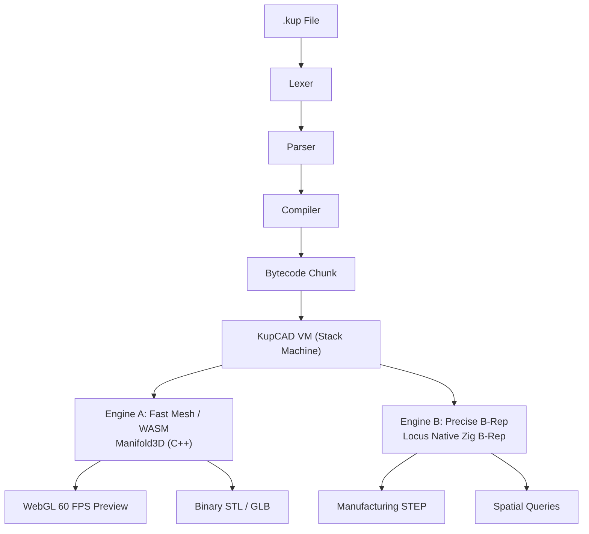

# KupCAD Language & Architecture Specification

**Version:** 1.0.0

**Core Runtime:** Custom Zig Bytecode VM (`VM`) + Manifold3D (Mesh/Preview) + Locus Native B-Rep (STEP/Analytical)

**Syntax Paradigm:** Ruby-inspired, Expression-based, Method-chaining OOP

## 1. Syntax & Core Concepts

KupCAD (`.kup`) is a high-level, expression-based parametric CAD language executing on a custom stack-based VM. Primitives are generated via built-in classes like `Solid` and `Sketch2D`. Every operation returns a first-class geometry node, enabling fluid method-chaining.

### 3D Primitives & Assemblies

Primitives accept intelligent keyword arguments, including native support for rounded corners and chamfers directly during instantiation. Every built-in shape and geometry method checks its keywords: a misspelt or unsupported one is an `ArgumentError` naming the keywords it accepts, never silently ignored.

```ruby
# Native 3D primitives with built-in filleting
base_box = cube(x: 50, y: 30, z: 20, round_r: 2.0, center: true)
cyl = cylinder(r: 5, h: 40, chamfer: 1.0)
ring = torus(major_r: 10.0, minor_r: 2.0)
custom = polyhedron(points: [[0,0,0], [10,0,0], [0,10,0], [0,0,10]],
                    faces: [[0,2,1], [0,1,3], [0,3,2], [1,2,3]])

# Method-chained transformations & CSG booleans
housing = base_box
  .translate(z: 10)
  .difference(cyl)

# Grouping parts into structured, named assemblies
final_part = assemble(name: "HousingAssembly", parts: [housing, ring])

```

### Batch CSG & Operator Overloading

You can use standard math operators (`+`, `-`, `&`) for binary CSG, or utilize batch operations for arrays of geometry to heavily optimize the evaluation graph:

```ruby
# Union or Hull across entire arrays natively
pins = [cylinder(r: 2, h: 10), cylinder(r: 2, h: 10).translate(x: 20)]
casing = union(pins)
convex_wrap = batch_hull(pins)

```

---

## 2. 2D Sketching, Profiles, & Text

The `Sketch2D` class provides powerful 2D cross-section primitives that can be swept into 3D.

```ruby
# Advanced 2D Polygons with Hole support (Even-Odd winding rules)
profile = polygon(
  [[0,0], [10,0], [10,10], [0,10], [2,2], [8,2], [8,8], [2,8]],
  paths: [[0, 1, 2, 3], [4, 5, 6, 7]] # Point indices: the outline, then an inner cutout hole
)

# Text Generation with alignment and typography controls
label = text("KupCAD", size: 12.0, font: "sans", halign: "center", valign: "baseline")

# Sweeping 2D into 3D
label_3d = label.extrude(5.0)
knob = regular_polygon(sides: 6, r: 15).translate(x: 20).revolve(deg: 360)
thread = circle(r: 1).translate(x: 3).helix(h: 20.0, twist: 3600) # 10 turns, pitch 2

```

---

## 3. Core Standard Library & Block Iteration

KupCAD is a Turing-complete language with a robust standard library and functional iteration patterns.

### Blocks and Closures

KupCAD fully supports Ruby-style block execution using `do |args| ... end` or `{ |args| ... }`.

```ruby
# Using the block to generate an array of cylinders
pegs = []
(0...3).each do |row|
  pegs.push(cylinder(r: 2, h: 10).translate(x: row * 10))
end

# Counted loops
4.times { |i| puts(i) }            # 0, 1, 2, 3
1.upto(3) { |i| puts(i) }          # 1, 2, 3
3.downto(1) { |i| puts(i) }        # 3, 2, 1

```

`break value` inside a block ends the iteration and becomes the method's return value; `next` skips to the next element.

### Lambdas

A lambda is a block stored in a variable. It is a value, so it is called with `.call`:

```ruby
double = ->(x) { x * 2 }
plate = ->(w, h = 10, thickness: 2) do
  cube(x: w, y: h, z: thickness)
end

double.call(4)               # 8
plate.call(30, thickness: 3) # defaults and keyword parameters work as in a def

def apply(f, v)
  f.call(v)                  # a lambda passed as an argument is called the same way
end
apply(double, 5)             # 10
```

The rule is the same everywhere:

* **Named functions** (a `def`, or a built-in such as `cube`) are called by name, with or without parentheses: `plate_width`, `twice(4)`, `twice 4`, `cube` (the same as `cube()`).
* **Callable values** (a lambda, a block captured with `&blk`, a bound method from `obj.method(:name)`) are called with `.call`, which, like any method, needs no parentheses: `f.call`, `f.call(3)`. A bare `f` is always the value itself, so it can be stored or passed along; `f(3)` is a `TypeError`. A block can also be called implicitly with `yield`, which is an expression like any call (`x = yield`, `yield(v).round`, `ok ? yield : 0`), and `block_given?` tells whether the method got one.

Any call (to a method, a lambda's `.call`, `super` or `yield`) can spread its arguments as in Ruby:

```ruby
def box(x, y, z, center: false)
  cube(x: x, y: y, z: z, center: center)
end

size = [10, 20, 5]
opts = { center: true }
box(*size)                  # box(10, 20, 5)
box(*size, **opts)          # box(10, 20, 5, center: true)

double = ->(v) { v * 2 }
[1, 2, 3].map(&double)      # [2, 4, 6]: a lambda passed as the block
```

`*array` spreads an Array into positional arguments, `**map` a Map into keywords, and `&f` passes a lambda (or `nil`, for no block) as the call's block. A lambda passed as an ordinary argument stays an argument, even in last position.

### Differences from Ruby

KupCAD borrows Ruby's syntax but deliberately keeps a simpler model; these are design choices, not missing features:

* **Lambdas are the only callable objects.** Write `->(x) { ... }` or `-> do ... end`; there is no `proc`, `Proc.new` or `lambda { }`. Call one with `f.call(3)` (or `f.call` with no arguments); `f.()` and `f[3]` don't exist.
* **A lambda behaves exactly like a block.**
  * `return value` and `next value` leave just the block or lambda with that value; neither returns from the enclosing `def`. Use `break value` to stop an iteration and hand back a result (`break` is only valid in a block given to an iterating method, not in a lambda).
  * Both are lenient about arguments: missing ones are `nil` and extra ones are dropped, where a Ruby lambda would raise an `ArgumentError`.
* **Block parameters don't unpack arrays automatically.** `[[1, 2]].map { |a, b| ... }` binds `a = [1, 2]` and `b = nil`; destructure explicitly with `|(a, b)|`. Iterating a Map passes the key and the value separately, so `{ x: 1 }.each { |k, v| ... }` works as in Ruby.
* **Visibility is declared per method.** Write `private def helper ... end` (or `public def`); there are no section-style `private` / `protected` lines that change the visibility of the methods after them, and there is no `protected`. A private method can be called from inside its class (including on another instance of the same class) but not from outside.
* **Methods on the current object are called through `self.`** — a bare `plate` inside a method is resolved as a variable, not as a method call.
* **Methods can read top-level variables** (convenient for parametric scripts: `width = param(:width, ...)` is visible inside every `def`). Assigning inside a `def`, or inside a block within it, always creates a local, so a helper's scratch `x` never overwrites a top-level `x`. Top-level code, and blocks or lambdas written at the top level, do update top-level variables. `$name` is always global.

```ruby
width = 20
def plate
  margin = 2              # local to plate
  width - margin          # reads the top-level width
end
def scratch
  width = 0               # a new local: the top-level width is still 20
end
```

```ruby
class Bracket
  def build
    self.plate.difference(self.holes)
  end

  private def plate
    cube(x: 40, y: 20, z: 3)
  end

  private def holes
    cylinder(r: 2, h: 10).translate(x: 10, y: 10)
  end
end
```

### Errors

Mistakes found before a script runs (a syntax error, `break` outside a loop, assigning to a built-in such as `cube = 5`) are reported by `kupcad check`, `kupcad build` and the editor with the file, line and column. Everything else is raised at run time.

`raise` and `begin … rescue … ensure … end` work as in Ruby. Errors raised by the language and the standard library are instances of specific classes, all subclasses of `StandardError`, so they can be rescued by kind; `e.message` holds just the message:

| Class | Raised for |
|---|---|
| `ArgumentError` | Wrong number of arguments, a missing block, a keyword the method doesn't take (`revolve(angle: 90)`; the message lists the accepted ones) |
| `TypeError` | A value of the wrong type (`polygon([[0, 0], [1, "x"], [0, 1]])`, `5[0]`) |
| `ValueError` | A value of the right type that is out of range or not finite (`cube(-1)`, `segments: 1e9`) |
| `IndexError` | An array index out of bounds |
| `RangeError` | A number outside a representable range (bitwise operands, shift counts) |
| `ZeroDivisionError`, `MathError` | Division by zero, an operation producing `NaN` |
| `NameError`, `NoMethodError` | An undefined variable or member, an unknown method |
| `ImportError` | A module that can't be read, parsed or compiled |
| `NotImplementedError` | A feature the active engine doesn't support yet |
| `GeometryError` | The geometry kernel failed an operation or produced an invalid solid (e.g. a `polyhedron` that isn't a closed manifold) |
| `AssertionError` | A failed `assert` |
| `RuntimeError` | `raise "message"`, and other runtime failures |

```ruby
begin
  plate = cube(x: width, y: depth, z: thickness)
rescue ValueError => e
  puts("bad dimensions: " + e.message)   # "cube expects ... got -1"
  plate = cube(10)
end
```

An uncaught error stops the script and is printed once with its class, e.g. `ValueError: cube expects x to be a finite number greater than zero, got -1`.

### Native Collections

* **Arrays**: Exposes functional mutators (`.push`, `.pop`, `.shift`, `.unshift`, `.slice`, `.join`), iterators (`.each`, `.map`, `.filter`, `.reduce`), and native numeric reducers (`.max`, `.min`, `.sum`, `.sort`).
* **Ranges**: `a..b` (inclusive) and `a...b` (exclusive) iterate with `.each` and `.map`, materialize with `.to_a`, and support `.size`, `.include?` / `.cover?`, `.first`, `.last`, `.exclusive?` and `.step(n)` (`(0..1).step(0.25).to_a` → `[0, 0.25, 0.5, 0.75, 1]`; negative steps count down). Iterating with a block (`.each`, `.map`, `.times`, …) has no length limit — like a `while` loop it is bounded only by the instruction budget and cancellation — but building an array (`.to_a`, or the array `.map` returns) is capped at 10,000,000 values (~130 MB). Numbers add `.times`, `.upto(n)` and `.downto(n)`, which require integers.
* **Maps**: Exposes key/value manipulation (`.keys`, `.values`, `.key?`, `.delete`, `.get`, `.merge`, `.empty?`). Keys can be swapped dynamically via `.symbolize_keys` and `.stringify_keys`.

### Strings, Symbols & Math

* **Strings**: Support `.length`, `.size`, `.upcase`, `.downcase`, `.trim`, `.split`, and `.replace`. Strings can check prefixes/suffixes with `.starts_with?` and `.ends_with?`, and typecast using `.to_sym`, `.to_f`, and `.to_i`.
* **Symbols**: Lightweight, interned identifiers (`:name`) used heavily for parameter keys and map properties.
* **Math Module**: Exposes variadic `.min` and `.max`, trigonometric functions (`.sin`, `.cos`, `.tan`, `.asin`, `.acos`, `.atan2`), and CAD-specific interpolation helpers (`.clamp`, `.lerp`, `.hypot`, `.sign`).

### Base Object Introspection

* All objects and geometry nodes support introspection methods like `.is_a?`, `.responds_to?`, and `.nil?`.
* Every value answers `.class` (its class, such as `Number` or a class you defined; `nil` for `nil` and lambdas) and `.inspect` (how it would be written in a script: `"a".inspect` is `"\"a\""`, `{ x: 1 }.inspect` is `{x: 1}`). Define `inspect` in a class to customise it.
* You can duplicate instances using `.dup` or `.clone`, extract bound methods with `.method(:name)` (called with `.call`), or yield to blocks contextually via `.tap` and `.into`.

---

## 4. Parametric UI & The "Hybrid Architecture"

KupCAD uses a **Hybrid Architecture** for parametric UI generation. The `param` keyword executes securely inside the VM, validating types, enforcing bounds, and extracting precise line/column locations for stack-trace error reporting if validation fails.

```ruby
# @title Heavy Duty Bracket
# @description A parametric L-bracket optimized for 3D printing.

# Supports min, max, and exact choice arrays
width = param(:width, default: 20.0, validate: { min: 10.0, max: 100.0 })
material = param(:material, default: "PLA", validate: { in: ["PLA", "PETG", "ABS"] })

def build
  # Dynamic retrieval halts execution safely if constraints are violated
  cube(x: width, y: 50, z: 5)
end

```

Global CAD engine overrides can be dynamically applied using the `CAD` module. Curved shapes (`sphere`, `cylinder`, `circle`, `torus`, `fillet_edges`) take their segment count from the active config; the primitives also accept `segments:` to override it per call:

```ruby
# Force specific tessellation resolutions for the enclosed block
CAD.with_config({ manifold: { min_angle_deg: 5.0 } }) do
  sphere(r: 10)
end

```

---

## 5. Geometry Modifiers & Sweeps

KupCAD exposes an exhaustive list of native mesh manipulation methods attached to all evaluated solid and 2D nodes:

* **Transforms**: `.translate`, `.rotate`, `.scale`, `.mirror`, `.align`, `.center`, `.transform` (Matrix), `.resize`. A Sketch stays in its XY plane: `rotate(a)`, `rotate(z: a)` and `rotate(0, 0, a)` turn it about z, and `mirror(x, y)` reflects it across the line with that normal; a component that would leave the plane (`translate(z: 5)`, `rotate(x: 45)`) is a `ValueError`, so extrude first to lift or tilt it.
* **Arrays**: `.repeat_linear`, `.repeat_polar`.
* **Sweeps**: `.extrude`, `.revolve`, `.helix`, `.loft`. `loft` currently joins two *convex* profiles (it is the convex hull between them); a concave profile or one with holes raises `NotImplementedError` rather than being filled in.
* **Advanced**: `.hull`, `.minkowski`, `.trim_by_plane`, `.split_by_plane`, `.offset`, `.slice`, `.project`, `.fillet_edges`, `.simplify`, `.decompose`, `.on_face`.

---

## 6. Inspection & Spatial Alignment

Evaluated geometry nodes are first-class objects with natively exposed mass properties and exact spatial bounding boxes.

```ruby
box = Solid.cube(x: 50, y: 30, z: 20)

# Physical inspection
bounds = box.bbox               # Returns a BoundingBox object
vol = box.volume                # mm³
area = box.surface_area         # mm²
gap = box.min_gap(other_part)   # Shortest distance between two solids
is_inside = box.contains?([x, y, z])        # Point-in-solid check
on_plate = square(10).contains?([x, y])     # Sketches: [x, y] (or [x, y, 0]); holes excluded, outline included
topology = box.genus            # Topological genus (holes)

```

---

## 7. System Kernel & Development Modifiers

The `Kernel` class provides global host bindings for I/O, garbage collection, and debugging.

```ruby
# CLI Output & Assertions
puts("Generating parts...")
assert(vol > 0, "Volume must be positive")
benchmark { heavy_csg_operation() }

# Memory introspection
GC.collect
puts(GC.bytes_allocated)

```

KupCAD also provides non-destructive inline modifiers to alter visibility in the viewport and inject metadata:

```ruby
# Debugging Modifiers pushed to the VM display list
env = cube(100).ghost           # Renders as a semi-transparent mesh
bolt = cylinder(r: 3).highlight # Forces high-contrast visibility

# Material metadata assigned to the geometry handle (propagates to GLB exports)
part = cube(10).material(color: "#FF0000", roughness: 0.2, metallic: 0.8)

```

---

## 8. Module & Asset Imports

KupCAD uses a Content Addressable File System (CAFS) paired with an SQLite cache for dependency management. Dependencies are declared in `kupcad.json` and pinned in `kupcad.lock` (format 2.0.0) to a commit plus a content integrity hash; `kupcad pkg install` verifies every cached or downloaded package against that hash and fails loudly on a mismatch. Package archives are streamed straight into the CAFS with symlink entries, path escapes and oversized archives rejected (see `architecture.md` §9). External solid files are parsed and injected directly into the VM.

```ruby
# 1. Importing native KupCAD modules via isolated lexical scope
import { Screw } from "github.com/kupcad-libs/hardware"

# 2. Importing external 3D CAD assets directly into the CSG tree
bearing = import_step("assets/608_bearing.step")
logo = import_stl("assets/logo.stl")

```

Every imported file runs in its own top-level scope. Its variables, `def`s and classes are private to it; only the names it lists in `export` reach the importer, and only under the names the importer lists in `import { ... }`. Exported functions and classes keep using their own file's variables wherever they are called from. Module code can use builtins, but not the importer's variables, and two libraries can use the same top-level name without clashing:

```ruby
# hardware.kup
thread_pitch = 1.5                 # private to hardware.kup
def bolt(len)
  cylinder(r: 3, h: len)           # thread_pitch is visible here
end
export bolt

# main.kup
import { bolt } from "./hardware.kup"
thread_pitch = 99                  # a different variable; bolt() is unaffected
```

---

## 9. Architecture & Execution Pipeline

The KupCAD engine is implemented entirely in **Zig**, relying on a dual-engine architecture governed by a robust VM.

* **The Session Manager**: Coordinates multi-file dependency trees using Kahn's Topological Sort and enforces strict RAM budgeting via LRU eviction.
* **$O(1)$ DAG Caching**: The `dag_evaluator` intercepts geometric evaluations, mapping cryptographic hashes of AST operations to pre-solved pointers, completely bypassing C++ FFI crossings on cached nodes.



---

## 10. IDE & Toolchain Ecosystem (`src/cli/`)

KupCAD ships as a monolithic executable containing a complete developer toolchain:

* `kupcad lsp`: Language Server Protocol daemon for VS Code, enabling real-time preview gateways. Documents are evaluated on a read-only virtual filesystem, so a script cannot write to disk just by being opened. The viewport WebSocket listens on `127.0.0.1` at `KUPCAD_VIEWPORT_PORT` (default 9001), falls back to a free port when that one is taken, and reports the real port to the editor via the `kupcad/viewportReady` notification.
* `kupcad fmt`: AST-based Code Formatter.
* `kupcad check`: Linter catching unused variables, zero-volume operations, and logic errors.
* `kupcad pkg`: Lockfile-driven dependency resolver (`add`, `install`, `doctor`) fetching GitHub packages into CAFS under `~/.kupcad` (override with `KUPCAD_HOME`), with lockfile integrity enforcement.
* `kupcad build`: Multi-Target Exporter (`STEP`, `STL`, `GLB`/`GLTF`, `--draco`) with CLI parameter injection (`--param key=value`). Exits non-zero on any failure, so it is safe to use as a CI step.
* `kupcad watch`: Real-time incremental rebuilding utilizing the persistent `SessionManager`.
* `kupcad dev`: VM development toolkit offering `ast-dump`, `disasm`, and `bench`.
