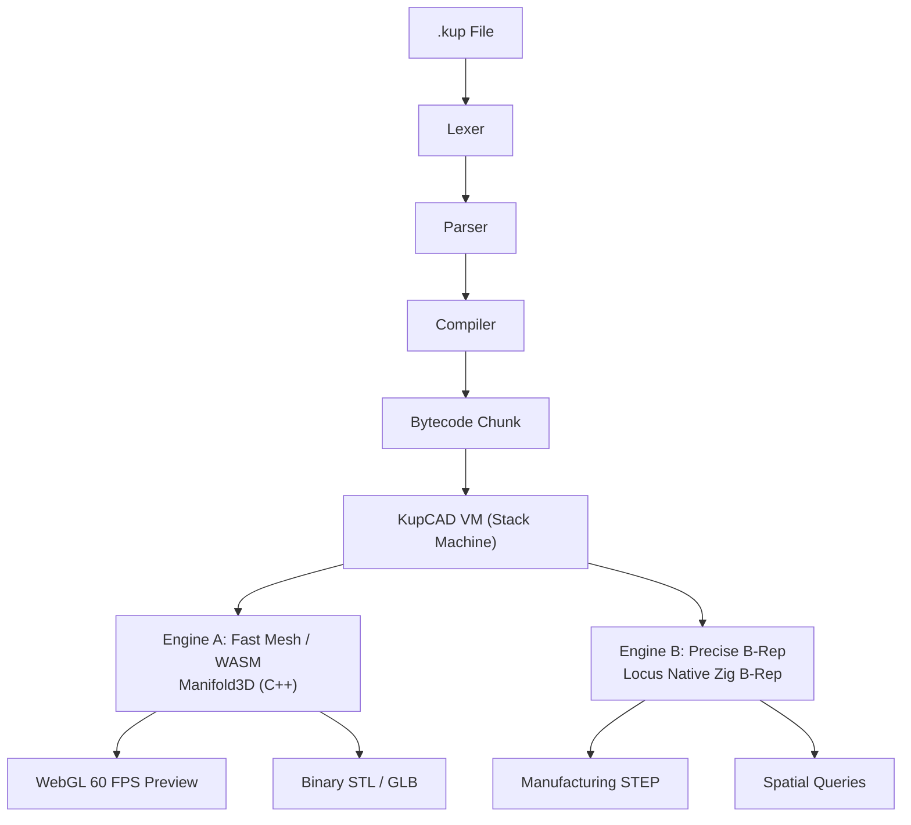

# KupCAD Language & Architecture Specification

**Version:** 1.0.0

**Core Runtime:** Custom Zig Bytecode VM (`VM`) + Manifold3D (Mesh/Preview) + Locus Native B-Rep (STEP/Analytical)

**Syntax Paradigm:** Ruby-inspired, Expression-based, Method-chaining OOP

## 1. Syntax & Core Concepts

KupCAD (`.kup`) is a high-level, expression-based parametric CAD language executing on a custom stack-based VM. Primitives are generated via built-in classes like `Solid` and `Sketch2D`. Every operation returns a first-class geometry node, enabling fluid method-chaining.

### 3D Primitives & Assemblies

Primitives accept intelligent keyword arguments, including native support for rounded corners and chamfers directly during instantiation. Every built-in shape and geometry method checks its keywords: a misspelt or unsupported one is an `ArgumentError` naming the keywords it accepts, never silently ignored. A keyword overrides the same option given positionally: `cube(5, z: 3)` is 5 × 5 × 3.

```ruby
# Native 3D primitives with built-in filleting
base_box = cube(x: 50, y: 30, z: 20, round_r: 2.0, center: true)
cyl = cylinder(r: 5, h: 40, chamfer: 1.0)
ring = torus(major_r: 10.0, minor_r: 2.0)
custom = polyhedron(points: [[0,0,0], [10,0,0], [0,10,0], [0,0,10]],
                    faces: [[0,2,1], [0,1,3], [0,3,2], [1,2,3]])

# Method-chained transformations & CSG booleans
housing = base_box
  .translate(z: 10)
  .difference(cyl)

# Grouping parts into structured, named assemblies
final_part = assemble(name: "HousingAssembly", parts: [housing, ring])

```

**`sides:` or `segments:`.** `sides:` is a faceted shape: `cylinder(d: 8, h: 5, sides: 6)` is a hexagonal prism (a nut trap), `circle(r: 5, sides: 6)` a hexagon, and `cylinder(r1:, r2:, sides:)` a frustum; the first corner lies on +x. It is the same on both engines. `segments:` only says how finely a round shape is drawn, overriding the resolution (`CAD.config`) for that call: the mesh engine draws a cylinder with that many facets, while the exact B-Rep engine keeps it round. Use `sides:` whenever the facets are the design; giving both is an `ArgumentError`, and a sphere has no `sides:`.

### Batch CSG & Operator Overloading

You can use standard math operators (`+`, `-`, `&`) for binary CSG, or utilize batch operations for arrays of geometry to heavily optimize the evaluation graph:

```ruby
# Union or Hull across entire arrays natively
pins = [cylinder(r: 2, h: 10), cylinder(r: 2, h: 10).translate(x: 20)]
casing = union(pins)
convex_wrap = batch_hull(pins)

# Optional parts: leave the nils out with .compact
boss = with_boss ? cylinder(r: 4, h: 6) : nil
part = cube(20).union([boss, rib].compact)
```

`a.union(b, c)`, `.difference`, `.intersection` and `.hull` take shapes of the receiver's kind, or Arrays of them; anything else, `nil` included, is a `TypeError` that says where it is. An empty list follows set theory: `a.union([])` and `a.difference([])` are `a`, `a.intersection([])` is the empty shape, and the global `union([])` is the empty Solid (a valid part, `empty?`, that renders nothing), so a list of optional parts that ends up empty is never an error; only `batch_hull([])` is, a hull of nothing being no shape. `a.difference(b, c)` removes `b` and `c` from `a`, the same as `a - b - c`.

---

## 2. 2D Sketching, Profiles, & Text

The `Sketch2D` class provides powerful 2D cross-section primitives that can be swept into 3D.

```ruby
# Advanced 2D Polygons with Hole support (Even-Odd winding rules)
profile = polygon(
  [[0,0], [10,0], [10,10], [0,10], [2,2], [8,2], [8,8], [2,8]],
  paths: [[0, 1, 2, 3], [4, 5, 6, 7]] # Point indices: the outline, then an inner cutout hole
)

# Text Generation with alignment and typography controls
label = text("KupCAD", size: 12.0, font: "sans", halign: "center", valign: "baseline")

# Sweeping 2D into 3D
label_3d = label.extrude(5.0)
knob = regular_polygon(sides: 6, r: 15).translate(x: 20).revolve(deg: 360)
thread = circle(r: 1).translate(x: 3).helix(h: 20.0, twist: 3600) # 10 turns, pitch 2

```

---

## 3. Core Standard Library & Block Iteration

KupCAD is a Turing-complete language with a robust standard library and functional iteration patterns.

### Blocks and Closures

KupCAD fully supports Ruby-style block execution using `do |args| ... end` or `{ |args| ... }`.

```ruby
# Using the block to generate an array of cylinders
pegs = []
(0...3).each do |row|
  pegs.push(cylinder(r: 2, h: 10).translate(x: row * 10))
end

# Counted loops
4.times { |i| puts(i) }            # 0, 1, 2, 3
1.upto(3) { |i| puts(i) }          # 1, 2, 3
3.downto(1) { |i| puts(i) }        # 3, 2, 1

```

`break value` inside a block ends the iteration and becomes the method's return value; `next` skips to the next element.

### Lambdas

A lambda is a block stored in a variable. It is a value, so it is called with `.call`:

```ruby
double = ->(x) { x * 2 }
plate = ->(w, h = 10, thickness: 2) do
  cube(x: w, y: h, z: thickness)
end

double.call(4)               # 8
plate.call(30, thickness: 3) # defaults and keyword parameters work as in a def

def apply(f, v)
  f.call(v)                  # a lambda passed as an argument is called the same way
end
apply(double, 5)             # 10
```

The rule is the same everywhere:

* **Named functions** (a `def`, or a built-in such as `cube`) are called by name, with or without parentheses: `plate_width`, `twice(4)`, `twice 4`, `cube` (the same as `cube()`). A `def` takes the arguments it declares: `twice(1, 2)` or `twice` is an `ArgumentError` (`twice takes 1 argument, got 2`), and so are keyword arguments to a `def` without keyword parameters. A Map passed as a positional argument stays one; only `key: value` arguments reach the keyword parameters.
* **Source files are UTF-8.** One that isn't is reported as a syntax error at its first bad byte.
* **One statement per line**, or several separated by `;`: `x = 1; y = 2`. Two side by side, such as `puts 1 2`, are a syntax error (as in Ruby). A block's closing word ends the statement before it, so `if ok then 1 else 2 end` is one line.
* **Spacing decides what follows a name**, as in Ruby and Crystal. After a method name, `-1`, `+1`, `*xs`, `**opts`, `&blk` or `[...]` written with a space before and none after is the first argument: `puts -1`, `count *xs`, `list.map &blk`, `extrude [0, 0, 10]`. After a variable (a local bound earlier in this or an enclosing body, a parameter, a constant, `@field` or `$global`) the same tokens are arithmetic or indexing: `x -1` is `x - 1`, `pts [0]` is `pts[0]`. `name(` with no space holds the arguments; `name (` with a space only groups the first one, so `puts (1 + 2) * 3` prints 9, and `f (1, 2)` is a syntax error. A call without parentheses takes everything after it as arguments: `[f -1, 2]` is `[f(-1, 2)]`, so write `[(f -1), 2]` or `[f(-1), 2]`.
* **Callable values** (a lambda, a block captured with `&blk`, a bound method from `obj.method(:name)`) are called with `.call`, which, like any method, needs no parentheses: `f.call`, `f.call(3)`. A bare `f` is always the value itself, so it can be stored or passed along; `f(3)` is a `TypeError`. A block can also be called implicitly with `yield`, which is an expression like any call (`x = yield`, `yield(v).round`, `ok ? yield : 0`), and `block_given?` tells whether the method got one.

Any call (to a method, a lambda's `.call`, `super` or `yield`) can spread its arguments as in Ruby:

```ruby
def box(x, y, z, center: false)
  cube(x: x, y: y, z: z, center: center)
end

size = [10, 20, 5]
opts = { center: true }
box(*size)                  # box(10, 20, 5)
box(*size, **opts)          # box(10, 20, 5, center: true)

double = ->(v) { v * 2 }
[1, 2, 3].map(&double)      # [2, 4, 6]: a lambda passed as the block
```

`*array` spreads an Array into positional arguments, `**map` a Map into keywords, and `&f` passes a lambda (or `nil`, for no block) as the call's block. A lambda passed as an ordinary argument stays an argument, even in last position.

### Loops

```ruby
for i in 0...4                         # an Array, a Range or a Map
  cube(2).translate(i * 5, 0, 0)
end

for x, y in [[0, 0], [10, 5]]          # several variables spread each element
  cylinder(r: 1, h: 3).translate(x, y, 0)
end

for size, *rest in [[3, :m3, :hex]]    # one of them may take the rest
  puts size
end

for name, d in { m3: 3, m4: 4 }        # a Map yields [key, value] pairs
  puts "#{name}: #{d}"
end

n = 0
while n < 3                            # `until` loops while the condition is false
  n += 1
end
```

* `for` walks a Range exactly as `.each` does (steps, exclusive ends, negative and fractional steps), an Array as it is at each step (elements pushed during the loop are visited too), and a Map's pairs in insertion order. Anything else is a `TypeError`. One variable takes each element whole; several spread it like a multiple assignment.
* As in Ruby, a loop opens no scope: the loop variables, and whatever the body assigns, are still there after it.
* `next` skips to the next element and `break value` ends the loop with that value; otherwise a `for` loop's value is what it iterated, and a `while` loop's is `nil`. Unlike in a block, `return` inside a loop returns from the enclosing `def`.

### Differences from Ruby

KupCAD borrows Ruby's syntax but deliberately keeps a simpler model; these are design choices, not missing features:

* **Lambdas are the only callable objects.** Write `->(x) { ... }` or `-> do ... end`; there is no `proc`, `Proc.new` or `lambda { }`. Call one with `f.call(3)` (or `f.call` with no arguments); `f.()` and `f[3]` don't exist.
* **A lambda behaves exactly like a block.**
  * `return value` and `next value` leave just the block or lambda with that value; neither returns from the enclosing `def`. Use `break value` to stop an iteration and hand back a result: `[10, 20].each { |v| break v * 2 }` is `20`. A `break` leaves the call the block was given to: `m { break 5 }` is `5` and `m` stops where it stands, whether it reached the block through `yield` (from its own body or from inside another block), by handing it on with `each(&blk)` or with `blk.call`. `break` is only valid in a block given to an iterating method (not in a lambda, and an `ArgumentError` in a block given to `highlight`, `ghost`, `benchmark` or `assert`). An iteration reaches the elements its block adds to the array or map it iterates, as in Ruby.
  * Both are lenient about arguments: missing ones are `nil` and extra ones are dropped, where a Ruby lambda would raise an `ArgumentError`.
  * Inside a method, both see the method's context: `self`, `yield` and `block_given?` refer to the method's receiver and block, `super` continues the method, and a private call is allowed, exactly as in the method's own body. Only the argument-less `super` must be spelled out there (`super(a, b)`), because a block can't know the method's parameters. `yield`, `block_given?` and `super` outside a `def` are compile errors.
* **Block parameters don't unpack arrays automatically.** `[[1, 2]].map { |a, b| ... }` binds `a = [1, 2]` and `b = nil`; destructure explicitly with `|(a, b)|`. Iterating a Map passes the key and the value separately, so `{ x: 1 }.each { |k, v| ... }` works as in Ruby.
* **A loop header ends at the line break (or `;`), with no `do`.** Write `for x in xs` or `while n < 3` and start the body on the next line; Ruby's optional `for x in xs do` and `while cond do` are syntax errors that point at the `do`. A block inside the header still works in brackets or braces: `for x in xs.map { |v| v * 2 }`.
* **Visibility is declared per method.** Write `private def helper ... end` (or `public def`); there are no section-style `private` / `protected` lines that change the visibility of the methods after them, and there is no `protected`. A private method can be called from inside its class or a subclass (including on another instance of that class, and from a block inside such a method) but not from outside. `super` always continues above the class whose `def` contains it, so a chain `C < B < A` runs `C#foo`, `B#foo`, `A#foo` once each; a class variable `@@x` belongs to the class whose code first assigns it and is shared with its subclasses, never with an unrelated class.
* **`self` in a class or module body is the class or module being defined**, as in Ruby, so `@@count = 0`, `LIMIT = self.compute`, `self.helper(...)` and `class << self` work there; a block in the body sees the same `self`.
* **Compound assignment** works on variables, instance variables, properties and indexes: `x += 1`, `@n -= 2`, `a[i] *= 3`, `obj.p ||= default` (assigns only when the current value is `nil` or `false`; the right-hand side is evaluated only then) and `x &&= v`. An instance variable that was never assigned reads as `nil`, also where a method has its name (`@v` inside `def v`).
* **`include` takes a Module, inside a class body** (`include M` in a module, or a non-Module, is a `TypeError`), and a superclass must be a Class (`class A < X` with `X = 5` is a `TypeError`), both rescuable like any error.
* **Methods on the current object are called through `self.`** — a bare `plate` inside a method is resolved as a variable, not as a method call.
* **Methods can read top-level variables** (convenient for parametric scripts: `width = param(:width, ...)` is visible inside every `def`). Assigning inside a `def`, or inside a block within it, always creates a local, so a helper's scratch `x` never overwrites a top-level `x`. Top-level code, and blocks or lambdas written at the top level, do update top-level variables. `$name` is always global.

```ruby
width = 20
def plate
  margin = 2              # local to plate
  width - margin          # reads the top-level width
end
def scratch
  width = 0               # a new local: the top-level width is still 20
end
```

```ruby
class Bracket
  def build
    self.plate.difference(self.holes)
  end

  private def plate
    cube(x: 40, y: 20, z: 3)
  end

  private def holes
    cylinder(r: 2, h: 10).translate(x: 10, y: 10)
  end
end
```

### Errors

Mistakes found before a script runs (a syntax error, `break` outside a loop, assigning to a built-in such as `cube = 5`) are reported by `kupcad check`, `kupcad build` and the editor with the file, line and column. Everything else is raised at run time.

`raise` and `begin … rescue … ensure … end` work as in Ruby: `raise "msg"` raises a `RuntimeError`, `raise Klass, "msg"` raises `Klass.new("msg")` and `raise Klass` an instance whose message is the class name; `ensure` runs however the `begin` is left (normally, after a matching `rescue`, by `return`, `break` or `next`, or by an error nobody rescued, which goes on after it), and an error raised inside `ensure` replaces the one in flight. The one exception is a block's `break` that leaves a method through `yield`: the method is abandoned at once, and `ensure` bodies pending in it don't run. Errors raised by the language and the standard library are instances of specific classes, all subclasses of `StandardError`, so they can be rescued by kind (`rescue ValueError => e`, also by a scoped name such as `rescue Parts::MyError`, or by the bare name inside the module that defines the class); `e.message` holds just the message:

| Class | Raised for |
|---|---|
| `ArgumentError` | Wrong number of arguments, a missing block, a keyword the method doesn't take (`revolve(angle: 90)`; the message lists the accepted ones), more positional arguments than it takes (`extrude(10, 5)`: `extrude takes at most 1 positional argument (h), got 2`) |
| `TypeError` | A value of the wrong type (`polygon([[0, 0], [1, "x"], [0, 1]])`, `5[0]`) |
| `ValueError` | A value of the right type that is out of range or not finite (`cube(-1)`, `segments: 1e9`) |
| `IndexError` | An Array or String index out of bounds (`[1, 2][5]`, `"abc"[9]`; Ruby gives `nil`) |
| `RangeError` | A number outside a representable range: arithmetic that overflows (`2 ** 1024`; numbers are 64-bit floats, so beyond ±1.8e308 there is no number), bitwise operands, shift counts. A script that needs a non-finite value writes `Number::INFINITY` or `Number::NAN` |
| `ZeroDivisionError`, `MathError` | Division by zero, an operation producing `NaN` |
| `NameError`, `NoMethodError` | An undefined variable or member, an unknown method |
| `ImportError` | A module that can't be read, parsed or compiled |
| `NotImplementedError` | A feature the active engine doesn't support yet |
| `GeometryError` | The geometry kernel failed an operation or produced an invalid solid (e.g. a `polyhedron` that isn't a closed manifold) |
| `AssertionError` | A failed `assert` |
| `RuntimeError` | `raise "message"`, and other runtime failures |

```ruby
begin
  plate = cube(x: width, y: depth, z: thickness)
rescue ValueError => e
  puts("bad dimensions: " + e.message)   # "cube expects ... got -1"
  plate = cube(10)
end
```

A built-in never ignores what it is given: an extra argument, a keyword to a method that takes none, a `nil` or a Sketch in a Solid's `union` is an error, not dropped. `nil` for an optional parameter (`slice(nil)`, `center(nil)`, `segments: nil`) leaves it unset, as if it weren't passed.

An uncaught error stops the script and is printed once with its class, e.g. `ValueError: cube expects x to be a finite number greater than zero, got -1`.

### Native Collections

* **Arrays**: Index with a number (negative from the end) or a Range (`arr[1..2]`, like `.slice`). Exposes functional mutators (`.push`, `.pop`, `.shift`, `.unshift`, `.slice`, `.join`), iterators (`.each`, `.map`, `.filter` and its complement `.reject`, `.reduce`), `.compact` (a copy without the `nil`s, for a list of optional parts: `base.union([boss, rib].compact)`), and native numeric reducers (`.max`, `.min`, `.sum`, `.sort`). `.sort` gives a sorted copy: Numbers or Strings on their own, anything else with a block returning the sign of the comparison (`sort { |a, b| b <=> a }`). `.max`, `.min` (Numbers or Strings, not mixed) and `.sum` (Numbers) raise a `TypeError` for anything else instead of skipping it, a `MathError` for `NaN`, and `.sum` a `RangeError` when the total overflows; on an empty Array `.max` and `.min` are `nil` and `.sum` is `0`. `==` (and so `!=`, `.contains?` and `case`/`when`) compares Arrays, Maps and Ranges by content, nested ones included; a Map's order doesn't matter.
* **Ranges**: `a..b` (inclusive) and `a...b` (exclusive) iterate with `.each` and `.map`, materialize with `.to_a`, and support `.size`, `.include?` / `.cover?`, `.first`, `.last`, `.exclusive?` and `.step(n)` (`(0..1).step(0.25).to_a` → `[0, 0.25, 0.5, 0.75, 1]`; negative steps count down). Iterating with a block (`.each`, `.map`, `.times`, …) has no length limit — like a `while` loop it is bounded only by the instruction budget and cancellation — but building an array (`.to_a`, or the array `.map` returns) is capped at 10,000,000 values (~130 MB). Numbers add `.times`, `.upto(n)` and `.downto(n)`, which require integers.
* **Maps**: Exposes key/value manipulation (`.keys`, `.values`, `.key?`, `.delete`, `.get`, `.merge`, `.empty?`). Keys can be swapped dynamically via `.symbolize_keys` and `.stringify_keys`.

### Strings, Symbols & Math

* **Numbers**: All numbers are 64-bit floats; whole numbers print without a decimal point (`3`, `2.5`). They answer `.odd?` / `.even?` (of whole numbers), `.zero?`, `.positive?`, `.negative?`, `.integer?`, `.finite?`, `.nan?`, `.infinite?`, `.clamp(lo, hi)` and `.between?(lo, hi)`; `Number::EPSILON` is the gap between 1 and the next number, a scale for tolerances. `%` is floored as in Ruby (`7 % -3` is `-2`), `<=` and `>=` are false against `Number::NAN` like `<` and `>`, and `.round(d)` with more decimals than a Number holds leaves it unchanged (`.round(-400)` is `0`). As in Ruby, `-2.abs` is `2`: a minus against a number is part of it (`-2 ** 2` is still `-4`). They print in plain digits while every digit is exact, and in scientific notation from 1e16 (past 2^53, where floats skip integers) and below 1e-6: `2 ** 53` prints `9007199254740992`, `2 ** 60` prints `1.152921504606847e18`, `0.0000001` prints `1e-7`.
* **Strings**: Index by character like Arrays (`"abc"[0]` is `"a"`, `s[-1]` the last, `s[1..2]` a substring). Support `.length`, `.size`, `.upcase`, `.downcase`, `.trim`, `.split` (`split("")` is the characters), and `.replace`. Strings can check prefixes/suffixes with `.starts_with?` and `.ends_with?`, and typecast using `.to_sym`, `.to_f`, and `.to_i`.
* **Symbols**: Lightweight, interned identifiers (`:name`) used heavily for parameter keys and map properties. As in Ruby, a Symbol reads as its name (`"#{:m3}"`, `puts :m3` and `[:a, :b].join` give `m3`, `m3`, `ab`) and inspects with its colon (`:m3.inspect` is `:m3`).
* **Math Module**: Constants `Math::PI`, `Math::TAU` (2π) and `Math::E`. Trigonometry in radians (`.sin`, `.cos`, `.tan`, `.asin`, `.acos`, `.atan`, `.atan2`) and, since CAD angles are degrees, in degrees (`.sind`, `.cosd`, `.tand`, `.asind`, `.acosd`, `.atand`, `.atan2d`), exact at the angles where the result is 0, ±½ or ±1: `Math.cosd(90)` is `0`, where `Math.cos(Math::PI / 2)` is `6.1e-17`. Roots and logarithms (`.sqrt`, `.cbrt`, `.exp`, `.log(x)` or `.log(x, base)`, `.log2`, `.log10`), rounding (`.round`, `.ceil`, `.floor`, `.abs`, `.sign`), `.deg2rad` / `.rad2deg`, variadic `.min` / `.max` and `.hypot(x, y, ...)` (a 3D distance is `Math.hypot(dx, dy, dz)`). Modelling helpers: `.clamp(v, lo, hi)`, `.lerp(a, b, t)`, `.snap(x, step)` to the nearest multiple of `step`, `.remap(x, from_lo, from_hi, to_lo, to_hi)`, `.smoothstep(edge0, edge1, x)`, `.close?(a, b, tolerance = 1e-9)` for comparing measurements, and `.gcd` / `.lcm` of whole numbers (gear tooth counts). Like arithmetic, a function whose result would be NaN or infinite raises a `MathError` or `RangeError`.

### Base Object Introspection

* All objects and geometry nodes support introspection methods like `.is_a?`, `.respond_to?`, and `.nil?`.
* Every value answers `.class` (its class, such as `Number`, `NilClass`, `Proc` for a lambda, `Method` for a bound method, `Class`, or a class you defined) and `.inspect` (how it would be written in a script: `"a".inspect` is `"\"a\""`, with `"`, `\` and control characters escaped as the lexer reads them; `{ x: 1 }.inspect` is `{x: 1}`; a container that holds itself prints as `[...]` or `{...}`, as in Ruby). Define `inspect` in a class to customise it. Built-in values come from literals and methods, not `.new`: `Array.new(3, 0)`, `String.new` and `Map.new` exist as in Ruby, while `Number.new` or `Proc.new` is a `NoMethodError`.
* A constant assigned in a class or module body is read from outside with `::`: `Gear::TEETH`, `Parts::Bolt::LENGTH` (inside the class, plain `TEETH`).
* `puts`, `print` and `"#{...}"` show an instance by its own `to_s` when its class defines one; it must return a String.
* `.dup` and `.clone` make a shallow copy of an Array, Map or instance (its own elements, entries or fields, holding the same values; other values are returned as they are), you can extract bound methods with `.method(:name)` (called with `.call`), or yield to blocks contextually via `.tap` and `.into`.

---

## 4. Parametric UI & The "Hybrid Architecture"

KupCAD uses a **Hybrid Architecture** for parametric UI generation. The `param` keyword executes securely inside the VM, validating types, enforcing bounds, and extracting precise line/column locations for stack-trace error reporting if validation fails.

```ruby
# @title Heavy Duty Bracket
# @description A parametric L-bracket optimized for 3D printing.

# Supports min, max, and exact choice arrays
width = param(:width, default: 20.0, validate: { min: 10.0, max: 100.0 })
material = param(:material, default: "PLA", validate: { in: ["PLA", "PETG", "ABS"] })

def build
  # Dynamic retrieval halts execution safely if constraints are violated
  cube(x: width, y: 50, z: 5)
end

```

### Engine settings (`CAD.config`)

`CAD.config(...)` changes the settings for the rest of the script; `CAD.with_config(...) do ... end` applies them only inside the block; `CAD.current_config` returns them as a Map with the same keys. The shared settings mean the same on both kernels, so a model reads the same whichever engine builds it:

```ruby
CAD.config(
  engine: :manifold,          # or :brep (exact B-Rep, for STEP)
  tolerance: 1e-5,            # points closer than this are the same point
  resolution: {               # how finely curves are cut into straight edges
    segments: 0,              # edges per full circle; 0 = from the two rules below
    min_angle: 12,            # at most this many degrees of arc per edge ...
    min_length: 2,            # ... and edges no shorter than this, whichever gives fewer
  },
  max_vertices: 5_000_000,    # most vertices one operation may produce
  manifold: { simplify_coplanar: false },                       # mesh engine only
  brep: { max_newton_trials: 50, max_marching_steps: 500 },     # B-Rep only
)

# A finer resolution for one part
CAD.with_config(resolution: { min_angle: 5 }) do
  sphere(r: 10)
end
```

* `resolution` is OpenSCAD's `$fn`, `$fa` and `$fs`. Curved shapes (`sphere`, `cylinder`, `circle`, `torus`, `fillet_edges`, `revolve`) take their segment count from it; `segments:` on a call overrides it for that call. Automatic counts are capped at 2048. A count that isn't whole (`segments:`, `sides:`, `slices:`) is rounded down, as OpenSCAD does with `$fn`, so one computed from a size (`segments: r * 4`) needs no rounding. `text` follows it too: its glyphs are drawn as finely as a circle half the text size (`tolerance:` on the call sets the chord tolerance itself).
* `tolerance` is the one distance tolerance: the B-Rep kernel welds points and sews faces within it, `manifold: { simplify_coplanar: true }` merges coplanar faces within it, and measurements such as `contains?` and `on_face` use it.
* A setting CAD.config doesn't have is an `ArgumentError` naming the ones it has, a value of the wrong type a `TypeError`, and a value the kernels can't use (a tolerance of 0, a 2-edge circle) a `ValueError`; nothing is applied then.
* Geometry keeps the settings it was made under. A part made inside `CAD.with_config(engine: :brep) do ... end` is a B-Rep part wherever it is later measured or exported, and `CAD.config` changes the settings for what is made after it, not before. The same part made under two settings is two parts, each built and cached once.

### The B-Rep engine today

`engine: :brep` (and every STEP export, which needs exact geometry) runs on Locus, KupCAD's own B-Rep kernel, which is still being written. Today it builds cubes, cylinders and polyhedra (and the sketches `square`, `circle`, `polygon`, `text`), the convex hulls of flat-faced solids (`hull`, `batch_hull`), and STEP files of them. A STEP file holds only exact geometry, so a part built by the Manifold engine (a mesh, from a `CAD.with_config(engine: :manifold)` block or a script left on the default engine) is a `NotImplementedError` that names the part; it used to be left out of the file without a word. Everything else is a `NotImplementedError` that names what is missing and suggests `engine: :manifold`, rather than a stand-in answer:

* shapes and operations: spheres (Locus builds a fixed faceted one), cones (`r1` different from `r2`); `translate`, `rotate`, `scale`, `mirror`, `transform`; booleans on solids and sketches; hulls of curved solids; `extrude` (so `cube(round_r:)` and `text` solids too), `revolve`, `loft`, `helix`; `offset`, `minkowski` and `fillet_edges`, `trim_by_plane` and `split_by_plane`, `slice`, `project`, `decompose`;
* measurements: `volume`, `surface_area`, `genus`, `empty?`, `bbox` and what uses it (`align`, `center`, `resize`), `contains?`, `ray_cast`, `min_gap`, `on_face`;
* meshes: STL and glTF export, and the viewport.

Materials are the exception: a B-Rep model is built without them, with one warning. Each of these turns on as Locus implements it (`supports` in `kernel/engines/brep/driver.zig`).

## 5. Geometry Modifiers & Sweeps

KupCAD exposes an exhaustive list of native mesh manipulation methods attached to all evaluated solid and 2D nodes:

* **Transforms**: `.translate`, `.rotate`, `.scale`, `.mirror`, `.align`, `.center` (the axes to center on, `"xyz"` by default, as a String or Symbol: `center(:xy)`; a Sketch only on x and y), `.transform` (Matrix), `.resize`. A transform takes its x, y, z as three numbers, one Array (`translate([1, 2, 3])`) or names (`scale(x: 2)`); one bare number has a meaning of its own: `scale(s)` scales every axis by `s` (as every CAD tool reads it), and `rotate(a)` turns about z, for a Solid as for a Sketch (OpenSCAD's default). A Sketch stays in its XY plane: `rotate(a)`, `rotate(z: a)` and `rotate(0, 0, a)` turn it about z, and `mirror(x, y)` reflects it across the line with that normal; a component that would leave the plane (`translate(z: 5)`, `rotate(x: 45)`) is a `ValueError`, so extrude first to lift or tilt it.
* **Arrays**: `.repeat_linear`, `.repeat_polar`.
* **Sweeps**: `.extrude`, `.revolve` (`deg:`, `segments:`; without `segments:` the count follows the profile's distance from the axis and the active config), `.helix`, `.loft`. `loft` currently joins two *convex* profiles (it is the exact convex hull of their outlines, the base at z = 0 and the top at the height); a concave profile or one with holes raises `NotImplementedError` rather than being filled in.
* **Advanced**: `.hull`, `.minkowski`, `.trim_by_plane`, `.split_by_plane`, `.offset`, `.slice`, `.project`, `.fillet_edges`, `.simplify`, `.decompose`. (`on_face` and the `Workplane` it returned are withheld until the sketching-on-a-face API exists.)
* **Assemblies**: `assemble(name: "Housing", parts: [housing, ring])` groups Solids under a name for export. Every part must be a Solid (a `TypeError` names the first that isn't: an Array of nils from `.ghost` or a nested assembly used to vanish from every export); the assembly keeps its own copy of the list. It answers `.name` and `.parts` (a new Array each time) and exports with `.export_stl(path)` (the parts united, as STL holds one mesh), `.export_gltf(path)` (the parts kept apart) and `.export_step(path)` (every part must be B-Rep). A ghost isn't a part: `.ghost` returns nil and shows and exports the shape beside the model.

---

## 6. Inspection & Spatial Alignment

Evaluated geometry nodes are first-class objects with natively exposed mass properties and exact spatial bounding boxes.

```ruby
box = Solid.cube(x: 50, y: 30, z: 20)

# Physical inspection
bounds = box.bbox               # Returns a BoundingBox object
vol = box.volume                # mm³
area = box.surface_area         # mm²
gap = box.min_gap(other_part)   # Shortest distance between two solids
is_inside = box.contains?([x, y, z])        # Point-in-solid check
on_plate = square(10).contains?([x, y])     # Sketches: [x, y] (or [x, y, 0]); holes excluded, outline included
topology = box.genus            # Topological genus (holes)

```

---

## 7. System Kernel & Development Modifiers

The `Kernel` class provides global host bindings for I/O, garbage collection, and debugging.

```ruby
# CLI Output & Assertions
puts("Generating parts...")
assert(vol > 0, "Volume must be positive")
benchmark { heavy_csg_operation() }

# Memory introspection
GC.collect
puts(GC.bytes_allocated)

# Stop here and inspect variables (.step, .continue, .locals, .help)
debugger()
```

`puts` and `print` write to stderr. `debugger()` opens an interactive prompt, also on stderr, when `kupcad build` or `kupcad watch` runs from a terminal; anywhere no one could answer it (piped input, the LSP, the viewport, the browser) it does nothing, so a forgotten breakpoint never stalls a build or an editor. At the prompt, `.step` runs to the next line and stops again, `.continue` resumes, `.locals`, `.stack` and `.globals` show the state, and an expression is evaluated in place.

KupCAD also provides non-destructive inline modifiers to alter visibility in the viewport and inject metadata:

```ruby
# Debugging Modifiers pushed to the VM display list
env = cube(100).ghost           # Renders as a semi-transparent mesh
bolt = cylinder(r: 3).highlight # Forces high-contrast visibility

# Material metadata assigned to the geometry handle (propagates to GLB exports)
part = cube(10).material(color: "#FF0000", roughness: 0.2, metallic: 0.8)

```

`color` is `"#RRGGBB"` or `"#RGB"`; `alpha`, `roughness`, `metallic` and `transmission` are between 0 and 1. Anything else is a `ValueError`.

---

## 8. Module & Asset Imports

KupCAD uses a Content Addressable File System (CAFS) paired with an SQLite cache for dependency management. Dependencies are declared in `kupcad.json` and pinned in `kupcad.lock` (format 3.0.0) to a commit plus a content integrity hash; `kupcad pkg install` verifies every cached or downloaded package against that hash and fails loudly on a mismatch. Package archives are streamed straight into the CAFS with symlink entries, path escapes and oversized archives rejected (see `architecture.md` §9). External solid files are parsed and injected directly into the VM.

### Packages (`kupcad pkg`)

* `kupcad pkg init` writes a fresh `kupcad.json`; where one exists it changes nothing and fails, so a project's dependencies can't be wiped by a stray `init`.
* The global store (`~/.kupcad`, or `KUPCAD_HOME`) is shared by every project and every `kupcad` process: a write to its index waits up to 5 seconds for another process's lock rather than failing with "database is locked".
* A package is imported by its alias in `kupcad.json`: `import { Screw } from "hardware"` runs the package's `main.kup`, and `"hardware/screws.kup"` another of its files.
* A dependency is `<host>/<user>/<repo>[@ref]` on github.com, gitlab.com, codeberg.org or gitea.com. A self-hosted server is written with the API it speaks, `gitlab:git.example.com/team/parts` or `gitea:git.example.com/team/parts`, since its name doesn't tell; an unknown host without one is an error (it used to be taken for Gitea). `file:<path>` and an `http(s)://` URL of a `.tar.gz` name an archive directly.
* Downloads follow at most 5 redirects, each connected with the same 10-second timeout and never to a less trusted place: not from `https` to `http`, and not from a public host to a private one (loopback, an IP address, an intranet name).
* `kupcad pkg prune` removes from the store what no project uses: a file stays while a project hard-links it, or while it, or a package an install used, is less than 7 days old (`--force` drops the age rule). An install prunes this way on its own at most once a week. Where the store is on another device the project gets copies, so only the index can tell a package is in use.
* `@ref` is a branch, tag or commit (`main` when left out). `@^1.2`, `@~1.4`, `@>=2.0` or `@=1.2.3` is a version range: the package is the highest tag that satisfies it (`v1.4.2` or `1.4.2`; tags that aren't versions, pre-releases included, are skipped; the newest 1000 or so are searched), and `kupcad.lock` keeps that commit until the range changes. A bare version such as `@v1.2.3` is that tag.
* A package's files are those of its repository: the top folder a git host wraps its archives in (`repo-<sha>/`) is stripped, so the repository's files are the package's. A `file:` or `http(s)` archive is the package as it is, so make it from inside the package's folder (`tar czf part.tar.gz -C part .`); only gzip'd tarballs are installed, a `.zip` URL is refused with that reason. A `kupcad.lock` from before 3.0.0 is still verified, against a fresh download, and rewritten.
* A lock entry is keyed by the package at its ref (`github.com-user-repo-<8 hex>`, the hash covering location and ref), so `a-b/c` and `a/b-c` are two packages and one repository at two refs is two entries; entries no install visits are dropped when the lockfile is saved.
* `kupcad pkg add <alias>=<url>` writes the dependency to `kupcad.json` only once it has installed and linked: a failed `add` leaves the project as it was.

```ruby
# 1. Importing native KupCAD modules via isolated lexical scope
#    (a package, by its alias: `kupcad pkg add hardware=github.com/kupcad-libs/hardware`)
import { Screw } from "hardware"

# 2. Importing external 3D CAD assets directly into the CSG tree
bearing = import_step("assets/608_bearing.step")
logo = import_stl("assets/logo.stl")

```

A relative import (`"./hardware.kup"`, `"../lib/units.kup"`, `"./logo.stl"`) names a file next to the one that imports it, so `kupcad build parts/main.kup` and the files it imports agree on where `./` is. Imports stay inside the project (the directory `kupcad` runs in, or the folder the editor opened): one that climbs out of it is refused. Any other name is a package, by its alias.

Every imported file runs in its own top-level scope. Its variables, `def`s and classes are private to it; only the names it lists in `export` reach the importer, and only under the names the importer lists in `import { ... }`. Exported functions and classes keep using their own file's variables wherever they are called from. Module code can use builtins, but not the importer's variables, and two libraries can use the same top-level name without clashing:

```ruby
# hardware.kup
thread_pitch = 1.5                 # private to hardware.kup
def bolt(len)
  cylinder(r: 3, h: len)           # thread_pitch is visible here
end
export bolt

# main.kup
import { bolt } from "./hardware.kup"
thread_pitch = 99                  # a different variable; bolt() is unaffected
```

---

## 9. Architecture & Execution Pipeline

The KupCAD engine is implemented entirely in **Zig**, relying on a dual-engine architecture governed by a robust VM.

* **The Session Manager**: Coordinates multi-file dependency trees using Kahn's Topological Sort and enforces strict RAM budgeting via LRU eviction.
* **$O(1)$ DAG Caching**: The `dag_evaluator` intercepts geometric evaluations, mapping cryptographic hashes of AST operations to pre-solved pointers, completely bypassing C++ FFI crossings on cached nodes.



---

## 10. IDE & Toolchain Ecosystem (`src/cli/`)

KupCAD ships as a monolithic executable containing a complete developer toolchain:

* `kupcad lsp`: Language Server Protocol daemon for VS Code, enabling real-time preview gateways. Documents are evaluated on a read-only virtual filesystem, so a script cannot write to disk just by being opened. Diagnostics follow every keystroke, but the preview is evaluated only once typing pauses (for 200 ms), and an edit or a request cancels a preview evaluation still running (the edit makes it stale, and a request, such as a hover, doesn't wait for it); it runs again once the editor is quiet, keeping the files it finished; a request the editor cancels with `$/cancelRequest` before the server reaches it is dropped and answered `RequestCancelled`. A script run for the preview stops after 100 million instructions, as in the browser, so one that loops forever can't hang the editor's language features. Inlay hints name each positional argument of a built-in from its `Signature`, the list the runtime parses (`cube(5)` shows `size:`, `circle(2).revolve(90)` shows `r:` and `deg:`); a variable assigned a built-in's result gets that result's class (`s = part.slice(1)` shows `: CrossSection`). A method's hints are shown where the script shows its receiver is a solid or a sketch. Imports between open documents follow their unsaved text: each document is known by its path in the workspace folder the editor opened, an import of it reads what the editor has, and editing it re-evaluates the documents that import it. A hover over a variable shows what running the document gives it (a shape's bounds, volume and area): the document runs once, under the same limit as the preview, and every hover reads that run until something is edited. Every request (diagnostics, hovers, hints, symbols, code actions) reads the document the server parsed when the text arrived, and a hover finds its token by binary search, so a long file costs no more than a short one; a solid's vertex and face counts are read from the kernel, not from a mesh built for the hover. Closing a document clears its diagnostics and drops it from the session, so a long editing session doesn't keep every file it ever opened. The viewport WebSocket listens on `127.0.0.1` at `KUPCAD_VIEWPORT_PORT` (default 9001), falls back to a free port when that one is taken, and reports the real port to the editor via the `kupcad/viewportReady` notification. It takes up to 8 connections, and closes one that hasn't sent its upgrade request within 5 seconds, so idle sockets can't keep the viewer out. The server logs to stderr (the editor's output panel): each message it handles at debug level, which only debug builds print, a viewport or announcement that failed as a warning, and only its own faults as errors; a script that doesn't parse or run is not a server fault and is not logged as one.
* `kupcad fmt`: AST-based Code Formatter. `kupcad fmt file.kup` prints the file formatted; `--write` rewrites the files that change, in place and atomically; `--check` lists the files that aren't formatted and exits non-zero if there are any, for CI. Number, string and symbol literals are printed as written (`20.0` stays `20.0`, `1_000` stays `1_000`, `"x\ty"` keeps its `\t` and its double quotes, `'raw'` its single ones, `:"with space"` its quotes); only a heredoc, which can't be reprinted in place, becomes a double-quoted literal. A run of imports is sorted by path unless a comment sits on or between them, which stays with its import. It prints calls with their parentheses (`puts -1` becomes `puts(-1)`), keeps every parenthesis the author wrote (`d + (w * 2)` stays) and adds the ones the meaning needs, taking operator precedence from the parser; only a call's argument loses its own outer pair (`f((x))` is `f(x)`). A call's arguments, an array, a map and a chain of calls stay on one line when they fit in `line_width` (100 by default, set under `"fmt"` in `.kupcad.json`); one that doesn't is laid out over lines, an item per line with a trailing comma, or a call per line for a chain, a single call on a receiver breaking its arguments instead (`cube(10).translate(...)` stays together). When a call's last argument is a list, a map or a lambda, it opens up in place (`inspect("Bounds:", [` ... `])`) rather than moving to a line of its own. What the author broke over lines stays broken, in the author's rows: a matrix written row by row keeps its rows, and calls of a chain written on one line stay together. An operator expression keeps the line breaks the author put after its operators, its continuation lines indented once. A block keeps its delimiter: `{ |x| x * 2 }` stays on one line when it fits, and `do ... end` stays `do ... end`. Spacing within a line is its own, one space around `=` and operators, so columns lined up by hand (`width   = 10`) are not kept, as gofmt does. It keeps one blank line wherever the source had any (so a script keeps its sections), keeps each comment with the statement, list row, chain call or block it belongs to, and is stable: formatting its own output changes nothing. Before returning anything it re-parses its output and checks that it is the same program with the same comments (`tools/fmt/equivalence.zig`, as black and rustfmt do), so a formatter bug is reported instead of rewriting your model.
* `kupcad doc`: prints the script's parameters as JSON, for a UI to build its controls from: each `param(:name, default:, validate:)` with its name, its type (from the default), its default and its `validate` rules as `param` takes them, `min`, `max` and the `in` choices (null when the list holds something only a run can compute). The script's `# @title`, `# @description` and `# @author` comments fill `meta`. The browser build gives the same JSON (`extract_params_wasm`).
* `kupcad check`: syntax errors, compile errors and lint findings, before anything runs (see *Linting* below). Given a directory, `check` and `fmt` take every `.kup` file under it except in hidden directories (`.git`, `.kupcad` with the installed packages); a hidden path named outright is still taken.
* `kupcad pkg`: Lockfile-driven dependency resolver (`add`, `install`, `doctor`) fetching GitHub packages into CAFS under `~/.kupcad` (override with `KUPCAD_HOME`), with lockfile integrity enforcement.
* `kupcad build`: Multi-Target Exporter (`STEP`, `STL`, `GLB`/`GLTF`, `--draco`; glTF output is in metres and Y-up as glTF defines, with the mesh kept in millimetres under a 0.001 node scale; a `.gltf` file is glTF JSON with its buffer embedded as a base64 data URI, a `.glb` file is binary glTF, and so is `export_gltf("part.glb")` while `export_gltf("part.gltf")` writes JSON; with `--draco` each part's primitive carries its own compressed vertices; an empty model is an error for STL as for glTF, never a file with no triangles) with CLI parameter injection (`--param key=value`, or `-p`, repeatable: the value is what `param(:key, ...)` returns, so it goes through the same validation; it must be a finite number and the name can't be empty). Exits non-zero on any failure, so it is safe to use as a CI step.
* `kupcad watch`: builds a script, then rebuilds it whenever it or a module it imports changes (every imported `.kup` file is watched, and a file restored to an older version counts as a change). A build that fails is reported like `kupcad build`, syntax errors with their file, line and column, and watching goes on until the fix.
* `kupcad dev`: VM development toolkit offering `ast-dump`, `disasm`, `lex-dump` and `bench`. `kupcad dev bench part.kup` times the script's phases, parse, compile, VM run and the evaluation of the geometry it leaves, each a cold run, and prints the median of `--repeat N` runs (5 by default) so one slow run doesn't set the figure; one more run with the tracing profiler attached gives the per-function table (`--no-profile` skips it, `--no-eval` the geometry, `--json` prints the medians as JSON for scripts that track them). The script's own output (`puts`, `inspect`, `benchmark`) is not shown, so the report is all there is on stdout.

Every command explains itself with `--help` (or `-h`), wherever it appears: `kupcad build --help`, `kupcad check part.kup -h`. An option a command doesn't take is an error that prints its usage.

Output is coloured only on a terminal: piped or redirected output is plain text. `NO_COLOR=1` turns colours off everywhere and `CLICOLOR_FORCE=1` keeps them when redirected ([no-color.org](https://no-color.org)).

### Linting (`kupcad check`)

Every finding names the rule that made it: `part.kup:3:1: W: Unused variable 'x'. Prefix with '_' if intentional. [unused-variable]`. `kupcad check --help` lists the rules:

| Rule | Finds |
|---|---|
| `nonpositive-size` | A primitive's size written as zero or a negative number (`cube(-5)`, `cylinder(h: 0)`). Which arguments are sizes comes from each primitive's `Signature` in `stdlib/primitives.zig`, the declaration it parses its keywords from, so a coordinate such as `translate(-5)` is never flagged. |
| `unused-variable` | A variable assigned and never read in its scope. Scopes are the language's (a `def`, lambda, call block, class or module; an `if`, `while` or `for` body belongs to the enclosing one); `x += 1` reads `x`, `export x` uses it, and the last statement of a script, method or block hands its value back, so `part = box - drill` at the end of a model is not reported. A method of a class or module is not reported: it is called through the class's objects (`Gear.new.teeth`). A name starting with `_` is never reported. |
| `unreachable-code` | Statements after one that always leaves: a `return`, `break`, `next` or `raise`, an `if` whose branches all do, a `case` with an `else` whose branches all do, or a `begin` whose body and rescues all do. A `return` inside a block leaves only the block, so it never ends the method around it. Reported once, at the first dead statement. |
| `self-subtraction` | `part - part`, which leaves nothing. |
| `param-order` | A `param` read before it is defined, or defined inside a body, where the UI can't find it. |
| `unused-param` | A `param(:x, default: ...)` on a line of its own, its value dropped, and never read with `param(:x)` or `params[:x]`: a slider that changes nothing. One assigned to a variable is `unused-variable`'s. |
| `unknown-keyword` | A keyword a built-in doesn't take, with the nearest one it does when that is clear (`cube(sise: 3)`, `part.translate(X: 5)`). An **error** by default: it fails when the script runs. The keywords come from each primitive's and method's `Signature`. A method is checked where the script shows its receiver is a solid or a sketch (a primitive, a variable assigned one, a chain of methods on one), since a class of the script may have a `translate` of its own. |
| `segments-as-sides` | `segments: 3` to `8` on a `cylinder` or `circle`, which is a polygon only on the mesh engine (B-Rep keeps the shape round): `sides:` makes it on both. |
| `brep-unsupported` | After `CAD.config(engine: :brep)`, or inside `CAD.with_config(engine: :brep) do ... end`, something the B-Rep engine can't do yet, which fails when the script runs: a call (`translate`, `volume`, `sphere`, a cone, ...), a boolean on shapes (`box - hole`, known to be shapes from the primitives and methods that make them), or a call to a method of the script whose body needs one (`plate() uses translate`). A method's body runs under the engine of its call, so it is reported where it is called. |

`.kupcad.json` also takes `"vm_memory_limit"` (bytes): the most script heap a run may hold (strings, arrays, maps, instances; the kernel's meshes aren't counted) before it stops with a Sandbox Error. `kupcad build` applies it when set; `kupcad watch` and the language server, which run scripts for others, cap at 1 GiB unless the project sets its own. `"compiler_memory_limit"` caps what `kupcad check` may use to parse one file. Each rule's level is set in `.kupcad.json` (or the file given with `--config`), by its id: `off`, `info`, `warning` (the default) or `error`. Errors fail `kupcad check`, so a rule set to `error` can gate CI. The `.kupcad.json` used is the one in the current folder or the nearest folder above it, as git finds a repository, so a project's settings hold in all of its folders; the editor looks the same way from each document's folder, so it lints and formats as `kupcad check` and `kupcad fmt` do whatever directory it starts the server in.

```json
{ "lint": { "unused-variable": "off", "self-subtraction": "error" } }
```

A setting `.kupcad.json` doesn't have is an error that gives its line and column, so a mistyped rule is never ignored.

In the editor, each finding with a fix offers it as a quick fix (Ctrl+. / Cmd+.), the safe ones marked preferred, and every lint finding also offers "Disable <rule> for this line", which adds the `kupcad:disable-next-line` comment above it, indented like the line.

For CI, `--max-warnings <n>` fails the run when there are more than `n` warnings (`0` fails on any), and `--format json` or `--format sarif` writes one document to stdout instead of the report: JSON lists each finding with its path, line, column, end, severity, rule, message and fix; SARIF 2.1.0 is what code-scanning services read (GitHub shows the findings on a pull request with `github/codeql-action/upload-sarif`).

A comment can hide findings where they are deliberate. It names the rules it hides, and may say why after ` -- `:

```ruby
# kupcad:disable-next-line unused-variable -- read by the next revision
spare = cube(5)
holes = cube(1) # kupcad:disable-line unused-variable
# kupcad:disable param-order          (the whole file)
```

`kupcad check --fix` applies the fixes that keep the model the same and rewrites the files, then reports what is left. Today that renames an unused variable `x` to `_x`, everywhere it is assigned; it doesn't when a rename would change more than the variable (a method's parameter, a `for` target, a multiple assignment) or when `_x` is already used. Other fixes are only suggestions, which the editor offers but `--fix` never applies: deleting unreachable code (often half-finished work), the nearest keyword for a misspelt one, or `sides:` for `segments:` (it changes the B-Rep model). A pass is refused when it would add a syntax or compile error, or build a different model: before writing anything, `--fix` runs the script and the fixed text (writes discarded, under the editor's limits) and compares what they build, every shape's operations, numbers and settings, the ghosts and the materials. When the original script itself can't run, only the error check applies. Passes repeat until nothing more applies.

Only lint findings can be hidden; a syntax or compile error can't. A directive that hides nothing, or names a rule or directive that doesn't exist, is reported itself (`[suppression]`), so stale ones don't pile up.
