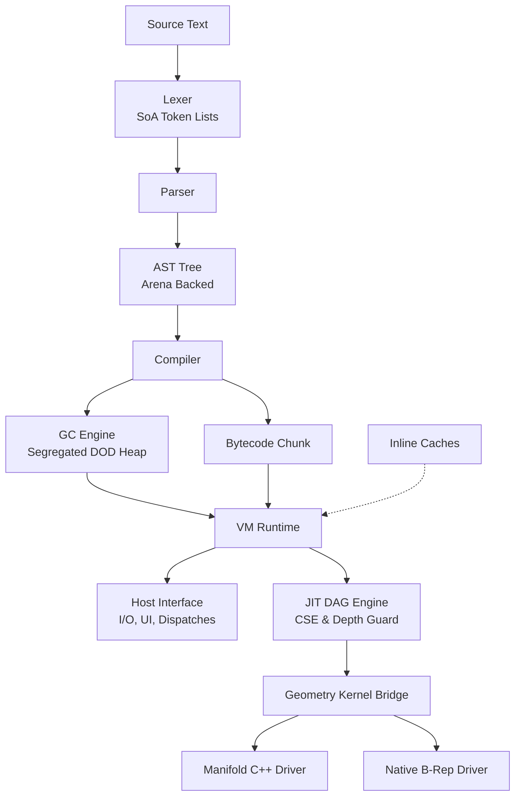
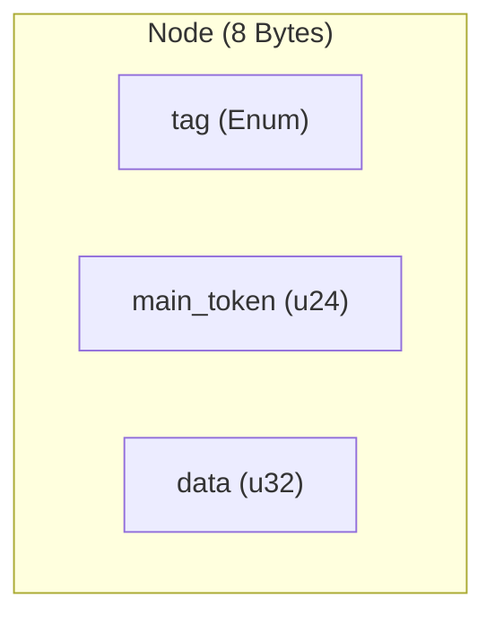
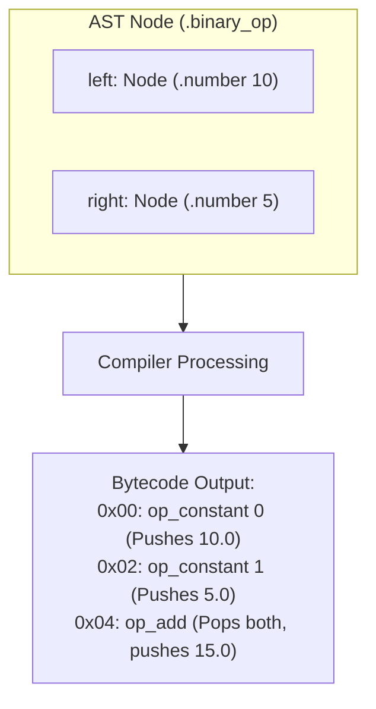
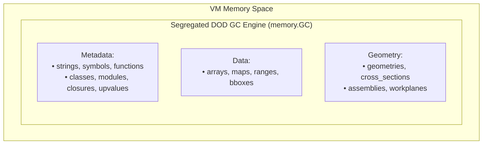
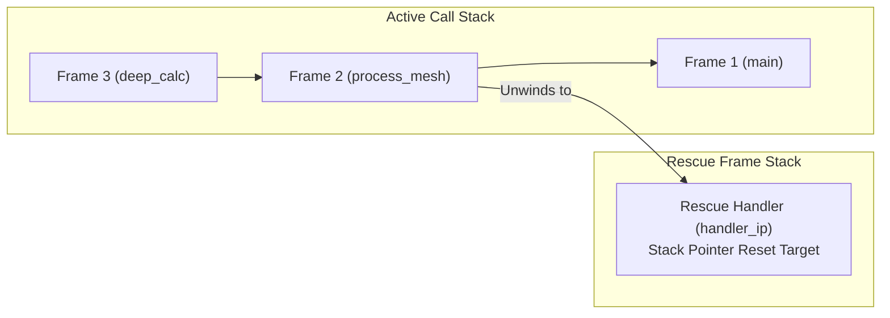
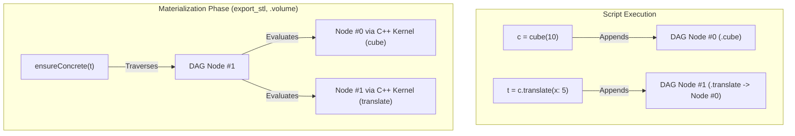

# KupCAD System Architecture & Memory Model

The KupCAD pipeline is structured as a multi-pass CAD language compiler and virtual execution environment, optimized for zero-waste memory access, explicit memory ownership, and deferred 3D geometry evaluation.



---

## 1. Lexical Analysis (The Lexer)

The Lexer scans raw source text and converts character streams into tokens using a **Structure of Arrays (SoA)** memory layout.

* **Zero-Allocation Scanning:** The Lexer does not allocate individual token objects. It scans strings directly from source memory and records byte offsets.
* **SoA Token Storage:** Tokens are stored across three contiguous, cache-line-friendly arrays:
* `tags: []Tag` (e.g., `.keyword_def`, `.number`, `.ident`)
* `starts: []u32` (Source code byte offsets)
* `lengths: []u32` (Token byte lengths)


* **Compile-Time Keyword Hashing:** Identifiers are evaluated via `std.StaticStringMap` at compile time, yielding $O(1)$ keyword resolution without heap allocations or string branching.
* **What starts no token:** a character the language doesn't use is an `.invalid` token, which the parser reports as "Unexpected character". That includes a `$` that starts no global name. Comments are `#` lines; `/* */` is no comment.
* **Escapes:** string tokens keep their escapes as written; the parser decodes each string piece through `core/string_escape.zig` when it builds the node, which also gives the formatter its rules for writing a value back. A backslash before a letter or digit must start a known escape (`\n`, `\t`, `\0`, `\u00e9`, `\u{1F600}`; a `\u` becomes UTF-8), and before other printable ASCII it stands for the character. Anything else, a surrogate or a code point past U+10FFFF is a `Problem` the parser reports at the escape itself. Single-quoted and `%q` strings lex as `.raw_string` and decode Ruby's way (`unescapeRawInto`: only `\\` and the delimiter, which is the byte before the token's text). The formatter writes either back as it was, its quotes or `%q` and its delimiter included: it wrote a `%q` string as a double-quoted one, which needs the escapes `%q` was picked to avoid, and refused one whose delimiter is `"` (`%q"a\nb"` would have held a newline).
* **Quoted symbols:** `:"..."` and `:'...'` are lexed as the string in the same quotes (`consumeString`), under their own tags: `.quoted_symbol` (its escapes decoded as a double-quoted string's), `.raw_symbol` (as a single-quoted one's) and, for one with `#{`, `.symbol_start` before the string's own `.string_mid`/`.string_end` tokens. The parser builds a `.symbol` node from either of the first two (`Builder.quotedNode`, `quotedNodeRaw`) and an `.interpolated_symbol` from the third, laid out as `.interpolated_string`, which compiles to the string and `op_to_symbol`. They kept their text as written, backslashes included, and ended at the first quote, so `:"a\"b"` was named `a\"b` and `:"a#{x}"` wasn't interpolated. `lexer.isBareSymbol` says whether `:name` reads a name back (`bareSymbolEnd`, the scan `consumeSymbolOrColon` makes), and `isLabelName` whether `name:` does (the lexer run on the name: an identifier or constant, not a keyword). `inspect` quotes any other name (`:"a b"`, which was `:a b`) and writes such a Map key with `=>`; the formatter writes a quoted symbol as it was and a `%i[]` word that needs it quoted (`%i[a-b]` is `[:"a-b"]`), and keeps `=>` after such a key. It wrote `[:a:]` for `%i[a:]` and `{ a b: 1 }`.
* **Heredocs:** a heredoc's token is its opener (`<<~NAME`), so tokens stay in source order (the LSP binary-searches them by offset). Its body is in a side table, `TokenList.heredocs` (token index, body start and length, in token order): the lexer reads the body when it meets the opener, lexes the rest of the line as code, and skips the bodies at the line's newline (`Lexer.heredoc_resume`, which is also where a second opener on the line finds its body). A token is one slice of the source, so a string that runs past the opener's line is a `.runs_into_heredoc` error rather than a token holding the body. The parser builds the string through `string_escape.unescapeHeredocInto`, which strips a `<<~` body's indentation line by line before decoding escapes, with an escape error placed in the body. The formatter ends a statement on the terminator line of the last heredoc opened on its last line (`Formatter.pastHeredocs`).

```zig
// Data layout inside TokenList
pub fn TokenList(comptime Tag: type) type {
    return struct {
        tags: []const Tag,
        starts: []const u32,
        lengths: []const u32,
    };
}

```

### Calls without parentheses

The parser reads spacing from the token offsets (`starts`/`lengths`; the lexer emits no whitespace tokens) and keeps the local variables in scope (`Parser.locals`, a set of source slices, with `local_order` so a body drops exactly the names it bound). Together they decide what follows a name, as in Ruby and Crystal: `puts -1` and `f *xs` pass an argument, `x -1` subtracts from the local `x`, `name(` holds the arguments and `name (` only groups the first one. Its scopes mirror the resolver's: a def, lambda, block, class or module body sees the names around it and drops its own at its end; `if`/`while`/`begin` bodies don't scope.

---

## 2. Abstract Syntax Tree (The AST)

The AST uses a **Data-Oriented Cache-Dense Layout**. Nodes avoid heap pointers and object graphs.

* **Compact Node Size:** Every AST `Node` is packed into **exactly 8 bytes** for L1 cache line density.
* **Index-Based References:** Nodes refer to child nodes, spans, or interned strings using 32-bit integer indices (`NodeIndex`, `StringId`) instead of pointers.
* **Side-Table Metadata:** Extended payloads (such as function parameters or multi-branch `case/when` lists) are appended to a contiguous `extra_data: ArrayListUnmanaged(u32)` buffer.
* **String Interning:** Identifier and string literal characters are stored in a dedicated String Pool. Duplicate strings map to the exact same `StringId`, turning name comparisons into $O(1)$ integer equality checks.



---

## 3. Bytecode Compilation (The Compiler)

The Compiler traverses the AST and translates nodes into virtual machine instruction streams called **Chunks**.



* **Locals vs. Globals:** Local variables live directly in evaluation stack slots. Name lookup is resolved at compile time to a 1-byte or 2-byte index (`op_get_local`, `op_get_local_wide`).
* **Constants:** a chunk's constants are deduplicated as they are made (`emitter.makeConstant`): a string by its text, every other value (numbers, interned symbols, objects) by its bits, each through one hash map lookup, so a 4000-number literal compiles in linear time (a scan of the constants comparing values would be quadratic). Arithmetic on literals is folded at compile time (`tryConstantFold`: `+ - * / % **` and the unary minus, so `-5 * 2` is the one constant `-10`); an overflow or a NaN is left to the VM to report.
* **Wide Instruction Variants:** To break standard 255-item operand boundaries without sacrificing bytecode density, instructions support `_wide` variants (e.g., `op_constant_wide`, `op_closure_wide`, `op_switch_wide`) using 16-bit operands.
* **Call Sites:** `op_call`, `op_invoke`, `op_super_invoke` and `op_yield` carry the argument count followed by a `CallFlags` byte (`chunk.zig`). `has_block` marks the last argument as the call's block, so a lambda passed as an ordinary argument is never mistaken for one; `spread` means the positionals arrive packed in one Array (the call used `*splat`), which the VM spreads onto the stack before dispatch. Keywords (including `**map`) always arrive as one trailing Map.
* **Parameters:** a function's frame holds the closure in slot 0, then its positionals (a splat among them), the keyword map when it takes keywords, the block, and one slot per keyword parameter; `ParamLayout` (`compiler.zig`) works the slots out once, and `compileClosureBlock` declares them (`declareParams`), takes each keyword out of the map (`emitKeywordParams`) and fills in the positionals' defaults (`emitPositionalDefaults`) before the body.
* **Upvalue Resolution:** When a closure captures a variable from an outer function, the Compiler generates an `Upvalue` mapping. The VM bridges this slot either directly on the evaluation stack or hoists it to the heap when the outer function frame returns.
* **`for` Loops:** A `for` loop keeps its iterable and the count of elements taken in two hidden local slots (`hiddenLocalSlots`), and `op_for_next` (u16 slot, 4-byte exit offset) pushes the next element or jumps out. Keeping the state out of the stack makes `break`, `next` and `return` work exactly as in a `while` loop. Ranges use the same `vm/sequence.zig` rules as `Range#each`, so both yield the same values.
* **Stack Depth Simulation:** The Compiler maintains `current_stack_depth` and `max_stack_depth` counters during code generation. `errdefer` stack restoration guards ensure that compilation failures (e.g., constant pool overflow) roll back stack depth counters cleanly to prevent compiler assertions from panicking.

---

## 4. Virtual Machine Runtime & Memory Management

KupCAD employs a **Segregated Data-Oriented Design (DOD) Tracing Garbage Collector** that manages all language objects and CAD handles through flat memory slices.



### Values

A `Value` is 8 bytes, NaN-boxed (`core/value.zig`): a number is its IEEE 754 bits, and nil, the booleans and heap pointers live in the quiet-NaN space `QNAN` marks (a pointer with the sign bit set too). So a number must never look like that space: `initNumber` turns every NaN into one canonical NaN (and -0.0 into 0.0). Otherwise a NaN with payload bit 50 set, which an f32 NaN widened to f64 can carry (an STL coordinate), would read as nil, a boolean or, with the sign bit, a pointer.

### Segregated DOD Object Tracking

Instead of a single heterogeneous linked list, `memory.GC` organizes object allocations into 18 dedicated `ArrayListUnmanaged` arrays (`strings`, `geometries`, `closures`, `instances`, etc.).

* **Built-ins arena:** objects that live as long as the VM are allocated from `GC.builtins`, an arena freed with the GC: every native (they all come from the standard library's tables) and the static names the library registers methods, classes and constants under (`GC.internStatic`, `VM.staticString`, which intern the literal without copying it). They are created marked and kept out of the sweep lists, so the mark phase passes over them (they reference no other object) and no sweep frees them; a script string with the same text is the static string. A VM makes about 100 allocations before it runs anything, where one per native and per name would be about 850.

* **Iterative Mark Phase:** Mark roots originate from evaluation stack slots (`vm.stack`), active call frames (`vm.frames`), global symbol tables (`vm.globals`, each imported module's `Namespace`, and builtins the main script shadowed), the import cache (`vm.modules`), pending unwind entries (`vm.unwind_stack`), static pre-interned literals (`static_true`, `static_false`, `static_nil`), and the constant pools of chunks that are still being compiled (`GC.live_chunks`, see below). Reference tracing uses an explicit `gray_stack: ArrayListUnmanaged(*Obj)` to prevent C-stack overflows on deeply nested object structures.
* **Chunks Under Compilation:** A top-level chunk is not reachable from any root until `interpret()` or `op_import` wraps it in a closure, yet compiling it allocates heap constants (strings, functions). `emitter.makeConstant` registers such a chunk in `GC.live_chunks` (a `ChunkRegistry`, `vm/chunk.zig`) so a collection triggered mid-compile cannot sweep constants already stored in it; the chunk unregisters itself when it is freed or once the script closure roots it. Nested function chunks are traced through their `ObjFunction`, which the compiler keeps on the VM stack while compiling the body. The chunk stays the caller's: once the run returns, `interpret` detaches it from the script function (`chunk = null`), which can outlive it, since every top-level `def` and lambda holds the script closure as its `self` (a module's export kept in a session's globals did, and the next collection read the freed chunk). The debugger's prompt does the same for the chunk it evaluates.
* **Test Hook:** `GC.stress` collects on every allocation. It exists only so tests can prove rooting invariants deterministically; production code never sets it.
* **Memory Limit:** `max_memory_limit` caps what the GC tracks: an object, a string's bytes or a list's growth past it fails with `error.OutOfMemory`, and the run raises an `OutOfMemoryError` (`VM.allocationFailed`). While that error is raised (`raising_out_of_memory`, set by `raiseError`), the cap is the limit plus `OUT_OF_MEMORY_RESERVE` (64 KB), room for its instance, message and backtrace: a heap filled to the byte by small allocations has none, and the run would end with "out of memory while raising an error", which no rescue sees. Only the raise gets the reserve, so the heap never passes the limit by more. The GC logs nothing of its own at the failing allocation: the error a script can rescue is the report.
* **Contiguous Sweep Phase:** Unreferenced objects are swept via contiguous slice iteration using $O(1)$ `swapRemove`. When an `ObjGeometry` holding a mesh of its own is swept, the GC destroys that kernel handle; a sketch holds none (its result lives in `cs_cache`, evicted after the sweep, see the result caches in §8).

### Stack Safety & Open Upvalue Patching

The VM evaluation stack (`vm.stack`) pre-allocates contiguous `Value` slots and grows dynamically via `ensureStackCapacity`.

When the evaluation stack reallocates to a new memory block:

1. The byte offset delta between the old and new stack base pointers is calculated.
2. The VM traverses the `open_upvalues` linked list and patches every active `location` pointer (`u.location = new_base + offset`).

This prevents open upvalues from dangling or pointing to deallocated stack memory during runtime stack expansions.

### The Dispatch Loop's Checks

Before each instruction the loop reads the cancel token (a relaxed atomic load: it only has to see a cancel soon) and one flag, `hooks.active` (`vm/instruction_hooks.zig`): whether the instruction budget, zealous GC or the debugger's stepping is on. Only then does it call `beforeInstruction`, which does what is on. `InstructionHooks` keeps the flag through its setters (`setLimit`, `setZealousGc`, `setStep`), which every host and test uses. Testing each on every instruction would cost a fifth of a tight loop's time (1M iterations, ReleaseFast: 36.6 ms against 46.6 ms; a loop of calls 17.4 against 21.4 ms). Where a host sets a budget (the language server, the browser) the count runs on every instruction.

The switch itself writes out the short, frequent instructions (constants, locals, arithmetic, jumps, upvalues, globals, calls, `@x` reads) and hands every other one to an `execute*` function, whose `.ok` means the run goes on: an error the instruction raised was rescued, and the loop resumes at the handler. Anything else ends the run (`ended`). Written inline, a rescued allocation failure would return from the run itself, so a script that rescued an OutOfMemoryError (spreading an array past the memory limit, say) would stop there as if it had finished.

### Inline Caching (IC)

Property getters/setters (`op_get_property`, `op_set_property`) and method invocations (`op_invoke`) use a **2-Way Polymorphic Inline Cache (PIC)** (`InlineCache` in `chunk.zig`). A property read whose name is a method of the receiver's class (a reader, `b.width` with `def width`) caches that method at the read site, as a call site does (`InlineCache.cachedMethod`), instead of finding no field and looking the method up, class chain and private name, on every read.

```zig
pub const InlineCache = struct {
    cached_class_1: ?*value.ObjClass = null,
    cached_val_1: value.Value = value.Value.initNil(),
    offset_1: usize = 0,

    cached_class_2: ?*value.ObjClass = null,
    cached_val_2: value.Value = value.Value.initNil(),
    offset_2: usize = 0,
};

```

* **Monomorphic Hit:** If the receiver's `ObjClass` matches `cached_class_1`, field access or method dispatch executes in $O(1)$ time bypassing table lookup.
* **Polymorphic Graduation:** If a second receiver class is encountered, slot 2 (`cached_class_2`) is populated to accelerate multi-type call sites without cache thrashing.


**Global caches.** `op_get_global` and `op_define_global` carry a second 16-bit index, of the site's `GlobalCache` (`chunk.zig`): the slot its name resolved to (`VM.globalSlot`, in `globals`, a module's namespace or `shadowed_builtins`) and the VM's `global_generation` at the time. While the generation is unchanged a read is one load and an assignment one store, so a loop over top-level variables runs nearly as fast as one over locals (1M iterations, ReleaseFast: 57 ms, locals 47 ms; hashing the name on every read, 105 ms). A new generation is taken whenever a table's layout can move a slot: a new name (`defineGlobal`, `defineInNamespace`, `setGlobal` for the host's globals), a builtin the main script shadows, a removal. Assigning a name that exists goes through `getEntry`/`getPtr`, which never rehash. Generations come from one process-wide counter, so a cache filled under one VM never matches another's.

### Dictionary Interning & The Scratch Arena

* **Strict Value Dictionaries:** All object dictionaries (`methods`, `class_fields`, `instance_fields`, `map`) strictly require GC-tracked `Value` types (Interned Strings or Symbols) as keys rather than raw `[]const u8` slices. This guarantees that dynamically generated dictionary keys are safely traced during the GC Mark phase.
* **Scratch Arena Lifecycle:** The VM utilizes a secondary `scratch_arena` (an `ArenaAllocator`) for ephemeral string formatting, interpolation, and method resolution. It is reset (`.reset(.retain_capacity)`) when the outermost `runUntil` returns, even after an unwind, recycling the memory without OS-level thrashing. A nested run (a native calling a block through `callClosureSync`) and error backtraces never reset it, because the native that started them may still be holding scratch memory.

---

## 5. Exception Handling & Stack Unwinding

When `raise(...)` or an internal VM error occurs:



1. **Rescue Registration:** Entering a `begin` block emits `op_setup_rescue`, pushing a `RescueFrame` recording `handler_ip`, target `stack_top`, frame count, and `open_upvalue` state.
2. **Throw Execution (`op_throw`):** `executeThrow` peeks the thrown value (it stays rooted in its slot), raises a class as a new instance of it (`instantiateRaisedClass`), wraps any other value that is no error into a `RuntimeError` with the value for its message (`wrapInRuntimeError`), then reports it as uncaught (`reportUncaught`) or hands it to the innermost rescue (`unwindToRescue`). Every error instance gets its `message` and `backtrace` through `VM.setErrorFields`, which roots both while it sets them, and they are read back through `VM.errorField`. Errors raised by the VM and natives go through `VM.raiseError(kind, fmt, args)`: `vm/error_kind.zig` lists the kinds, `stdlib/exceptions.zig` registers one `StandardError` subclass per kind (cached in `VM.error_classes`), and the message carries no class prefix. A compile-time check rejects a format string that starts with a kind name or ends in a newline, so the convention can't drift.
3. **Stack Unwinding:**
* Open upvalues above the target stack height are closed (`closeUpvalues`).
* Dead `CallFrame` records are popped off the call stack.
* VM evaluation stack slots are shrunk back to `RescueFrame.stack_top`.


4. **Handler Execution:** Instruction pointer `ip` is set to `handler_ip`, and the error payload instance is pushed onto the evaluation stack.

### Unwinding Across Native Boundaries

Native (Zig) functions such as `Array#each` run script blocks through `callClosureSync`. When a block raises, `executeThrow` has already unwound the frames, but every native between the raise and the handler still returns `error.Unwind`, and their `defer`s (handle scopes, scratch resets) may rewrite `stack_top` on the way out. To keep the handler's view of the stack intact:

* `executeThrow` records one `UnwindFrame` (`err_val`, `stack_top`, `frame_count`) and clears any older entry — at most one is ever live, because no bytecode runs while an unwind propagates.
* Each native boundary (`executeNative`, native constructors, `op_yield`, `op_import`) calls `restoreAfterUnwind`, which re-applies the saved stack layout; the boundary whose caller frame owns the handler consumes the entry.
* A native that calls `raiseError` and then returns an ordinary error is detected via `throw_seq`/`last_throw_target`, so the VM never raises a second "Native Execution Error" on top of an exception that was already thrown (and possibly rescued).
* `return`, `break` and `next` inside `begin … rescue … ensure` emit `op_pop_rescue` for every enclosing handler and inline the `ensure` body before the jump (`compiler.emitUnwind`).

**Known limitation:** `ensure` bodies do not run when an exception propagates out of the block *uncaught* — only on normal exit, `return`/`break`/`next`, or when a `rescue` clause in the same block handles the error.

---

### Top-Level Scopes

The main script's top-level variables, `def`s and classes live in `vm.globals`, together with the builtins the host registers. Each imported module gets its own `value.Namespace`, created by `op_import`. The compiler stamps it on every `ObjFunction` it compiles for that module (`ObjFunction.namespace`), so a module's functions, methods and blocks resolve globals in the module's namespace wherever they are called from. `op_get_global`, `op_define_global`, `op_class` (class reopening) and `defined?` all go through `VM.lookupGlobal`:

* main-script code reads and writes `vm.globals`;
* module code reads its own namespace first, then builtins only. Names the main script defined itself (`script_defined_globals`) are skipped, and a builtin the main script shadowed is served from `shadowed_builtins`. Module code writes only to its own namespace.

The hidden `__exports__` object that `export` builds lives in the module's namespace and is handed to the importer by `op_import`. Assignment inside a `def` always creates a local (`Compiler.writesScriptGlobal`); methods only *read* top-level variables.

---

## 6. Host Platform Interface (The Host)

The `Host` interface (`vm/host.zig`) decouples the VM runtime core from OS dependencies, standard output streams, file I/O, and UI binding layers.

```zig
pub const Host = struct {
    binary_handler: ?*const fn (vm: *VM, op: chunk.OpCode, a: value.Value, b: value.Value) anyerror!value.Value = null,
    mesh_destructor: ?*const fn (handle: GeometryHandle) void = null,
    compile_module: ?*const fn (vm: *VM, path: []const u8, source: []const u8, namespace: *value.Namespace) anyerror!*chunk.Chunk = null,
    print_handler: ?*const fn (vm: *VM, message: []const u8) void = null,
};

```

* `print_handler`: Intercepts calls from `puts()`, `print()`, and `inspect()`. Routes output to stdout in CLI mode or UI widgets in WebAssembly/GUI modes.
* `binary_handler`: Handles CSG binary operations between geometry objects.
* `mesh_destructor`: Called when `ObjGeometry` handles are freed by the GC to release C++ mesh memory.
* `compile_module`: Compiles an imported module (`import "lib.kup"`) into its own namespace (`compiler/module_compiler.zig`, registered by the standard library). The VM reads the file, checks the cache, the depth limit and cycles, verifies and runs the chunk; parsing and compiling are the host's, so the VM doesn't import the compiler (they imported each other).

### Parameter Values

A host gives a script's parameters their values as `ParamValues` (`core/param_values.zig`): names to a number, a boolean, or text, owned, in the order given, a later value replacing an earlier one. `kupcad build` fills them from `-p name=text` and `-P file.json` (`putJson`, which refuses JSON that isn't one object of numbers, strings and booleans, naming the parameter); the API takes them in `BuildOptions.params`, the session in `setParams`, and WebAssembly as a JSON object (`build_model_wasm`). `api.injectParams` puts them in the VM's `params` Map, text as a String, and `param()` reads each by its default's type (`core/params/`): text becomes a finite number, a boolean (`true`/`false`/`1`/`0`), a String or a Symbol. Reading text by type in `param()`, which knows the type, keeps the hosts from having to know it: `-p` used to take numbers only. JSON is read by `core/json_input.zig`, which the project config and `import_json` use too: one parser, so they accept the same JSON (a key written twice is an error) and place a syntax error at its line and column.

### Data Files (`import_json`)

What an `import` reads is `core/import_kind.zig`'s to say, for the compiler, the parser, the workspace and the watcher alike: the `type` of its `with { }` (`"kup"`, `"stl"`, `"step"`, `"json"`), else its path's extension in any case, else a module. The parser reports a `with { }` with another key or an unknown type (`import-attribute`), and a file import naming more than one variable (`file-import-names`); the attributes were parsed and then ignored by everything, so `with { version: 2 }` meant nothing. A file import compiles to a call of its kind's built-in (`Kind.importer`) with the resolved path. The AST records whether an import's names are in braces (`ImportStmt.braced`), which mean something else for a file: a bare name binds its value, braces take a JSON file's keys (`Kind.hasKeys`; a mesh has none), compiled as `import_json(path, ["a", "b"])` and an index per name. The formatter keeps them as written; it printed braces always, so `import gears from "./gears.json"` came out braced. `import_json(path)` (`stdlib/json.zig`) reads the file with `json_input` and turns it into script values in one recursive pass: an object becomes a `JsonObject`, an array an Array. A `JsonObject` (`ObjJsonObject`, its own object type and GC list, class `JsonObject`) holds its entries in a `ValueMap`, the same storage a Map has, with the file's Strings as keys, plus where it is: the file (`source`) and its path in it (`path`, as `gears[0]`), interned Strings. The VM looks a key up with `jsonObjectGet`: a Symbol key is turned into the String of the same name by looking it up in the interned strings (`vm.strings`), not by making one, so a lookup allocates nothing and a name never interned is no key. A Map was left as it is, since one where `"a"` and `:a` are one key would change the language and slow every lookup, keyword arguments included. The object is read-only (`[]=` is a `TypeError`), so `fetch` and `dig` (`stdlib/classes/json_object.zig`) can word a `KeyError` with `Where`, the file and the path, and `to_h` copies it into Maps. Each container is rooted on the VM stack while its entries are read (a `HandleScope` per level, with the stack reserved for `MAX_JSON_DEPTH` levels up front).

A font file (`Kind.font`: `.ttf`, `.otf`, or `type: "font"`) is read by `import_font` (`stdlib/files.zig`) into a `Font` (`ObjFont`, an object type and GC list of its own, class `Font`): the file's bytes, copied into the GC's tracked memory so they count against `vm_memory_limit` and are freed with the Font, and its name from the font's name table (`text.fontName`: the full name, else family and style; the file's name for a font that gives none or one past `MAX_FONT_NAME_BYTES`). Before that, `text.importedFace` checks the file is a face `text` can draw: tatfi reads it, it has TrueType (glyf) or CFF outlines, and a cmap; past `limits.MAX_FONT_BYTES` it isn't parsed at all. `text(font:)` parses a face from the bytes at each call, which is cheap (tatfi reads the table directory, not the glyphs) and means nothing borrows the bytes past the call; the Font, an argument, is rooted meanwhile. Whoever wrote the script chose the file, so `-Dfuzz-target=fonts` (`src/importers_fuzz_test.zig`) fuzzes it from the fonts in `src/core/test_fonts/`, through the face check, the name, the cmap and `text`'s outlines and kerning, nightly in a job of its own.

Every file a run reads as data goes through `VM.readScriptFile`, which notes its path in `files_read` (whether or not it could be read) before reading it through the VFS; `import_stl` uses it too. A session's modules are the root and every module it imports or re-exports from, read through the VM's file system (`ScriptSession.loadImports`; in the editor the open documents come first, then the disk). Whether a module that ran again changed for its importers is its fingerprint (`fingerprintOutput`): what the viewport shows (its meshes and materials) and what importers see (`daemon/exports_fingerprint.zig`: each export by content, a shape by its node's hash in the geometry graph). An export that isn't hashed by content (a function, a class, an object) counts as changed whenever its module runs again. A module without a shape was fingerprinted by its source alone, so one that exported a value computed from an import, or re-exported it, never passed a change of that import on; one that runs again and exports the same values still stops the re-evaluation. A `ScriptSession` copies the files a run read into the module's `SessionNode.files_read` after each run, failed runs included, and `markDataFileEdited(path)` marks the modules that read a file (and their importers) stale, with `data_changed` making them run again though their source hash is the same. The watcher keeps the data files' mtimes beside the modules' (`data_mtimes`, owned keys, a missing file as 0), records new ones after every build and polls them with the modules, so one change of either kind rebuilds once.

### Parts List

`named(name)` adds a `set_name` node (layout `target_value`: the operand and the name's id in the builder's `part_names`, interned and kept through compactions as the settings table is); it evaluates to a clone of its operand, a name being the parts list's alone. `stdlib/bom.zig` walks each Solid down through `translate` and `rotate` to its shape, taking the outermost `set_name` and `set_material` on the way, and on through a `mirror`, `scale` or `transform_matrix` (which is the shape: a mirrored copy is another part) for the name and material it was made with. Solids are grouped by the shape's node hash with the name and the material's content (`MaterialDef.hashInto`, which takes the `density` too), each part measured once, from its shape before its placement. `bom` gives the rows as Maps; `api.billOfMaterials` writes the final model's (`api.collectModel`, the same Solids an export takes) as JSON for `kupcad build --bom`.

### The model and the formats

`api.collectModel` gathers the script's final value into a `Model`: its Solids and Sketches, from the value itself, an Assembly's parts or an Array's items (Arrays nested to `MAX_MODEL_NESTING`, each item numbered for messages: "item 2.1"), with the ghosts the script showed and an Assembly's name. A value that is neither raises a TypeError in the VM naming it; a Number in the Array, and an Array inside the Array with everything in it, were silently left out. `api.ExportFormat` says what each format holds and needs (`dimension`, `extensions`, `supportsDraco`, `showsGhosts`, `requiredEngine`), which the CLI's extension table, help text, `--draco` rule and STEP's engine switch read instead of keeping their own, and `api.requireExportable` is the one check of a model against a format before any exporter runs: a 3D format refuses a Sketch (extrude it) and a model with no Solid unless the format shows ghosts and there are some. The refusal is raised in the VM, so the CLI, the API's `BuildDiagnostic` and the browser build report it alike (they reported a bare `NoGeometry`). An exporter's own `error.NoGeometry` is left for what has no triangle to write.

### OBJ

An `.obj` export (`exporters/3d/obj.zig`) is one `o` object per Solid of the model, in the model's order, named after its part in the parts list (`bom.group`) and numbered from its second copy on; vertices and normals are indexed from 1 across the whole file, as OBJ does, each face with a normal of its own (computed from its winding) so CAD edges stay sharp in viewers that smooth by shared normals. It is written in millimetres and Z up as the script made it, since OBJ carries no unit or up axis, and names no material unless `kupcad build --mtl` asks for the library (`buildMaterialLibrary`: the default grey, then the VM's materials as `material_N` by slot, colour as `Kd` and `Ka`, alpha as `d`), which the CLI writes beside the file, named after it, and the faces then name their materials in runs. The triangles' grouping by material slot is `exporters/3d/material_groups.zig`, shared with glTF's primitives; `api.ExportOptions` carries the flags (Draco, the library's name) to the exporters.

### 3MF and Split Parts

A `.3mf` export (`exporters/3d/threemf.zig`) is the parts list's grouping (`bom.group`, which keeps each copy's `Placement`) written as a 3D Manufacturing Format package: one `<object>` per part, its mesh the part as made (`bom.madeOf`: the shape with its material and name, without the placement), and one build `<item>` per copy with its transform. A copy's placement is its translates and rotates composed, outermost first (`core/placement.zig`); a rotation is built as Manifold's `CsgNode::Rotate` builds it (about x, then y, then z, with its exact quarter turns), so an item lands where the kernel puts the Solid, which `placement_test.zig` checks against the kernel's own meshes. Colours are base materials, one per material slot (the default first), referenced by triangle. The package is a zip (`exporters/zip.zig`) of stored files with their CRC-32s, names UTF-8 and times fixed, so the same model makes the same bytes. `kupcad build --split dir/` writes each part as made in a file of its own (`api.exportPartsFromVm`), named by `PartFileNames`.

### Native Functions

Built-ins are `ObjNative`s: a `NativeFn` and the name scripts know them by (`Array#map`, `Math.sin`, `extrude`), used in error messages and by the profiler. A `NativeFn` receives `NativeArgs` (`core/value.zig`): the arguments on the VM stack with the receiver just below them, their count, and `has_block` from the call site's `CallFlags`, so a lambda passed as an ordinary argument is never mistaken for the block.

Natives are written as typed Zig functions and turned into `NativeFn`s by `wrapMethod` / `wrapGlobal` (`stdlib/classes/common.zig`). The wrapper unboxes each parameter (an optional one may be omitted, a `[]const Value` takes the rest), passes the block only to a `?*ObjClosure` (optional) or `*ObjClosure` (required) last parameter, and raises an `ArgumentError` for a wrong argument count or a `TypeError` for a wrong type, naming the native and the argument.

---

## 7. Geometry Kernel Bridge & Drivers

The `kernel/` module abstracts specific 3D solid modeling backends behind a unified, polymorphic interface (`GeometryKernel`).

### Tagged Geometry Handles

`GeometryHandle` and `CrossSectionHandle` wrap foreign C++ opaque pointers inside tagged structs:

```zig
pub const EngineType = enum { manifold, brep_native };

pub const GeometryHandle = struct {
    engine: EngineType,
    ptr: *anyopaque,
};

```

### Backend Engine Drivers

* **Manifold Driver (`kernel/engines/manifold/driver.zig`):** Translates calls into C FFI bindings (`bindings/manifold/manifold.zig`), communicating with the C++ Manifold mesh library.
* **Native B-Rep Driver (`kernel/engines/brep/driver.zig`):** Executes exact boundary representation operations using topological structures (`Vertex`, `Edge`, `Face`, `Solid`). Locus is unfinished: most of its operations are still stubs, so the driver's `supports` lists what is real (cubes, cylinders, polyhedra, sketches, hulls of flat-faced solids, STEP export) and everything else is refused before it runs (see *Engine features* below). A copy (`BrepSolid.clone`) duplicates the solid's arenas, NURBS data included (an identity transform would keep only points, lines and planes).

### Ownership & Engine Rules

* **Single Owner:** Every kernel function that returns a `GeometryHandle`/`CrossSectionHandle` returns a *new* handle owned by the caller. Inputs are only borrowed: a driver must never return, consume or destroy an input — not even on no-op or fallback paths (`material`, `simplify`, `decompose`, single-operand `batchBoolean`), where it returns `kernel.clone(input)` instead. The alternative is two owners (the DAG cache and a GC'd `ObjGeometry`) destroying the same C++ pointer.
* **Same Engine:** Operands of multi-input operations must come from the same engine. `kernel.zig` and both drivers check `engine` tags at runtime and fail with a null result; the DAG evaluator surfaces this as `EngineMismatch`. `std.debug.assert` is never used for this, because it is compiled out of `ReleaseFast` builds.

---

## 8. Lazy JIT Geometry Evaluation (The DAG)

KupCAD uses a **Directed Acyclic Graph (DAG)** to defer expensive C++ kernel calculations until materialization.



### DAGBuilder Architecture

* **Cache-Dense 8-Byte Nodes:** Every `DAGNode` contains a 1-byte `tag`, 1-byte `flags`, and a 4-byte `data` index into flat side-table arrays (`extra_data`, `numbers`, `poly_points`, `poly_faces`).
* **Side tables on the general-purpose allocator:** the tables grow as the script builds geometry and are freed one by one in `deinit`. An arena would keep every outgrown buffer until the end, so a DAG would hold about twice its size (240k nodes: 56 MB of peak memory against 31 MB).
* **Common Subexpression Elimination (CSE):** Nodes are hashed deterministically using `Wyhash`; variable-length payloads (polygon contours, polyhedron points/faces, batch operand lists) are hashed with their lengths so differently-split inputs never collide. The `dedup_map: AutoHashMapUnmanaged(u64, DAGNodeIndex)` finds a candidate in $O(1)$, and `nodesEqual` then compares tag, flags and side-table payloads structurally before reusing the index — a raw 64-bit hash collision derives a fresh hash instead of merging two different nodes.
* **Concrete Leaf Nodes:** Results that cannot be recomputed from the graph (`decompose` parts, `simplify` output) are registered with `addConcrete(handle)` as `.concrete` nodes. The `DAGBuilder` owns these meshes (`concrete_leaves`), never in the evictable cache. After an outermost run in a VM that runs script after script (`runs_many_scripts`, set by `ScriptSession`: the editor's worker, the REPL; a build's VM runs one script and skips it) (`VM.tidyGeometryGraph`, at the end of `interpret`, when no native holds node indices of its own) a collection finds the live shapes, `liveNodes` the nodes they are made from, and `releaseUnreachableLeaves` destroys the meshes of the other leaves, which would otherwise stay until the VM went, a mesh per run in the editor's long-lived worker. It can't happen in a collection: a native that has just made a leaf holds its index before any object does. A leaf is hashed by a serial, never its slot, so no later leaf takes over the results cached under its hash; `CONCRETE_NODE_SENTINEL` is a named sentinel that every child lookup rejects with `InvalidDAGNode` rather than indexing out of bounds.
* **Payload Layouts:** `dag.layoutOf(tag)` says where each kind of node keeps its payload: numbers at `data`, operands in `extra_data`, an operand and a numbers index, a polygon's point range, a polyhedron's ranges, a concrete leaf's slot. The verifier checks every node against it, `operandsOf` finds a node's operands by it, and the node hash and the equality check that confirms a hash hit both walk a node's payload by it, part by part (`payloadParts`: operands, numbers, a plain value, a polyhedron's points and faces, a leaf's serial), so the two can't disagree about what a node holds. A polyhedron is hashed by the mesh hash computed once when it is made, not its points.
* **Compaction:** the builder only appends, so a long-lived VM (the editor's worker, one session for the whole editing) would keep every node it ever made. Once the tables (`tableBytes`) have doubled since the last compaction, and are past 1 MiB, the end of an outermost run (`VM.tidyGeometryGraph`, as for the leaves' meshes) compacts them, if at least half the nodes are garbage (a graph that is mostly live is left, the next try put off until it doubles): `compact` copies the nodes live shapes are made from, in order, into new tables by `layoutOf`, keeps their hashes (so `dag_cache` and `cs_cache` stay valid and a model's fingerprint doesn't change), rebuilds `dedup_map`, drops the rest with their leaves' meshes, and returns the renumbering the VM applies to every `ObjGeometry` and `ObjCrossSection`. Copying is all or nothing: without room, nothing changes and the next run tries again. Debug and test builds verify every copied node.
* **Node Verification:** in Debug and test builds every node is checked as it is added (`vm/dag_verifier.zig`), as the bytecode verifier checks a chunk: its payload lies inside the side tables, its operands are earlier nodes of the kind the operation takes (a sketch to extrude, a solid to translate), its numbers are finite, a polyhedron's faces name its own points, and its settings id exists. A malformed node is a bug in the native that built it, so the builder panics there, with that native on the stack, rather than the evaluator meeting it later as a kernel crash or a wrong part. An operand that is no node at all is refused in every build, with `error.InvalidDAGNode`, by the hasher.
* **Snapshot Rollback Safety:** Adding nodes uses snapshot guards (`StateSnapshot`) and `errdefer` blocks. If an `OutOfMemory` error occurs during node insertion, all side-table buffers shrink back to their pre-call length.

### Iterative Evaluation Engine & RAM Budgeting

`dag_evaluator.zig` evaluates symbolic trees iteratively, completely decoupling DAG depth from the host OS C-stack.

* **Frame & Value Stacks:** Evaluation is managed via two heap-allocated dynamic arrays: `EvaluationFrameStack` (for post-order tree traversal) and `IntermediateStack` (for temporarily holding `ValueHandle` wrappers around C++ pointers). Each node is met twice: first its operands' frames are pushed (`pushOperands`), then, once they are on the value stack, the node is built (`executeNode`, which hands each kind to `buildLeaf`, `executeSolidOp`, `executeSweep` or `executeSketchOp`) and its result checked and cached (`cacheResult`).
* **Union chains become one batch:** a script's `acc = acc + part` loop builds a chain of binary unions, `((a + b) + c) + d`; the evaluator flattens the chain under a union node into its operands (`collectUnionOperands`) and unions them in one kernel call, as `union([...])` and the repeat patterns (which build one `batch_union_op`) do, instead of N − 1 calls over a growing result (300 parts: 60× faster). A link of the chain already in `dag_cache` is one operand, so after an edit only the new parts join the cached rest; a link asked for on its own is evaluated as the chain it is.
* **No result checks after a transform:** every freshly built solid is checked once (`kernel.problem`, the vertex budget) before it enters the cache, except the result of a pure transform (`isPureTransform`: translate, rotate, scale, mirror, a matrix), which is its operand's mesh moved: the operand was checked, and the numbers are finite (the stdlib refuses the others). Manifold applies transforms lazily, composing a chain into one matrix, and the status or vertex-count query applied them at every link, so a chain of 200 translates cost 12× one.
* **Infinite Depth Support:** By avoiding recursive C++ function calls, KupCAD can evaluate extreme DAG structures (e.g., 5,000+ nested transformations) without triggering C-stack overflows or segfaults.
* **Per-Node Settings:** geometry is evaluated lazily, so each `DAGNode` records the settings it was created under: its spare 16 bits hold a `SettingsId` into `DAGBuilder.settings_table` (distinct `EngineConfig`s, interned; 0 is the defaults). The VM's `config_stack` holds these ids and is changed only through `setConfig` / `pushConfig` / `popConfig`, which also set the builder's `current_settings`. The evaluator builds each node with its own settings (engine, tolerance, vertex budget, `simplify_coplanar`), not those in force at evaluation, so `CAD.with_config` holds for what is evaluated after the block. The node hash covers the settings' `resultHash` (by content, so it stays valid for a cache that outlives the table), which makes it the whole `dag_cache` key: the same node under two engines yields different handle types, and under two tolerances different solids, so they are different nodes.
* **Engine features:** `kernel.Feature` lists what an engine may lack, and each driver answers `supports(feature)` (Manifold has everything; the B-Rep driver lists what Locus implements). The evaluator and the stdlib call `vm.requireFeature(engine, feature)` before the kernel, which raises a `NotImplementedError` naming the feature, so a Locus stub never answers 0 or an empty solid in a script; `vm.warnUnsupported` does the same for materials, once per run, as a warning. The exporters, the LSP hover and the daemon's change hash check `kernel.supports` too.
* **Settings travel with B-Rep solids:** the kernel's creation functions (`kernel.cube`, `kernel.circle`, ...) take the active `EngineConfig`. The B-Rep driver turns it into a Locus `MathEnv` (`mathEnv`: every distance tolerance is `tolerance`, the angular one is fixed) stored on the `BrepSolid`, and every solid derived from it inherits that env, so a whole model is computed with one tolerance. `Resolution` is defined in Locus (`math_env.zig`), which can't import KupCAD, and re-exported by `engine_config.zig`, so the B-Rep tessellator and the mesh engine cut curves by the same rule.
* **Result caches:** a solid's result is kept in `VM.dag_cache` and a sketch's in `VM.cs_cache`, both keyed by node hash and owning their handles; the evaluator and `ensureConcreteCrossSection` hand them out borrowed. Keyed by node, a sketch is cut once however many extrusions or `area` calls use it, even built twice (ten extrusions of a 2,000-point outline, ReleaseFast: 18 ms, against 44 ms cached on the `ObjCrossSection` alone). After each sweep the GC evicts from both, through `evictUnreferenced`, every result whose node no live solid or sketch refers to. That bound is by reachability, not by age: over 200 edits of a document in one `ScriptSession` the solid cache went back to its 8 live entries after every collection, so there is no LRU on top. The `DAGBuilder`'s own tables are bounded by compaction (above).
* **Ownership on Error Paths:** Each entry on the intermediate stack records whether the evaluator or the cache owns its handle. When evaluation fails (`RamBudgetExceeded`, `Cancelled`, a kernel null), only evaluator-owned intermediates are destroyed; cache-owned operands and concrete leaves stay alive.
* **RAM Budgeting:** Before an evaluated mesh is committed to the cache, the evaluator checks the C++ kernel's vertex count against the current `EngineConfig.max_vertices`. If it exceeds the limit, the engine safely destructs the intermediate handles and throws a `RamBudgetExceeded` exception, protecting the host hardware from runaway memory exhaustion. Because that check runs *after* the kernel has allocated, two things bound the mesh *before* it is built: user-supplied tessellation counts are capped (`limits.MAX_SEGMENTS`, see §10), so a single primitive cannot request a multi-gigabyte mesh, and an operation whose output multiplies its inputs is estimated first (`checkEstimatedVertices`: a Minkowski sum is about `verts(a) × verts(b)`, an extrusion `profile × (slices + 2)`, a revolution `profile × (segments + 1)`) and refused with the same error.
* **Release builds:** `build.zig`'s `cxxFlags` adds `-DNDEBUG` to Manifold, Draco and the C++ bindings outside Debug builds, so release binaries don't run the libraries' internal asserts; Debug builds keep them.
* **Out of memory in the kernel:** the C++ libraries are built with `-fno-exceptions`, as LLVM and Chromium are, so an allocation that fails inside Manifold aborts the process instead of unwinding into Zig. That is a deliberate trade: wrapping all 68 entry points the driver uses in `try`/`catch` would cost a C++ shim per call and still differ on wasm, where there are no exceptions. The budgets above are what keep an untrusted script from reaching that point.

---

## 9. Content-Addressable File System (CAFS) & Package Integrity

The package manager (`pkg/`) downloads package archives, verifies them, stores every file as a content-addressed blob under `~/.kupcad` (or `KUPCAD_HOME`), and links the workspace's `.kupcad/pkg/<alias>` to those blobs.

* **Streaming Extraction:** `Cafs.extractTarball` walks the gzip'd tarball with `std.tar.Iterator` and writes each regular file straight into the blob store — the archive is never materialized as a directory tree. Every byte of an archive is attacker-controlled, so:
  * symlink and hardlink entries are skipped (never created), which closes the "plant a link, then write through it" escape;
  * entry paths are sanitized (`sanitizeEntryPath`: no absolute paths, `..`, `\`, `:` or NUL; duplicates rejected);
  * decompressed bytes and file counts are capped (`pkg/limits.zig`), guarding against gzip/tar bombs.
* **Atomic Blob Writes:** Each blob is streamed to a randomly named `tmp/blob_*` file opened exclusively, hashed, then `rename`d to its final content-addressed path, so a crash or a concurrent process can never leave a half-written blob under its final name.
* **Lockfile & Integrity:** `kupcad.lock` (`LOCKFILE_VERSION` 1.0.0) pins every dependency to a commit and a length-prefixed Merkle `integrity` hash over the package's `path → blob` map. Paths are relative to the package: a git host archive's top folder (`repo-<sha>/`, `Cafs.ArchiveLayout.wrapped`) is stripped at extraction. `install` loads the existing lockfile, re-resolves only unlocked refs or ones the manifest changed, verifies both cached and freshly downloaded content against the locked hash (`IntegrityMismatch`), and refuses entries without integrity (`LockfileMissingIntegrity`). A lockfile of any 1.x version is read and saved back as 1.0.0; another major, a version that doesn't parse or none is `UnsupportedLockfileVersion` at load, with a warning to upgrade kupcad or delete `kupcad.lock`, rather than an `IntegrityMismatch` later. `kupcad.lock` isn't written when resolving, verifying or linking fails.
* **Input Validation:** Aliases, hosts, refs and repo segments are validated (`pkg/validate.zig`) before they become symlink names, URLs or SQL parameters; transitive dependencies may only point at public git hosts, and all SQL in `store.zig`/`gc.zig`/`health.zig` uses bound parameters.
* **One HTTP client per install:** the `Resolver` owns one `Fetcher` (one `std.http.Client`) for every package it installs, so connections are pooled and the system's root certificates are loaded once. Registering a package prepares its two insert statements once and runs them per file (`Stmt.exec`).
* **Store Schema:** SQLite (`store.zig`) with a `user_version` migration chain; packages are keyed by `(id, commit_sha)` so several commits of one package can coexist, and GC/doctor evict package rows together with their blobs.

---

## 10. Input Limits & Sandboxing

KupCAD evaluates untrusted scripts in three places — the CLI, the LSP (just by opening a file) and WebAssembly. Release builds use `ReleaseFast`, where Zig's safety checks and `std.debug.assert` are compiled out, so every user-reachable bound is a real check that returns an error. The C and C++ libraries (Manifold, SQLite, Draco) are compiled without UBSan outside Debug builds (`cxxFlags` in build.zig): Zig gives C code trapping UBSan in ReleaseSafe, which cost the kernel its arithmetic checks on every operation and aborted the process on a finding; the WebAssembly flags say the same.

| Limit (`core/limits.zig`, `pkg/limits.zig`) | Value | Guards |
|---|---|---|
| `MAX_SOURCE_BYTES` | 10 MiB | `Document.parse`, CLI file reads |
| `MAX_JSON_BYTES`, `MAX_JSON_DEPTH` | 64 MiB / 256 | A JSON file `import_json` reads, and how deep its objects and arrays nest (the reader and `JsonObject#to_h` recurse per level) |
| `MAX_TOKENS` | 2²⁴ − 2 | u24 token indices in the parser |
| `MAX_AST_DEPTH` | 1500 | Parser and compiler recursion; counted for statements, blocks and `a.b.c` / `a + b + …` chains |
| `MAX_ARGS` | 255 | Parameters per `def`/block, checked against the real frame-slot layout |
| `MAX_CONSTANTS`, `MAX_INLINE_CACHES`, `MAX_JUMP_TABLE_CASES` | 65 535 | 16-bit bytecode operands; larger `case` tables fall back to linear compares |
| `MAX_LOCALS` / `MAX_UPVALUES` | 65 535 / 255 | Variables per function, and those a closure captures; the compiler finds a local through a name → slot map (`Compiler.local_slots`), so a function with tens of thousands of them compiles in linear time |
| `MAX_HASH_ENTRIES` | 32 767 | Entries in one map literal (`a map literal holds at most 32767 entries`) |
| `INTERACTIVE_INSTRUCTION_LIMIT`, `INTERACTIVE_MEMORY_LIMIT` | 100 M / 1 GiB | Instructions and script heap of a run where a person waits (the browser, the language server, `kupcad watch`); the GC collects before an object would cross the memory limit, and every allocation the dispatch loop can't make raises an `OutOfMemoryError` (`VM.allocationFailed`, which takes only `error{OutOfMemory}`, so a call that fails otherwise doesn't compile against it) instead of ending the run without a message |
| `MAX_SEGMENTS` | 2048 | Every tessellation count (segments, sides, slices, `resolution: { segments: }`); auto-computed counts are clamped |
| `MAX_PATTERN_COUNT` | 10 000 | `repeat_linear` / `repeat_polar` |
| `MAX_RANGE_MATERIALIZE` | 10 000 000 | Arrays built from ranges (`to_a`, `map`'s result); block iteration (`each`, `times`) is bounded by the instruction budget instead |
| `MAX_NEWTON_TRIALS`, `MAX_MARCHING_STEPS` | 1000 / 100 000 | B-Rep solver budgets set via `CAD.config` |
| `EngineConfig.max_vertices` | 5 M | Vertex budget (`RamBudgetExceeded`): estimated before Minkowski sums, extrusions and revolutions, and checked on every finished mesh |
| `MAX_ARCHIVE_DOWNLOAD_BYTES`, `MAX_EXTRACTED_TOTAL_BYTES`, `MAX_EXTRACTED_FILE_COUNT` | 256 MiB / 1 GiB / 50 000 | Package downloads and extraction |

`core/limits_test.zig` meets every public limit in `core/limits.zig` with the script that crosses it and checks the error its author sees (or, for a limit with a fallback such as a large `case`, the right answer); a limit added without a case there fails to compile.

Every integer keyword argument goes through `util.checkedInt` (rejects NaN, ±inf and out-of-range), dimensions through `requirePositive` (rejects non-finite), and polyhedron/polygon indices are bounds-checked before any kernel call.

**Sandboxing**

* **Bytecode Verifier:** `interpret()` and `op_import` run `vm/verifier.zig` once over each chunk (operand bounds, constant and inline-cache indices, local and upvalue slots within the function's frame and closure, closure capture descriptors, switch tables, jump targets on instruction boundaries, nested-chunk depth) so the dispatch loop can index without checks.
* **LSP:** Every VM the language server runs uses `vfs/readonly.zig` — reads come from open editor buffers, then a read-only view of the workspace; writes (`export_*`, `makePath`, links) are discarded, so opening a malicious `.kup` cannot touch the disk.
* **Viewport WebSocket:** Binds `127.0.0.1` only, checks `Origin` against an allowlist (`vscode-webview://`, the local dev server), caps clients at `MAX_CLIENTS` and frames at `MAX_INCOMING_FRAME_BYTES`, and uses a per-client writer with a drop-stale mailbox so a stalled viewer cannot block the LSP thread. The port is `KUPCAD_VIEWPORT_PORT` (default 9001) with an OS-assigned fallback reported via the `kupcad/viewportReady` notification.
* **CLI:** `kupcad build` exits non-zero on any failure (arguments, runtime error, export) so CI can rely on it.

---

## 11. Linter (`tools/lint`)

`api.checkDocument` runs the linter over the syntax tree (and adds the parser's and the compiler's errors), for `kupcad check`, the LSP and wasm alike.

* **Rules and ids:** each rule (`tools/lint/rules/*.zig`) declares a stable `id` (`unused-variable`) and a `description`. `Linter.RuleSet` holds the rule instances in fields named by those ids, and `lint.Config` has one level per id (`off`, `info`, `warning`, `error`), set from the `lint` section of `.kupcad.json`; a compile-time check keeps the two lists equal. A rule reports through `Linter.report(id, ...)`, which takes the severity from the config, and every finding carries its rule's id, printed after the message by the CLI and sent as the diagnostic `code` by the LSP. What a rule keeps during a check is freed by its `deinit` hook, which `Linter.check` calls after every check, finished or failed; `checkEOF` only reports.
* **Error codes:** every syntax and compile error has a stable code (`errors.Code`, `unexpected-token`, `builtin-redefined`), named like the rules, so a message can be reworded without breaking what users search for and tools match on. The parser and the resolver pass one with each diagnostic (`Parser.reportError`, `Diagnostics.add`); the compiler derives it from its error (`codeOf`, an exhaustive switch, so a new `CompileError` doesn't compile without one). A `LinterDiagnostic`'s `origin` is a union of the rule's id and the error's code, never neither: `code()` is what every output shows (the text report's `[...]`, the LSP diagnostic's `code`, JSON's `code`, SARIF's `ruleId`, whose rule list declares every code), and `ruleId()` is null for an error, which is what keeps suppressions and quick fixes off errors. `core/error_codes_test.zig` gives a script for each code a script can reach, and checks that docs/README.md lists every code and no other. Runtime errors keep their class (`ArgumentError`) as their name.
* **Suppressions:** `tools/lint/suppressions.zig` runs after the rules, in `api.checkDocument`: it reads the `kupcad:disable-next-line` / `disable-line` / `disable` directives from the comments the parser collected and drops the findings they name, so rules know nothing of them. Findings without a rule id (syntax and compile errors) are never dropped, and a directive that is malformed or hid nothing becomes a finding of its own.
* **Fixes:** a finding may carry a `Fix`: a title and a list of `Edit`s (renaming `x` edits every place it is bound, which `Binding.sites` records per scope), marked `safe` if it keeps the model's meaning. `api.fixCode` (`check --fix`) applies the safe ones through `tools/lint/fixer.zig`, which skips any fix overlapping one already taken and writes the edits in source order, re-checks, refuses a pass that adds a syntax or compile error, and repeats up to `MAX_FIX_PASSES`. Suggestions (`safe = false`) are for the editor only. `core/token_span.zig` gives a statement's first and last token, shared with the formatter.
* **Tests:** `tools/lint/testing.zig` lints a source with chosen rules for the rules' unit tests. End to end, `tools/lint/snapshot_test.zig` checks each `snapshots/<case>.kup` as `kupcad check` would and compares the findings with `<case>.snap`; both files are embedded, so a changed case reruns the test, and `zig build test -Dupdate-snapshots` rewrites the snapshots (review the diff before committing it).

## 12. Example Models as Tests

Every model in `examples/` is built end to end by `src/examples_test.zig`: run, each part fingerprinted (engine, volume, surface area, bounds, genus, mesh vertices and triangles), then exported as `kupcad build` would (STEP for an exact model, glb for the rest). The fingerprints must match `src/examples.snap`: measures within a relative 1e-6, mesh counts within 1%, genus exactly, since the last bits of a sine differ between the platforms' math libraries. `zig build test -Dupdate-snapshots` rewrites the snapshot (with the lint snapshots); review the diff. The examples sit outside the Zig module, so `build.zig` lists them (`EXAMPLES`) and passes each in as an import, which also makes the build rerun the test when one changes; a guard test fails on an example missing from the list.

## 13. Exports Read Back

The exporters' tests read every format back. An STL is parsed (the reader welds equal positions) and must be closed and consistently oriented, every edge shared by two triangles running along it in opposite directions (`kernel/mesh_check.zig`, for any test with a mesh to check). A glb's primitives must close every part over its shared vertices, and each Draco primitive is decoded (`bindings/draco.zig` `decodeMesh`) to the vertex and index counts its accessors declare, within their bounds, with as many triangles as the uncompressed export. Each material's colour, metallic and roughness factors, alpha mode, transmission extension and viewer role are checked in the JSON. In CI (Linux, Debug), `pnpm check:gltf` builds models that reach every branch of the glTF exporter, in both containers with and without Draco, and checks them with the Khronos glTF Validator (`core/scripts/validate-gltf.mjs`); any error or warning fails.

A 3MF package is read back with `std.zip` (whose checksums the zip test checks itself), and every build item's object, placed by the item's transform, must have the vertices of the kernel's mesh of the Solid it stands for. In CI (Linux, Debug), `pnpm check:3mf` builds models that reach every branch of the 3MF exporter, and each part of them with `--split`, and reads every file with lib3mf (`core/scripts/validate-3mf.py`, the version pinned in `core/scripts/requirements.txt`, Python from `.tool-versions`) in strict mode: a refusal or a warning fails, and so do objects, build items or a title other than the model's.

## 14. Allocation Failures

`src/alloc_failure_test.zig` runs a build (glb, gltf with Draco, and STEP from the B-Rep engine), a format, a check, a script under GC stress and a DAG evaluation once for every allocation each makes, failing that allocation (`test_support.expectAllocationFailuresHandled`): each run must free everything and either fail or give exactly what an unfailed run gives, so a failure swallowed into a smaller result shows. The replays allocate through a checking allocator that records no stack traces: the testing allocator unwinds the stack on every allocation and free (by DWARF on macOS, about 20 µs), which would be most of the sweep's time (the six sweeps: 1.3 s in Debug, against 12.5 s). Double frees and writes after free are caught all the same, and the failing allocator counts the leaks.

## 15. Fuzzing

`src/frontend/fuzz_test.zig` feeds bytes through the lexer, the parser, the linter and the compiler (with its bytecode verifier): none may crash, the compiler may not report an internal error, and a script that parses must format to the same program, stably. `src/vm/fuzz_test.zig` runs every input that compiles on a VM closed off for it (muted, an empty in-memory file system, instruction and memory budgets, and `evaluates_geometry` off, so a shape that must be measured is a `GeometryError` and no time goes to the kernel's C++, which the fuzzer can't see into): a script may fail as it likes, but the VM may not crash, trip an assertion or leak. Both start from the same corpus (`src/frontend/fuzz_corpus.zig`). Each also has a twin that fuzzes generated programs instead of bytes (`src/frontend/fuzz_program.zig`): the fuzzer's input picks each choice, a statement, an expression, a method, so nearly every input gets past the parser. The generator keeps track of what each variable holds and calls only the methods that kind of value has, taking their names from the stdlib's own tables (the manifest's globals and shape methods, with their keywords, and the classes' method tables); it calls methods and classes only once defined, puts `return`, `break`, `next` and `yield` only where they are allowed, and makes loops count to a bound. A generated program must parse, so a syntax error in one is the generator's bug or the parser's. A plain test run checks 100 seeded programs through each. A plain test run replays its corpus (grammar snippets, the programs in `src/frontend/fuzz_corpus/`, the lint snapshot cases and the examples) on every platform; `zig build fuzz --fuzz=<runs>` searches from it with both tests, `<runs>` each, or one with `-Dfuzz-target` (`frontend`, `runtime`, `frontend_programs`, `runtime_programs`, `importers`, `json`); the nightly job on Linux fuzzes each in a job of its own, millions of runs on bytes and hundreds of thousands of the generated programs, which cost about ten times as much, each about an hour and a half; each job keeps the fuzzer's corpus (Zig's cache `f/` directory) in a cache of its own, so a night goes on from the inputs the last one found (`.github/workflows/nightly.yml`). The corpus programs cover the language area by area: `canonical/` ones are already in the formatter's style (so formatting them must change nothing), `raw/` ones use layouts and literals it rewrites (heredocs, `%w[]`, odd spacing); `pnpm check:examples` keeps all of them lint-clean and the canonical ones formatted, and a test fails on a file in the folder that `fuzz_corpus.zig` doesn't list. The `fuzz` step builds only the fuzz tests, with LLVM: Zig's own x86_64 backend, the debug default on Linux, emits no coverage instrumentation. The C and C++ libraries and KupCAD's bindings build as one static library, `kupcad_native`, that the module links: a fuzzing build instruments what the test compiles, and clang's coverage hooks for C and C++ aren't in Zig's fuzzer. `zig build --fuzz=<runs>` exits 0 even when it finds a crash (Zig 0.17 counts only the steps run before fuzzing), so the nightly job fails on the input the fuzzer saves, `.zig-cache/f/crash`, and uploads it; for a generated-program test that file holds the fuzzer's choices, which `Smith{ .in = bytes }` replays into the same program.

`src/importers_fuzz_test.zig` (`-Dfuzz-target=importers`) fuzzes the parsers of what KupCAD reads but didn't write: an STL file a script imports, a package archive and a provider's commit response from the network, a viewport client's WebSocket handshake, and a cloned project's `kupcad.lock`, `kupcad.json` and `.kupcad.json` with the versions and constraints in them. Each must take any bytes without crashing or leaking, and keep what it promises of what it accepts: an STL mesh's faces index its vertices and every vertex is finite, an extracted archive's paths stay inside the package (sanitizing one again changes nothing) and its files stay under the extraction limits, a commit id is a hex digest, a handshake key is 24 bytes.

`src/stdlib/json_fuzz_test.zig` (`-Dfuzz-target=json`) fuzzes `import_json` from the files in `src/stdlib/json_fuzz_corpus/` (a test fails on one there that its `SEEDS` don't list, and checks each seed is read or refused as listed). On a VM without the standard library, which the reader doesn't need, it reads each input twice: what it reads must have finite numbers, String keys and nesting within `MAX_JSON_DEPTH`, be `==` to the second read, print, and turn into Maps all the way down with `to_h`. It has a nightly job of its own, as each target does.

## 16. GC Stress

`zig build test -Dgc-stress` builds every VM collecting at every object allocation (`GC.stress` defaults to `build_info.gc_stress`), so a value a native or the VM forgot to root is swept at once and the test that uses it fails there; the nightly job runs the whole suite this way on Linux. A test that builds bytecode by hand registers its chunk (`vm.gc.trackChunk`) as the compiler registers its own, and one that counts objects between its own collections turns stress off (`collectOnlyWhenAsked` in `vm/memory_test.zig`). A test can still set `vm.gc.stress` (or `vm.hooks.setZealousGc(true)`, a collection before every instruction) for a script of its own. The WebAssembly suite runs the same way (`zig build test-wasm -Dtarget=wasm32-wasi -Dgc-stress`), where usize and every pointer are 32 bits.

## 17. Engine Parity

`src/kernel/parity_test.zig` runs each primitive and keyword the B-Rep engine takes on both engines and requires the same box (a cylinder with sides in a multiple of 4, so Manifold's polygon reaches the circle's extremes), and runs arguments one engine refuses on the other, requiring the same error. B-Rep measures nothing yet, so its box is read from its STEP export: every `VERTEX_POINT`, and each `CIRCLE` by its centre, normal and radius (along an axis it reaches its radius times the sine of the angle to its normal). A shape B-Rep can't make is a `NotImplementedError` (see Engine features), never a different shape. Two keywords for one option (`d:` and `r:`, `size:` and `x:`) are an `ArgumentError` on both engines (`ALIAS_GROUPS` in `stdlib/primitives.zig`).

## 18. Determinism

`src/determinism_test.zig` builds each example (STEP for the exact one, glb for the rest) and a model large enough for Manifold's algorithms to run in parallel, twice, then once with oneTBB held to one thread (`manifold.setMaxThreads`, through `kupcad_set_max_threads` and `tbb::global_control`; the bindings get `-DKUPCAD_TBB=1` when oneTBB is built in), and requires the same bytes each time. Locus's `parallel_for` (`locus/src/bindings/parallel_c.cpp`) runs serially in every build: it parallelizes only under `MANIFOLD_PAR == 1`, which the bindings aren't compiled with.

## 19. Geometry Invariants

`src/kernel/invariants_test.zig` takes one of each kind of operation the Manifold kernel performs (primitives, rounded and chamfered cubes, booleans, extrusions with holes and twist, revolve, hull, Minkowski sums, mirror, scale, text) and checks the mesh of each: closed and consistently oriented (`kernel/mesh_check.zig`), its own signed volume and area the kernel's (to float precision: the exported positions are floats), its vertices' bounds the kernel's, and its Euler characteristic the kernel's genus. Scripts check what the operations must keep: inclusion-exclusion for booleans, the volume under a rigid move and mirror, eight times it under `scale(2)`.

## 20. The WebAssembly Suite

`src/wasm_test.zig` drives the exports as the browser does: a build the instruction cap stops (`DEFAULT_INSTRUCTION_LIMIT` is the interactive one on wasm32) leaves the next build working; thirty rounds of build, check, format and a failing build leave the module's linear memory (`@wasmMemorySize`) where three left it; a build imports the files `put_file_wasm` put in the VFS, and fails naming the file after `clear_vfs_wasm`; `check_code_wasm`'s JSON gives each finding a one-based `line` and `col`, the `offset` and `length` of what it marks, a `severity`, its `code` (the lint rule or the error's code) and a `message`, and `extract_params_wasm`'s is the `UiSchema` (`meta`, then each parameter's `name`, `type`, `default_value` and `validate`); and scripts of strings, maps, closures and instances run under GC stress with 32-bit pointers. A size finding marks the whole literal, sign and all (`Linter.nodeLoc`).

## 21. Coverage of the Rare Paths

* **Wide operands:** `src/compiler/wide_operands_test.zig` compiles and runs one construct per wide opcode, each behind an array of 300 constants (also inside the bodies that keep their own, and as an earlier keyword's default, read before a method's body), or with 300 locals, elements, entries or `when` values; a guard fails to compile when a wide opcode has no case.
* **`CAD.with_config` nesting:** an inner block changes only what it names and restores the outer block's settings, an error leaving both restores what was there before, and the block's value is the call's.
* **`text`:** a character the font has no glyph for (`中`, an emoji, a line break) is a `ValueError` naming it (`text.firstMissingGlyph`), not left out of the sketch. Each glyph follows the one before it by its advance plus the pair's kerning (`core/kerning.zig`): the `kern` feature's pair adjustments in the font's GPOS table, by glyph pair or by class, through an extension lookup or not; a font with no `kern` feature in GPOS is kerned by its older `kern` table, as OpenType asks. The fonts in `src/core/test_fonts/` (`scripts/make-test-fonts.py`, a few polygon glyphs each) have each kind: TrueType outlines with a `kern` table, CFF outlines with GPOS glyph and class pairs. Roboto, Roboto Serif and Allerta Stencil have it; Roboto Mono, all one width, has no GPOS table. Text was set by advances alone, so "AV" stood as far apart as "AB".
* **The language server's handlers**, through `cli/lsp_test.zig`'s server: formatting, inlay hints, completion, document symbols and code actions. Completion outside a chain offers the namespaces and global functions (`manifest.lsp_completions`), not the solid methods, each a `NameError` there, and document symbols include the script's top-level variables (their parent is the script's block, not none).

## 22. The VM's Tests

The VM's tests are split by topic: `vm/vm_test.zig` (the core: running scripts end to end, the dispatch loop, inline caches, globals, REPL locals, the debugger and the profiler), `vm_runtime_test.zig` (stack and frames, the instruction budget, GC and ARC, the scratch arena, memory limits), `vm_exceptions_test.zig`, `vm_cad_test.zig`, `vm_classes_test.zig`, `vm_blocks_test.zig` (callables and argument passing), `vm_strings_test.zig`, `vm_collections_test.zig` and `vm_syntax_test.zig` (operators, assignments, control flow). What several share is in `vm_test_helpers.zig`; a helper only one topic uses stays in its file.

## 23. The Test Run

`zig build test` builds the module's tests (`src/root.zig` lists every test file) as one binary, beside the CLI's, the process tests' and tatfi's, and runs them. Splitting it into five binaries that ran at once took a change from 78 s to 28 s on a 16-core Mac, but made CI slower: its runners have 3 or 4 cores and compile the tests on every run, and the five compiles cost more than the parallel runs saved (ReleaseSafe from about 11 to 13.5 minutes, macOS from 8.5 to 10), so the suite is one binary again. Tests live in `_test.zig` files, not in the files they test. Pull requests run the suite built Debug (Linux and macOS) and ReleaseSafe, the mode of the released binaries (Linux); the nightly job also runs it and the WebAssembly suite built ReleaseFast (`-Doptimize=fast`), which compiles the safety checks out, so code that is right only while they run fails there.

## 24. Crash Reports

`src/crash_report.zig` is the executable's panic handler (`pub const panic` in `main.zig`) and, when `KUPCAD_CRASH_DIR` is set, its handler for SIGSEGV, SIGBUS, SIGILL, SIGFPE and SIGABRT (`crash_report.enable`, called with the subcommand once it is known). A report is written with fixed buffers and libc's `open`/`write`, since the process may be out of memory and a signal handler may call nothing else; a panic adds the stack (`std.debug.writeCurrentStackTrace`), then goes on to Zig's own panic handler, and a signal handler puts back the handler it replaced and returns, so the fault recurs, or the abort raises again, and the process ends as it would have. One report per process. The report holds no script text, path or argument but the subcommand.

Released binaries carry no debug information, so a report's stack from one may show bare addresses. Each platform's is a release asset beside its archive, `kupcad_<version>_<os>_<arch>_symbols`, which turns them into files and lines: on Linux `kupcad.debug`, split from the binary by `objcopy --only-keep-debug` (82 MB of its 95), which the stripped binary names (`.gnu_debuglink`), so `gdb` and `addr2line -e kupcad.debug <address>` find it; on macOS `kupcad.dSYM`, which `dsymutil` gathers from the build's object files (`atos -o kupcad.dSYM/Contents/Resources/DWARF/kupcad <address>`); on Windows the `kupcad.pdb` the build writes.

## 25. The Language Server's Worker

The language server never runs a script itself. `Handler` (`cli/lsp.zig`) calls a `Preview` (`cli/lsp_preview.zig`): `update` and `remove` for the open documents, `setRoot` for the workspace folder, `fileChanged` for a file changed on disk and `filesRead` for the data files the runs read, `evaluate` for the viewport's GLB, `hoverFacts` for what a run knows about a node, `cancelToken` for the inbox to stop an evaluation, and `takeCrash`. `SessionPreview` does the work over a `ScriptSession` and the hover run (`HoverRun`); the tests drive it in process. The server uses `WorkerPreview` (`cli/lsp_worker.zig`), which runs a `SessionPreview` in `kupcad lsp --preview-worker`, started on first use and given the root and every open document, so the session's incremental evaluation and DAG cache live on in the worker between edits. They talk in frames on the worker's stdin and stdout (a kind byte, a u32 length, the payload); every request but `cancel` gets one reply. While an evaluation runs, a task passes the inbox's cancel on as a frame; the worker's reader clears its cancel flag when it reads an `evaluate` and sets it on a `cancel`, in arrival order, so a cancel always stops the run it was for. A worker that stops answering (it crashed, or was killed) is waited for and logged with how it ended, the user is told once (`window/showMessage`, from `takeCrash`), and the next call starts a new one; `deinit` kills a busy worker rather than wait for it. After each finished evaluation the handler asks `filesRead` (the union of the session's `SessionNode.files_read`, sorted, sent by the worker NUL-separated) and, when it differs from what the editor watches, unregisters the old watchers and registers one per file (`client/registerCapability`, a `RelativePattern` on the workspace folder's URI with the path glob-escaped), if the editor declared dynamic registration with relative patterns. Its answers come back through `onResponse`, which knows the server's own request ids (`kupcad/N`) and logs only a refusal. A `workspace/didChangeWatchedFiles` calls `fileChanged` for each file that isn't an open document (whose text is the editor's): in the worker it marks the modules that read the file as data stale (`ScriptSession.markDataFileEdited`), and reads again a module the session loaded from disk (`update` and `remove` load what the documents import, `ScriptSession.loadImports`), or forgets one that is gone. The preview is pending only when something read the file; the inbox counts the notification as an edit, so it cancels a run that would show the old data. Closing a document makes the preview pending too: one another document imports is read from disk again. A hover run computes its facts in the worker too, from its own parse of the same text, so a node index means the same node on both sides. Without a path to its own executable the server falls back to a `SessionPreview` in process.

## Architecture Summary Matrix

| Component         | Primary Responsibility                    | Memory Strategy                  | Key Safety Invariants                                  |
|-------------------|-------------------------------------------|----------------------------------|--------------------------------------------------------|
| **Lexer**         | Source text $\rightarrow$ SoA Token Lists | Zero-allocation byte slices      | Fixed-size SoA arrays                                  |
| **AST**           | Syntax tree & string interning            | 8-byte nodes, Arena-backed       | Integer index references (`NodeIndex`)                 |
| **Compiler**      | AST $\rightarrow$ Bytecode Chunk          | Stack depth simulation           | `errdefer` counter rollbacks                           |
| **VM**            | Instruction interpretation                | Pre-allocated dynamic stack      | Open upvalue pointer patching on realloc               |
| **GC Engine**     | Heap memory management                    | Segregated DOD tracking lists    | Iterative Grey Stack (prevents C-stack OOM)            |
| **Host**          | I/O & platform abstraction                | C function pointer callbacks     | Total decoupling from terminal/OS streams              |
| **Kernel Bridge** | Polymorphic 3D engine dispatcher          | Tagged `GeometryHandle` pointers | Single-owner handles, runtime engine checks            |
| **DAG Engine**    | Deferred CSG computation                  | 8-byte nodes, Wyhash CSE         | Structural dedup, engine-keyed cache, RAM budgeting    |
| **CAFS**          | Package extraction & storage              | Content-addressable storage      | Streaming extraction, no symlinks, lockfile integrity  |

```

```
