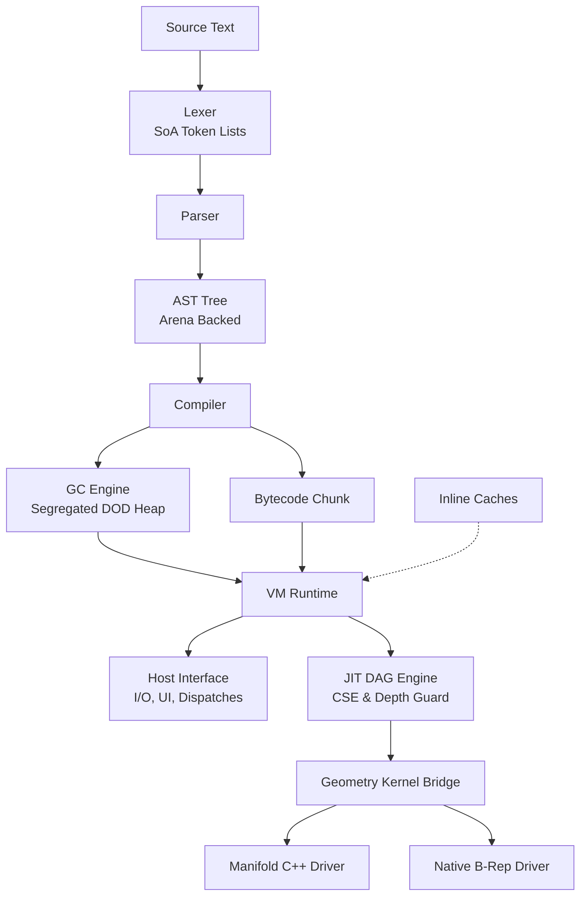
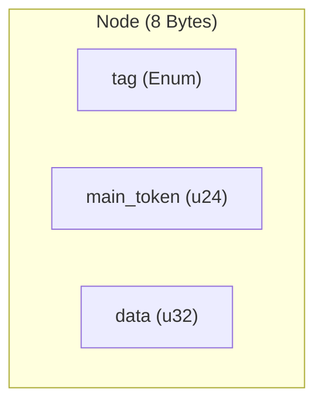
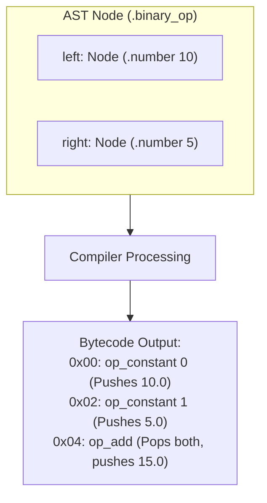
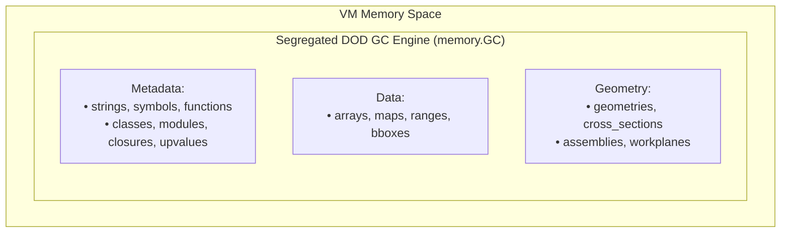
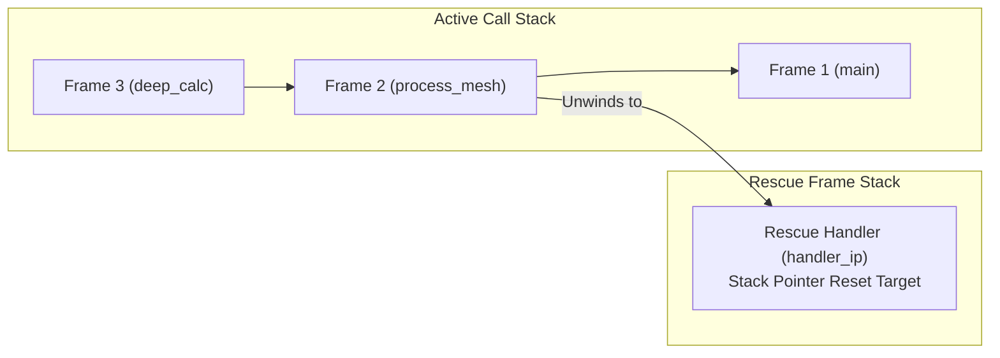
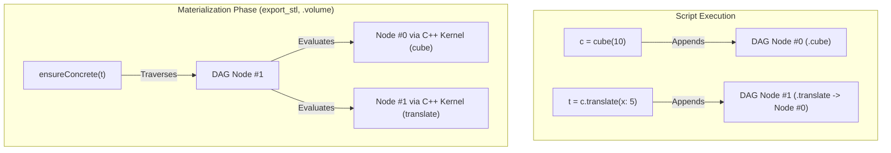

# KupCAD System Architecture & Memory Model

The KupCAD pipeline is structured as a multi-pass CAD language compiler and virtual execution environment, optimized for zero-waste memory access, explicit memory ownership, and deferred 3D geometry evaluation.



---

## 1. Lexical Analysis (The Lexer)

The Lexer scans raw source text and converts character streams into tokens using a **Structure of Arrays (SoA)** memory layout.

* **Zero-Allocation Scanning:** The Lexer does not allocate individual token objects. It scans strings directly from source memory and records byte offsets.
* **SoA Token Storage:** Tokens are stored across three contiguous, cache-line-friendly arrays:
* `tags: []Tag` (e.g., `.keyword_def`, `.number`, `.ident`)
* `starts: []u32` (Source code byte offsets)
* `lengths: []u32` (Token byte lengths)


* **Compile-Time Keyword Hashing:** Identifiers are evaluated via `std.StaticStringMap` at compile time, yielding $O(1)$ keyword resolution without heap allocations or string branching.

```zig
// Data layout inside TokenList
pub fn TokenList(comptime Tag: type) type {
    return struct {
        tags: []const Tag,
        starts: []const u32,
        lengths: []const u32,
    };
}

```

### Calls without parentheses

The parser reads spacing from the token offsets (`starts`/`lengths`; the lexer emits no whitespace tokens) and keeps the local variables in scope (`Parser.locals`, a set of source slices, with `local_order` so a body drops exactly the names it bound). Together they decide what follows a name, as in Ruby and Crystal: `puts -1` and `f *xs` pass an argument, `x -1` subtracts from the local `x`, `name(` holds the arguments and `name (` only groups the first one. Its scopes mirror the resolver's: a def, lambda, block, class or module body sees the names around it and drops its own at its end; `if`/`while`/`begin` bodies don't scope.

---

## 2. Abstract Syntax Tree (The AST)

The AST uses a **Data-Oriented Cache-Dense Layout**. Nodes avoid heap pointers and object graphs.

* **Compact Node Size:** Every AST `Node` is packed into **exactly 8 bytes** for L1 cache line density.
* **Index-Based References:** Nodes refer to child nodes, spans, or interned strings using 32-bit integer indices (`NodeIndex`, `StringId`) instead of pointers.
* **Side-Table Metadata:** Extended payloads (such as function parameters or multi-branch `case/when` lists) are appended to a contiguous `extra_data: ArrayListUnmanaged(u32)` buffer.
* **String Interning:** Identifier and string literal characters are stored in a dedicated String Pool. Duplicate strings map to the exact same `StringId`, turning name comparisons into $O(1)$ integer equality checks.



---

## 3. Bytecode Compilation (The Compiler)

The Compiler traverses the AST and translates nodes into virtual machine instruction streams called **Chunks**.



* **Locals vs. Globals:** Local variables live directly in evaluation stack slots. Name lookup is resolved at compile time to a 1-byte or 2-byte index (`op_get_local`, `op_get_local_wide`).
* **Constants:** a chunk's constants are deduplicated as they are made (`emitter.makeConstant`): a string by its text, every other value (numbers, interned symbols, objects) by its bits, each through one hash map lookup; a scan of the constants comparing values made a 4000-number literal quadratic to compile. Arithmetic on literals is folded at compile time (`tryConstantFold`: `+ - * / % **` and the unary minus, so `-5 * 2` is the one constant `-10`); an overflow or a NaN is left to the VM to report.
* **Wide Instruction Variants:** To break standard 255-item operand boundaries without sacrificing bytecode density, instructions support `_wide` variants (e.g., `op_constant_wide`, `op_closure_wide`, `op_switch_wide`) using 16-bit operands.
* **Call Sites:** `op_call`, `op_invoke`, `op_super_invoke` and `op_yield` carry the argument count followed by a `CallFlags` byte (`chunk.zig`). `has_block` marks the last argument as the call's block, so a lambda passed as an ordinary argument is never mistaken for one; `spread` means the positionals arrive packed in one Array (the call used `*splat`), which the VM spreads onto the stack before dispatch. Keywords (including `**map`) always arrive as one trailing Map.
* **Upvalue Resolution:** When a closure captures a variable from an outer function, the Compiler generates an `Upvalue` mapping. The VM bridges this slot either directly on the evaluation stack or hoists it to the heap when the outer function frame returns.
* **`for` Loops:** A `for` loop keeps its iterable and the count of elements taken in two hidden local slots (`hiddenLocalSlots`), and `op_for_next` (u16 slot, 4-byte exit offset) pushes the next element or jumps out. Keeping the state out of the stack makes `break`, `next` and `return` work exactly as in a `while` loop. Ranges use the same `vm/sequence.zig` rules as `Range#each`, so both yield the same values.
* **Stack Depth Simulation:** The Compiler maintains `current_stack_depth` and `max_stack_depth` counters during code generation. `errdefer` stack restoration guards ensure that compilation failures (e.g., constant pool overflow) roll back stack depth counters cleanly to prevent compiler assertions from panicking.

---

## 4. Virtual Machine Runtime & Memory Management

KupCAD employs a **Segregated Data-Oriented Design (DOD) Tracing Garbage Collector** that manages all language objects and CAD handles through flat memory slices.



### Values

A `Value` is 8 bytes, NaN-boxed (`core/value.zig`): a number is its IEEE 754 bits, and nil, the booleans and heap pointers live in the quiet-NaN space `QNAN` marks (a pointer with the sign bit set too). So a number must never look like that space: `initNumber` turns every NaN into one canonical NaN (and -0.0 into 0.0). A NaN with payload bit 50 set, which an f32 NaN widened to f64 can carry (an STL coordinate), used to read as nil, a boolean or, with the sign bit, a pointer.

### Segregated DOD Object Tracking

Instead of a single heterogeneous linked list, `memory.GC` organizes object allocations into 18 dedicated `ArrayListUnmanaged` arrays (`strings`, `geometries`, `closures`, `instances`, etc.).

* **Built-ins arena:** objects that live as long as the VM are allocated from `GC.builtins`, an arena freed with the GC: every native (they all come from the standard library's tables) and the static names the library registers methods, classes and constants under (`GC.internStatic`, `VM.staticString`, which intern the literal without copying it). They are created marked and kept out of the sweep lists, so the mark phase passes over them (they reference no other object) and no sweep frees them; a script string with the same text is the static string. One GC allocation per native and per name made a VM cost about 850 allocations before it ran anything; it is now about 100.

* **Iterative Mark Phase:** Mark roots originate from evaluation stack slots (`vm.stack`), active call frames (`vm.frames`), global symbol tables (`vm.globals`, each imported module's `Namespace`, and builtins the main script shadowed), the import cache (`vm.modules`), pending unwind entries (`vm.unwind_stack`), static pre-interned literals (`static_true`, `static_false`, `static_nil`), and the constant pools of chunks that are still being compiled (`GC.live_chunks`, see below). Reference tracing uses an explicit `gray_stack: ArrayListUnmanaged(*Obj)` to prevent C-stack overflows on deeply nested object structures.
* **Chunks Under Compilation:** A top-level chunk is not reachable from any root until `interpret()` or `op_import` wraps it in a closure, yet compiling it allocates heap constants (strings, functions). `emitter.makeConstant` registers such a chunk in `GC.live_chunks` (a `ChunkRegistry`, `vm/chunk.zig`) so a collection triggered mid-compile cannot sweep constants already stored in it; the chunk unregisters itself when it is freed or once the script closure roots it. Nested function chunks are traced through their `ObjFunction`, which the compiler keeps on the VM stack while compiling the body.
* **Test Hook:** `GC.stress` collects on every allocation. It exists only so tests can prove rooting invariants deterministically; production code never sets it.
* **Contiguous Sweep Phase:** Unreferenced objects are swept via contiguous slice iteration using $O(1)$ `swapRemove`. When a geometry handle (`ObjGeometry` or `ObjCrossSection`) is swept, the GC automatically invokes the registered host mesh destructor to release native C++ kernel handles.

### Stack Safety & Open Upvalue Patching

The VM evaluation stack (`vm.stack`) pre-allocates contiguous `Value` slots and grows dynamically via `ensureStackCapacity`.

When the evaluation stack reallocates to a new memory block:

1. The byte offset delta between the old and new stack base pointers is calculated.
2. The VM traverses the `open_upvalues` linked list and patches every active `location` pointer (`u.location = new_base + offset`).

This prevents open upvalues from dangling or pointing to deallocated stack memory during runtime stack expansions.

### Inline Caching (IC)

Property getters/setters (`op_get_property`, `op_set_property`) and method invocations (`op_invoke`) use a **2-Way Polymorphic Inline Cache (PIC)** (`InlineCache` in `chunk.zig`). A property read whose name is a method of the receiver's class (a reader, `b.width` with `def width`) caches that method at the read site, as a call site does (`InlineCache.cachedMethod`); it used to find no field and look the method up from scratch, class chain and private name, on every read.

```zig
pub const InlineCache = struct {
    cached_class_1: ?*value.ObjClass = null,
    cached_val_1: value.Value = value.Value.initNil(),
    offset_1: usize = 0,

    cached_class_2: ?*value.ObjClass = null,
    cached_val_2: value.Value = value.Value.initNil(),
    offset_2: usize = 0,
};

```

* **Monomorphic Hit:** If the receiver's `ObjClass` matches `cached_class_1`, field access or method dispatch executes in $O(1)$ time bypassing table lookup.
* **Polymorphic Graduation:** If a second receiver class is encountered, slot 2 (`cached_class_2`) is populated to accelerate multi-type call sites without cache thrashing.

### Dictionary Interning & The Scratch Arena

* **Strict Value Dictionaries:** All object dictionaries (`methods`, `class_fields`, `instance_fields`, `map`) strictly require GC-tracked `Value` types (Interned Strings or Symbols) as keys rather than raw `[]const u8` slices. This guarantees that dynamically generated dictionary keys are safely traced during the GC Mark phase.
* **Scratch Arena Lifecycle:** The VM utilizes a secondary `scratch_arena` (an `ArenaAllocator`) for ephemeral string formatting, interpolation, and method resolution. It is reset (`.reset(.retain_capacity)`) when the outermost `runUntil` returns, even after an unwind, recycling the memory without OS-level thrashing. A nested run (a native calling a block through `callClosureSync`) and error backtraces never reset it, because the native that started them may still be holding scratch memory.

---

## 5. Exception Handling & Stack Unwinding

When `raise(...)` or an internal VM error occurs:



1. **Rescue Registration:** Entering a `begin` block emits `op_setup_rescue`, pushing a `RescueFrame` recording `handler_ip`, target `stack_top`, frame count, and `open_upvalue` state.
2. **Throw Execution (`op_throw`):** The VM pops the exception object, automatically wrapping primitive error payloads (numbers, strings, maps) into `RuntimeError` instances with backtrace metadata. Errors raised by the VM and natives go through `VM.raiseError(kind, fmt, args)`: `vm/error_kind.zig` lists the kinds, `stdlib/exceptions.zig` registers one `StandardError` subclass per kind (cached in `VM.error_classes`), and the message carries no class prefix. A compile-time check rejects a format string that starts with a kind name or ends in a newline, so the convention can't drift.
3. **Stack Unwinding:**
* Open upvalues above the target stack height are closed (`closeUpvalues`).
* Dead `CallFrame` records are popped off the call stack.
* VM evaluation stack slots are shrunk back to `RescueFrame.stack_top`.


4. **Handler Execution:** Instruction pointer `ip` is set to `handler_ip`, and the error payload instance is pushed onto the evaluation stack.

### Unwinding Across Native Boundaries

Native (Zig) functions such as `Array#each` run script blocks through `callClosureSync`. When a block raises, `executeThrow` has already unwound the frames, but every native between the raise and the handler still returns `error.Unwind`, and their `defer`s (handle scopes, scratch resets) may rewrite `stack_top` on the way out. To keep the handler's view of the stack intact:

* `executeThrow` records one `UnwindFrame` (`err_val`, `stack_top`, `frame_count`) and clears any older entry — at most one is ever live, because no bytecode runs while an unwind propagates.
* Each native boundary (`executeNative`, native constructors, `op_yield`, `op_import`) calls `restoreAfterUnwind`, which re-applies the saved stack layout; the boundary whose caller frame owns the handler consumes the entry.
* A native that calls `raiseError` and then returns an ordinary error is detected via `throw_seq`/`last_throw_target`, so the VM never raises a second "Native Execution Error" on top of an exception that was already thrown (and possibly rescued).
* `return`, `break` and `next` inside `begin … rescue … ensure` emit `op_pop_rescue` for every enclosing handler and inline the `ensure` body before the jump (`compiler.emitUnwind`).

**Known limitation:** `ensure` bodies do not run when an exception propagates out of the block *uncaught* — only on normal exit, `return`/`break`/`next`, or when a `rescue` clause in the same block handles the error.

---

### Top-Level Scopes

The main script's top-level variables, `def`s and classes live in `vm.globals`, together with the builtins the host registers. Each imported module gets its own `value.Namespace`, created by `op_import`. The compiler stamps it on every `ObjFunction` it compiles for that module (`ObjFunction.namespace`), so a module's functions, methods and blocks resolve globals in the module's namespace wherever they are called from. `op_get_global`, `op_define_global`, `op_class` (class reopening) and `defined?` all go through `VM.lookupGlobal`:

* main-script code reads and writes `vm.globals`;
* module code reads its own namespace first, then builtins only. Names the main script defined itself (`script_defined_globals`) are skipped, and a builtin the main script shadowed is served from `shadowed_builtins`. Module code writes only to its own namespace.

The hidden `__exports__` object that `export` builds lives in the module's namespace and is handed to the importer by `op_import`. Assignment inside a `def` always creates a local (`Compiler.writesScriptGlobal`); methods only *read* top-level variables.

---

## 6. Host Platform Interface (The Host)

The `Host` interface (`vm/host.zig`) decouples the VM runtime core from OS dependencies, standard output streams, file I/O, and UI binding layers.

```zig
pub const Host = struct {
    binary_handler: ?*const fn (vm: *VM, op: chunk.OpCode, a: value.Value, b: value.Value) anyerror!value.Value = null,
    mesh_destructor: ?*const fn (handle: GeometryHandle) void = null,
    compile_module: ?*const fn (vm: *VM, path: []const u8, source: []const u8, namespace: *value.Namespace) anyerror!*chunk.Chunk = null,
    print_handler: ?*const fn (vm: *VM, message: []const u8) void = null,
};

```

* `print_handler`: Intercepts calls from `puts()`, `print()`, and `inspect()`. Routes output to stdout in CLI mode or UI widgets in WebAssembly/GUI modes.
* `binary_handler`: Handles CSG binary operations between geometry objects.
* `mesh_destructor`: Called when `ObjGeometry` handles are freed by the GC to release C++ mesh memory.
* `compile_module`: Compiles an imported module (`import "lib.kup"`) into its own namespace (`compiler/module_compiler.zig`, registered by the standard library). The VM reads the file, checks the cache, the depth limit and cycles, verifies and runs the chunk; parsing and compiling are the host's, so the VM doesn't import the compiler (they imported each other).

### Native Functions

Built-ins are `ObjNative`s: a `NativeFn` and the name scripts know them by (`Array#map`, `Math.sin`, `extrude`), used in error messages and by the profiler. A `NativeFn` receives `NativeArgs` (`core/value.zig`): the arguments on the VM stack with the receiver just below them, their count, and `has_block` from the call site's `CallFlags`, so a lambda passed as an ordinary argument is never mistaken for the block.

Natives are written as typed Zig functions and turned into `NativeFn`s by `wrapMethod` / `wrapGlobal` (`stdlib/classes/common.zig`). The wrapper unboxes each parameter (an optional one may be omitted, a `[]const Value` takes the rest), passes the block only to a `?*ObjClosure` (optional) or `*ObjClosure` (required) last parameter, and raises an `ArgumentError` for a wrong argument count or a `TypeError` for a wrong type, naming the native and the argument.

---

## 7. Geometry Kernel Bridge & Drivers

The `kernel/` module abstracts specific 3D solid modeling backends behind a unified, polymorphic interface (`GeometryKernel`).

### Tagged Geometry Handles

`GeometryHandle` and `CrossSectionHandle` wrap foreign C++ opaque pointers inside tagged structs:

```zig
pub const EngineType = enum { manifold, brep_native };

pub const GeometryHandle = struct {
    engine: EngineType,
    ptr: *anyopaque,
};

```

### Backend Engine Drivers

* **Manifold Driver (`kernel/engines/manifold/driver.zig`):** Translates calls into C FFI bindings (`bindings/manifold/manifold.zig`), communicating with the C++ Manifold mesh library.
* **Native B-Rep Driver (`kernel/engines/brep/driver.zig`):** Executes exact boundary representation operations using topological structures (`Vertex`, `Edge`, `Face`, `Solid`). Locus is unfinished: most of its operations are still stubs, so the driver's `supports` lists what is real (cubes, cylinders, polyhedra, sketches, hulls of flat-faced solids, STEP export) and everything else is refused before it runs (see *Engine features* below). A copy (`BrepSolid.clone`) duplicates the solid's arenas, NURBS data included; it used to go through an identity transform, which keeps only points, lines and planes.

### Ownership & Engine Rules

* **Single Owner:** Every kernel function that returns a `GeometryHandle`/`CrossSectionHandle` returns a *new* handle owned by the caller. Inputs are only borrowed: a driver must never return, consume or destroy an input — not even on no-op or fallback paths (`material`, `simplify`, `decompose`, single-operand `batchBoolean`), where it returns `kernel.clone(input)` instead. The alternative is two owners (the DAG cache and a GC'd `ObjGeometry`) destroying the same C++ pointer.
* **Same Engine:** Operands of multi-input operations must come from the same engine. `kernel.zig` and both drivers check `engine` tags at runtime and fail with a null result; the DAG evaluator surfaces this as `EngineMismatch`. `std.debug.assert` is never used for this, because it is compiled out of `ReleaseFast` builds.

---

## 8. Lazy JIT Geometry Evaluation (The DAG)

KupCAD uses a **Directed Acyclic Graph (DAG)** to defer expensive C++ kernel calculations until materialization.



### DAGBuilder Architecture

* **Cache-Dense 8-Byte Nodes:** Every `DAGNode` contains a 1-byte `tag`, 1-byte `flags`, and a 4-byte `data` index into flat side-table arrays (`extra_data`, `numbers`, `poly_points`, `poly_faces`).
* **Side tables on the general-purpose allocator:** the tables grow as the script builds geometry and are freed one by one in `deinit`. They were in an arena, which keeps every outgrown buffer until the end, so a DAG held about twice its size (240k nodes: 56 MB → 31 MB of peak memory).
* **Common Subexpression Elimination (CSE):** Nodes are hashed deterministically using `Wyhash`; variable-length payloads (polygon contours, polyhedron points/faces, batch operand lists) are hashed with their lengths so differently-split inputs never collide. The `dedup_map: AutoHashMapUnmanaged(u64, DAGNodeIndex)` finds a candidate in $O(1)$, and `nodesEqual` then compares tag, flags and side-table payloads structurally before reusing the index — a raw 64-bit hash collision derives a fresh hash instead of merging two different nodes.
* **Concrete Leaf Nodes:** Results that cannot be recomputed from the graph (`decompose` parts, `simplify` output) are registered with `addConcrete(handle)` as `.concrete` nodes. The `DAGBuilder` owns these handles for the life of the VM (`concrete_handles`) and they are never put in the evictable cache; `CONCRETE_NODE_SENTINEL` is a named sentinel that every child lookup rejects with `InvalidDAGNode` rather than indexing out of bounds.
* **Node Verification:** in Debug and test builds every node is checked as it is added (`vm/dag_verifier.zig`), as the bytecode verifier checks a chunk: its payload lies inside the side tables, its operands are earlier nodes of the kind the operation takes (a sketch to extrude, a solid to translate), its numbers are finite, a polyhedron's faces name its own points, and its settings id exists. A malformed node is a bug in the native that built it, so the builder panics there, with that native on the stack; the evaluator used to meet it later, as a kernel crash or a wrong part. An operand that is no node at all is refused in every build, with `error.InvalidDAGNode`, by the hasher.
* **Snapshot Rollback Safety:** Adding nodes uses snapshot guards (`StateSnapshot`) and `errdefer` blocks. If an `OutOfMemory` error occurs during node insertion, all side-table buffers shrink back to their pre-call length.

### Iterative Evaluation Engine & RAM Budgeting

`dag_evaluator.zig` evaluates symbolic trees iteratively, completely decoupling DAG depth from the host OS C-stack.

* **Frame & Value Stacks:** Evaluation is managed via two heap-allocated dynamic arrays: `EvaluationFrameStack` (for post-order tree traversal) and `IntermediateStack` (for temporarily holding `ValueHandle` wrappers around C++ pointers).
* **Union chains become one batch:** a script's `acc = acc + part` loop builds a chain of binary unions, `((a + b) + c) + d`; the evaluator flattens the chain under a union node into its operands (`collectUnionOperands`) and unions them in one kernel call, as `union([...])` and the repeat patterns (which build one `batch_union_op`) do, instead of N − 1 calls over a growing result (300 parts: 60× faster). A link of the chain already in `dag_cache` is one operand, so after an edit only the new parts join the cached rest; a link asked for on its own is evaluated as the chain it is.
* **No result checks after a transform:** every freshly built solid is checked once (`kernel.problem`, the vertex budget) before it enters the cache, except the result of a pure transform (`isPureTransform`: translate, rotate, scale, mirror, a matrix), which is its operand's mesh moved: the operand was checked, and the numbers are finite (the stdlib refuses the others). Manifold applies transforms lazily, composing a chain into one matrix, and the status or vertex-count query applied them at every link, so a chain of 200 translates cost 12× one.
* **Infinite Depth Support:** By avoiding recursive C++ function calls, KupCAD can evaluate extreme DAG structures (e.g., 5,000+ nested transformations) without triggering C-stack overflows or segfaults.
* **Per-Node Settings:** geometry is evaluated lazily, so each `DAGNode` records the settings it was created under: its spare 16 bits hold a `SettingsId` into `DAGBuilder.settings_table` (distinct `EngineConfig`s, interned; 0 is the defaults). The VM's `config_stack` holds these ids and is changed only through `setConfig` / `pushConfig` / `popConfig`, which also set the builder's `current_settings`. The evaluator builds each node with its own settings (engine, tolerance, vertex budget, `simplify_coplanar`), not those in force at evaluation, which lost `CAD.with_config` on anything evaluated after the block. The node hash covers the settings' `resultHash` (by content, so it stays valid for a cache that outlives the table), which makes it the whole `dag_cache` key: the same node under two engines yields different handle types, and under two tolerances different solids, so they are different nodes.
* **Engine features:** `kernel.Feature` lists what an engine may lack, and each driver answers `supports(feature)` (Manifold has everything; the B-Rep driver lists what Locus implements). The evaluator and the stdlib call `vm.requireFeature(engine, feature)` before the kernel, which raises a `NotImplementedError` naming the feature, so a Locus stub never answers 0 or an empty solid in a script; `vm.warnUnsupported` does the same for materials, once per run, as a warning. The exporters, the LSP hover and the daemon's change hash check `kernel.supports` too.
* **Settings travel with B-Rep solids:** the kernel's creation functions (`kernel.cube`, `kernel.circle`, ...) take the active `EngineConfig`. The B-Rep driver turns it into a Locus `MathEnv` (`mathEnv`: every distance tolerance is `tolerance`, the angular one is fixed) stored on the `BrepSolid`, and every solid derived from it inherits that env, so a whole model is computed with one tolerance. `Resolution` is defined in Locus (`math_env.zig`), which can't import KupCAD, and re-exported by `engine_config.zig`, so the B-Rep tessellator and the mesh engine cut curves by the same rule.
* **Ownership on Error Paths:** Each entry on the intermediate stack records whether the evaluator or the cache owns its handle. When evaluation fails (`RamBudgetExceeded`, `Cancelled`, a kernel null), only evaluator-owned intermediates are destroyed; cache-owned operands and concrete leaves stay alive.
* **RAM Budgeting:** Before an evaluated mesh is committed to the cache, the evaluator checks the C++ kernel's vertex count against the current `EngineConfig.max_vertices`. If it exceeds the limit, the engine safely destructs the intermediate handles and throws a `RamBudgetExceeded` exception, protecting the host hardware from runaway memory exhaustion. Because that check runs *after* the kernel has allocated, two things bound the mesh *before* it is built: user-supplied tessellation counts are capped (`limits.MAX_SEGMENTS`, see §10), so a single primitive cannot request a multi-gigabyte mesh, and an operation whose output multiplies its inputs is estimated first (`checkEstimatedVertices`: a Minkowski sum is about `verts(a) × verts(b)`, an extrusion `profile × (slices + 2)`, a revolution `profile × (segments + 1)`) and refused with the same error.
* **Release builds:** `build.zig`'s `cxxFlags` adds `-DNDEBUG` to Manifold, Clipper2, Draco and the C++ bindings outside Debug builds, so release binaries don't run the libraries' internal asserts; Debug builds keep them.
* **Out of memory in the kernel:** the C++ libraries are built with `-fno-exceptions`, as LLVM and Chromium are, so an allocation that fails inside Manifold aborts the process instead of unwinding into Zig. That is a deliberate trade: wrapping all 68 entry points the driver uses in `try`/`catch` would cost a C++ shim per call and still differ on wasm, where there are no exceptions. The budgets above are what keep an untrusted script from reaching that point.

---

## 9. Content-Addressable File System (CAFS) & Package Integrity

The package manager (`pkg/`) downloads package archives, verifies them, stores every file as a content-addressed blob under `~/.kupcad` (or `KUPCAD_HOME`), and links the workspace's `.kupcad/pkg/<alias>` to those blobs.

* **Streaming Extraction:** `Cafs.extractTarball` walks the gzip'd tarball with `std.tar.Iterator` and writes each regular file straight into the blob store — the archive is never materialized as a directory tree. Every byte of an archive is attacker-controlled, so:
  * symlink and hardlink entries are skipped (never created), which closes the "plant a link, then write through it" escape;
  * entry paths are sanitized (`sanitizeEntryPath`: no absolute paths, `..`, `\`, `:` or NUL; duplicates rejected);
  * decompressed bytes and file counts are capped (`pkg/limits.zig`), guarding against gzip/tar bombs.
* **Atomic Blob Writes:** Each blob is streamed to a randomly named `tmp/blob_*` file opened exclusively, hashed, then `rename`d to its final content-addressed path, so a crash or a concurrent process can never leave a half-written blob under its final name.
* **Lockfile & Integrity:** `kupcad.lock` (`LOCKFILE_VERSION` 3.0.0) pins every dependency to a commit and a length-prefixed Merkle `integrity` hash over the package's `path → blob` map. Paths are relative to the package: a git host archive's top folder (`repo-<sha>/`, `Cafs.ArchiveLayout.wrapped`) is stripped at extraction. A 1.x or 2.x pin, which hashed git host files under that folder, is checked against a fresh download hashed under the folder it had (`Store.IntegrityScheme.root`), then rewritten as 3.0.0. `install` loads the existing lockfile, re-resolves only unlocked or changed refs, verifies both cached and freshly downloaded content against the locked hash (`IntegrityMismatch`), and refuses entries without integrity. 1.x lockfiles are verified with the legacy scheme and rewritten; any other major version is `UnsupportedLockfileVersion`. The lockfile is not rewritten when resolution fails.
* **Input Validation:** Aliases, hosts, refs and repo segments are validated (`pkg/validate.zig`) before they become symlink names, URLs or SQL parameters; transitive dependencies may only point at public git hosts, and all SQL in `store.zig`/`gc.zig`/`health.zig` uses bound parameters.
* **One HTTP client per install:** the `Resolver` owns one `Fetcher` (one `std.http.Client`) for every package it installs, so connections are pooled and the system's root certificates are loaded once; each package used to get its own. Registering a package prepares its two insert statements once and runs them per file (`Stmt.exec`).
* **Store Schema:** SQLite (`store.zig`) with a `user_version` migration chain; packages are keyed by `(id, commit_sha)` so several commits of one package can coexist, and GC/doctor evict package rows together with their blobs.

---

## 10. Input Limits & Sandboxing

KupCAD evaluates untrusted scripts in three places — the CLI, the LSP (just by opening a file) and WebAssembly. Release builds use `ReleaseFast`, where Zig's safety checks and `std.debug.assert` are compiled out, so every user-reachable bound is a real check that returns an error. The C and C++ libraries (Manifold, Clipper, SQLite, Draco) are compiled without UBSan outside Debug builds (`cxxFlags` in build.zig): Zig gives C code trapping UBSan in ReleaseSafe, which cost the kernel its arithmetic checks on every operation and aborted the process on a finding; the WebAssembly flags say the same.

| Limit (`core/limits.zig`, `pkg/limits.zig`) | Value | Guards |
|---|---|---|
| `MAX_SOURCE_BYTES` | 10 MiB | `Document.parse`, CLI file reads |
| `MAX_TOKENS` | 2²⁴ − 2 | u24 token indices in the parser |
| `MAX_AST_DEPTH` | 1500 | Parser and compiler recursion; counted for statements, blocks and `a.b.c` / `a + b + …` chains |
| `MAX_ARGS` | 255 | Parameters per `def`/block, checked against the real frame-slot layout |
| `MAX_CONSTANTS`, `MAX_INLINE_CACHES`, `MAX_JUMP_TABLE_CASES` | 65 535 | 16-bit bytecode operands; larger `case` tables fall back to linear compares |
| `MAX_LOCALS` / `MAX_UPVALUES` | 65 535 / 255 | Variables per function, and those a closure captures; the compiler finds a local through a name → slot map (`Compiler.local_slots`), so a function with tens of thousands of them compiles in linear time |
| `MAX_HASH_ENTRIES` | 32 767 | Entries in one map literal (`a map literal holds at most 32767 entries`) |
| `INTERACTIVE_INSTRUCTION_LIMIT`, `INTERACTIVE_MEMORY_LIMIT` | 100 M / 1 GiB | Instructions and script heap of a run where a person waits (the browser, the language server, `kupcad watch`); the GC collects before an object would cross the memory limit, and every allocation the dispatch loop can't make raises an `OutOfMemoryError` (`VM.allocationFailed`, which takes only `error{OutOfMemory}`, so a call that fails otherwise doesn't compile against it) instead of ending the run without a message |
| `MAX_SEGMENTS` | 2048 | Every tessellation count (segments, sides, slices, `resolution: { segments: }`); auto-computed counts are clamped |
| `MAX_PATTERN_COUNT` | 10 000 | `repeat_linear` / `repeat_polar` |
| `MAX_RANGE_MATERIALIZE` | 10 000 000 | Arrays built from ranges (`to_a`, `map`'s result); block iteration (`each`, `times`) is bounded by the instruction budget instead |
| `MAX_NEWTON_TRIALS`, `MAX_MARCHING_STEPS` | 1000 / 100 000 | B-Rep solver budgets set via `CAD.config` |
| `EngineConfig.max_vertices` | 5 M | Vertex budget (`RamBudgetExceeded`): estimated before Minkowski sums, extrusions and revolutions, and checked on every finished mesh |
| `MAX_ARCHIVE_DOWNLOAD_BYTES`, `MAX_EXTRACTED_TOTAL_BYTES`, `MAX_EXTRACTED_FILE_COUNT` | 256 MiB / 1 GiB / 50 000 | Package downloads and extraction |

`core/limits_test.zig` meets every public limit in `core/limits.zig` with the script that crosses it and checks the error its author sees (or, for a limit with a fallback such as a large `case`, the right answer); a limit added without a case there fails to compile.

Every integer keyword argument goes through `util.checkedInt` (rejects NaN, ±inf and out-of-range), dimensions through `requirePositive` (rejects non-finite), and polyhedron/polygon indices are bounds-checked before any kernel call.

**Sandboxing**

* **Bytecode Verifier:** `interpret()` and `op_import` run `vm/verifier.zig` once over each chunk (operand bounds, constant and inline-cache indices, local and upvalue slots within the function's frame and closure, closure capture descriptors, switch tables, jump targets on instruction boundaries, nested-chunk depth) so the dispatch loop can index without checks.
* **LSP:** Every VM the language server runs uses `vfs/readonly.zig` — reads come from open editor buffers, then a read-only view of the workspace; writes (`export_*`, `makePath`, links) are discarded, so opening a malicious `.kup` cannot touch the disk.
* **Viewport WebSocket:** Binds `127.0.0.1` only, checks `Origin` against an allowlist (`vscode-webview://`, the local dev server), caps clients at `MAX_CLIENTS` and frames at `MAX_INCOMING_FRAME_BYTES`, and uses a per-client writer with a drop-stale mailbox so a stalled viewer cannot block the LSP thread. The port is `KUPCAD_VIEWPORT_PORT` (default 9001) with an OS-assigned fallback reported via the `kupcad/viewportReady` notification.
* **CLI:** `kupcad build` exits non-zero on any failure (arguments, runtime error, export) so CI can rely on it.

---

## 11. Linter (`tools/lint`)

`api.checkDocument` runs the linter over the syntax tree (and adds the parser's and the compiler's errors), for `kupcad check`, the LSP and wasm alike.

* **Rules and ids:** each rule (`tools/lint/rules/*.zig`) declares a stable `id` (`unused-variable`) and a `description`. `Linter.RuleSet` holds the rule instances in fields named by those ids, and `lint.Config` has one level per id (`off`, `info`, `warning`, `error`), set from the `lint` section of `.kupcad.json`; a compile-time check keeps the two lists equal. A rule reports through `Linter.report(id, ...)`, which takes the severity from the config, and every finding carries its rule's id, printed after the message by the CLI and sent as the diagnostic `code` by the LSP.
* **Suppressions:** `tools/lint/suppressions.zig` runs after the rules, in `api.checkDocument`: it reads the `kupcad:disable-next-line` / `disable-line` / `disable` directives from the comments the parser collected and drops the findings they name, so rules know nothing of them. Findings without a rule id (syntax and compile errors) are never dropped, and a directive that is malformed or hid nothing becomes a finding of its own.
* **Fixes:** a finding may carry a `Fix`: a title and a list of `Edit`s (renaming `x` edits every place it is bound, which `Binding.sites` records per scope), marked `safe` if it keeps the model's meaning. `api.fixCode` (`check --fix`) applies the safe ones through `tools/lint/fixer.zig`, which skips any fix overlapping one already taken and writes the edits in source order, re-checks, refuses a pass that adds a syntax or compile error, and repeats up to `MAX_FIX_PASSES`. Suggestions (`safe = false`) are for the editor only. `core/token_span.zig` gives a statement's first and last token, shared with the formatter.
* **Tests:** `tools/lint/testing.zig` lints a source with chosen rules for the rules' unit tests. End to end, `tools/lint/snapshot_test.zig` checks each `snapshots/<case>.kup` as `kupcad check` would and compares the findings with `<case>.snap`; both files are embedded, so a changed case reruns the test, and `zig build test -Dupdate-snapshots` rewrites the snapshots (review the diff before committing it).

## 12. Example Models as Tests

Every model in `examples/` is built end to end by `src/examples_test.zig`: run, each part fingerprinted (engine, volume, surface area, bounds, genus, mesh vertices and triangles), then exported as `kupcad build` would (STEP for an exact model, glb for the rest). The fingerprints must match `src/examples.snap`: measures within a relative 1e-6, mesh counts within 1%, genus exactly, since the last bits of a sine differ between the platforms' math libraries. `zig build test -Dupdate-snapshots` rewrites the snapshot (with the lint snapshots); review the diff. The examples sit outside the Zig module, so `build.zig` lists them (`EXAMPLES`) and passes each in as an import, which also makes the build rerun the test when one changes; a guard test fails on an example missing from the list.

## 13. Exports Read Back

The exporters' tests read every format back. An STL is parsed (the reader welds equal positions) and must be closed and consistently oriented, every edge shared by two triangles running along it in opposite directions (`kernel/mesh_check.zig`, for any test with a mesh to check). A glb's primitives must close every part over its shared vertices, and each Draco primitive is decoded (`bindings/draco.zig` `decodeMesh`) to the vertex and index counts its accessors declare, within their bounds, with as many triangles as the uncompressed export. Each material's colour, metallic and roughness factors, alpha mode, transmission extension and viewer role are checked in the JSON. In CI (Linux, Debug), `pnpm check:gltf` builds models that reach every branch of the glTF exporter, in both containers with and without Draco, and checks them with the Khronos glTF Validator (`core/scripts/validate-gltf.mjs`); any error or warning fails. It found that a Draco accessor carried a `byteOffset` without a buffer view, which glTF forbids; accessors now never write one.

## Architecture Summary Matrix

| Component         | Primary Responsibility                    | Memory Strategy                  | Key Safety Invariants                                  |
|-------------------|-------------------------------------------|----------------------------------|--------------------------------------------------------|
| **Lexer**         | Source text $\rightarrow$ SoA Token Lists | Zero-allocation byte slices      | Fixed-size SoA arrays                                  |
| **AST**           | Syntax tree & string interning            | 8-byte nodes, Arena-backed       | Integer index references (`NodeIndex`)                 |
| **Compiler**      | AST $\rightarrow$ Bytecode Chunk          | Stack depth simulation           | `errdefer` counter rollbacks                           |
| **VM**            | Instruction interpretation                | Pre-allocated dynamic stack      | Open upvalue pointer patching on realloc               |
| **GC Engine**     | Heap memory management                    | Segregated DOD tracking lists    | Iterative Grey Stack (prevents C-stack OOM)            |
| **Host**          | I/O & platform abstraction                | C function pointer callbacks     | Total decoupling from terminal/OS streams              |
| **Kernel Bridge** | Polymorphic 3D engine dispatcher          | Tagged `GeometryHandle` pointers | Single-owner handles, runtime engine checks            |
| **DAG Engine**    | Deferred CSG computation                  | 8-byte nodes, Wyhash CSE         | Structural dedup, engine-keyed cache, RAM budgeting    |
| **CAFS**          | Package extraction & storage              | Content-addressable storage      | Streaming extraction, no symlinks, lockfile integrity  |

```

```
