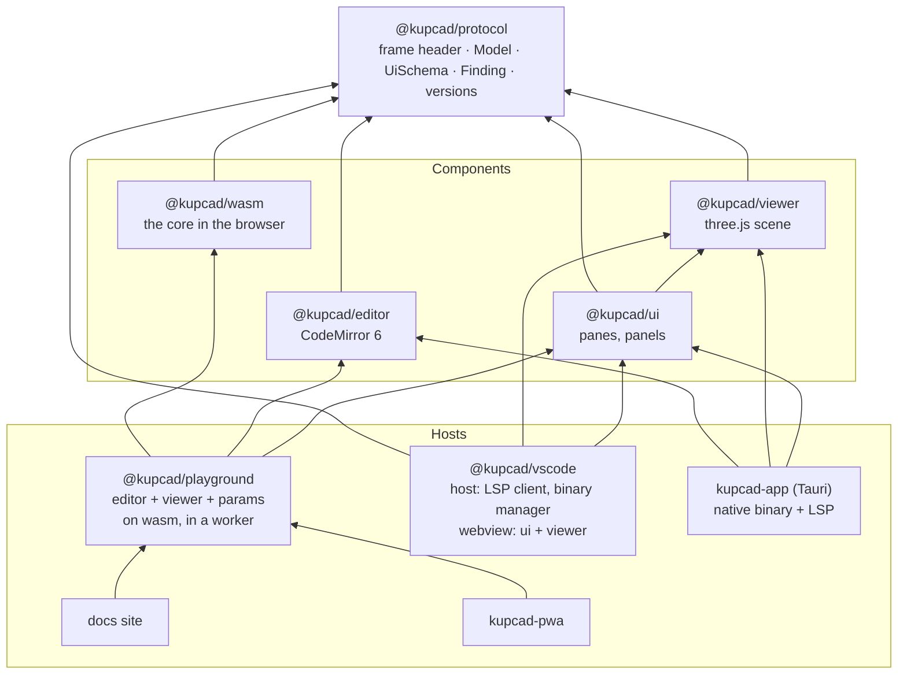

# Front-end architecture

How the packages in `packages/` are cut, what passes between them, and what each host (the VS
Code extension, the playground, the desktop app, the PWA) adds. The core's own architecture is
in [`core/docs/architecture.md`](../core/docs/architecture.md); this document starts where that
one ends, at the core's two faces: the `kupcad` binary (CLI and language server) and
`kupcad.wasm`.

## 1. The shape



An arrow points at what a package builds on.

Three rules keep it this shape:

1. **Components see data, not engines.** The viewer takes a `Model`; the parameter panel takes a
   `UiSchema` and gives back values. Neither knows whether the model came from wasm in a worker,
   from the language server over a socket, or from a spawned binary. The hosts know that.
2. **One protocol package, no runtime.** `@kupcad/protocol` is types and a few pure functions
   (a message is well-formed, a version is compatible). Every package depends on it; it depends on
   nothing, so a change to it is visible in every consumer's type check at once.
3. **The core's output formats are the interface.** A model crosses into the front end as what the
   core already writes: GLB for solids, SVG for drawings, the `UiSchema` JSON of `kupcad doc` for
   parameters, the findings JSON of `check`. The front end adds no second representation to keep in
   step.

## 2. `@kupcad/protocol`

The shapes the core sends, as it sends them, and the few pure functions every host needs to read
them. The shapes live in `src/types.d.ts` (unions read badly as `@typedef`s), exported as
`@kupcad/protocol/types`; the functions in `src/index.js`, typed by JSDoc against them. It
depends on nothing and runs nothing.

```ts
// src/types.d.ts: field for field what core/src/preview/frame.zig, tools/lint/finding.zig,
// tools/doc/extractor.zig and version.zig write. A field the core may leave out is `null`,
// never missing.

/** A preview frame's JSON header (`preview_wasm`, the language server's viewport socket). */
export interface FrameHeader {
  protocolVersion: number;
  /** What the host calls the document: the URI the editor opened it by, which
   *  `kupcad.setParams` takes; null from `preview_wasm`. */
  document: string | null;
  kind: '3d' | '2d' | 'none';
  /** A 3D model's parts; empty otherwise. */
  parts: Part[];
  warnings: Warning[];
  params: { schema: UiSchema; values: ParamValues };
  /** Why the run failed (`kind` is then 'none'), or null. */
  error: Failure | null;
  timing: { runMs: number; renderMs: number };
}
export interface Part {
  name: string; count: number;
  /** The GLB's nodes of its copies, by name: "bolt", "bolt_2". */
  nodes: string[];
  color: string | null;          // "#rrggbb"
  opacity: number;
}
/** Lines and columns are 1-based, columns in UTF-8 bytes; null where the script wasn't running. */
export interface Warning { message: string; line: number | null; column: number | null }
export interface Failure extends Warning { param: string | null }   // the parameter refused

/** What a frame shows: its body, typed by its kind. */
export type Model =
  | { kind: '3d'; glb: Uint8Array; parts: Part[] }   // export_gltf's GLB, each copy a named node
  | { kind: '2d'; svg: string }                      // export_svg's drawing, each shape's name its id
  | { kind: 'none' };
/** A frame read: its header, and its model. */
export interface Preview { header: FrameHeader; model: Model }

/** `kupcad doc`'s schema, as extract_params_wasm and every frame give it. */
export interface UiSchema { meta: Meta; parameters: ParamSpec[] }
export interface Meta { title: string | null; description: string | null; author: string | null }
export interface ParamSpec {
  name: string;
  type: 'number' | 'string' | 'boolean';   // a Symbol parameter is a 'string' with `validate.in`
  default_value: number | string | boolean | null;   // null when the default is computed
  validate: { min: number | null; max: number | null; in: (number | string | boolean)[] | null };
  step: number | null; unit: string | null; group: string | null;
}
export type ParamValues = Record<string, number | string | boolean>;

/** check_code_wasm's findings; `check --format json` adds the file's `path`. */
export interface Finding extends Range {
  severity: 'error' | 'warning' | 'info';
  rule: string | null;                   // null for a syntax or compile error
  code: string; message: string;
  fix: { title: string; safe: boolean; edits: (Range & { text: string })[] } | null;
}
export interface CheckFinding extends Finding { path: string }
/** 1-based lines and columns (UTF-8 bytes), and the byte offset and length an editor counting
 *  from the start wants. */
export interface Range {
  line: number; column: number; endLine: number; endColumn: number; offset: number; length: number;
}

/** `kupcad version --json` and version_wasm. */
export interface VersionInfo { version: string; protocolVersion: number; os: string; arch: string }
/** The language server's `kupcad/viewportReady` notification. */
export interface ViewportReady { port: number; protocolVersion: number }
/** The one argument of the `kupcad.setParams` command (`workspace/executeCommand`). */
export interface SetParamsArgument { uri: string; values: ParamValues }
/** The one argument of the `kupcad.preview` command: the document the viewport shows. */
export interface PreviewArgument { uri: string }
/** A host and its viewer: the document shown and its values; ready, setParams, a screenshot, a problem. */
export type HostMessage = ...; export type ViewerMessage = ...;
```

```js
// src/index.js
export const PROTOCOL_VERSION = 1;
export const VIEWPORT_READY_NOTIFICATION = 'kupcad/viewportReady';
export const SET_PARAMS_COMMAND = 'kupcad.setParams';
export const PREVIEW_COMMAND = 'kupcad.preview';
export function isHostMessage(value) { ... }            // and isViewerMessage, isParamValues
export function isCompatible(protocolVersion) { ... }   // this package reads that version
export function readFrame(bytes) { ... }                // ArrayBuffer | Uint8Array -> Preview
export class ProtocolError extends Error { ... }        // a frame this package can't read
```

`readFrame` splits a frame as `preview/frame.zig` writes it (a u32 little-endian header length,
the header, the body), refuses one whose `protocolVersion` it doesn't know or whose length or kind
doesn't hold up, and gives the body as the model its kind says (the GLB as a view on the bytes, not
a copy). Versioned: `PROTOCOL_VERSION` goes up when a shape changes, and a host and a viewer that
don't agree say so instead of showing nothing (the extension's webview and the language server
compare theirs through `kupcad/viewportReady`, a playground through `version_wasm`). A field
added as optional (`document`) needs no new version.

The messages between a host and a viewer (the extension's webview bridge) are the package's too
(`messages.js`, `HostMessage` and `ViewerMessage`): the host tells the viewer the document it
shows and the values its panel holds, and the viewer tells the host it is ready for a frame, the
values its panel gives, a screenshot to save and a problem to log. They arrive untyped
(`postMessage`), so each side reads the other's with a guard (`isHostMessage`,
`isViewerMessage`) and drops what isn't one.

## 3. `@kupcad/wasm`

The core's exports are plain C-style functions over linear memory (`core/src/wasm.zig`:
`preview_wasm`, `build_model_wasm`, `check_code_wasm`, `format_code_wasm`,
`extract_params_wasm`, `version_wasm`, `put_file_wasm`, `clear_vfs_wasm`,
`wasm_alloc`/`wasm_free`, `get_last_error`). This package is the typed face over them:

```js
const kupcad = await createKupcad({ wasm, log });  // instantiates once; createKupcadWorker() alike
await kupcad.preview(source, { params, signal })   // -> Preview (protocol's readFrame of preview_wasm)
await kupcad.build(source, { params, format: 'glb', draco: false, signal }) // -> Uint8Array
await kupcad.check(source)   // -> Finding[]
await kupcad.format(source)  // -> string
await kupcad.params(source)  // -> UiSchema
await kupcad.version()       // -> VersionInfo (version_wasm), checked against PROTOCOL_VERSION
await kupcad.files.put('plate.dxf', bytes); await kupcad.files.clear()  // the VFS imports read
```

* **Memory** is handled inside: strings and buffers are copied in with `wasm_alloc`, results
  copied out and freed, errors read from `get_last_error` and thrown as `KupcadError` with the
  core's message (a syntax error's `line:col`, a runtime error's text, `parameters:` for a bad
  value). A preview doesn't throw for the script's faults: a script that fails, or values the
  core refuses, is a frame whose `error` says why, as from the language server.
* **A worker wrapper**, `createKupcadWorker()`, gives the same API but runs the module in a Web
  Worker, passing buffers as transferables, with one call in flight and the next queued (a build
  can take seconds; the page must not freeze). A call's `AbortSignal` drops it while it waits and
  stops the worker while it runs, which is what the core's instruction cap can't do from
  outside; the next call starts a worker given the files put so far, as after a crash. The
  worker's side (`serve`) and the client's are tested over a `MessageChannel` with the real
  module, the worker itself being a stand-in in Node.
* **WASI** is the package's own (`src/wasi.js`): the module imports it, a browser has none, and
  Node's would give it a file system. It answers the calls the module makes (clocks, randomness,
  the log, which goes to `log` a line at a time) and every other one ENOSYS, from the module's own
  list of imports. `Kupcad.fromExports(exports)` takes a module a host instantiated itself.
* **A trap** (or an exit) leaves the instance unusable: it is a `KupcadCrashError` for that call
  and each after; a worker's is replaced on the next call.
* **Two builds** of the module come from core: `kupcad.wasm` and the threaded one
  (`-Dwasm_threads`, which needs `SharedArrayBuffer` and so cross-origin isolation). The package
  ships the plain one; the threaded one, a second entry a host opts into when its headers allow,
  comes with the first host that can serve it (it also needs its threads run in workers).
* **Versioning:** the package version is the core's (`build.zig.zon`), and the release workflow
  publishes it from the same tag that builds the binaries, with npm provenance. `kupcad.version()`
  returns the module's own (`version_wasm`), so a playground loading the module from a URL can
  show which core it runs, and refuses a module whose `protocolVersion` it doesn't know.

Tests drive the real module (Vitest in Node instantiates wasm): every format builds, an error
gives its message, the VFS round trips, the package's version is the core's, and memory doesn't
grow over repeated calls (the core's own wasm test checks the same from the inside). CI builds
the module from the same commit before the packages' tests (`pnpm build:core:wasm`, then
`pnpm -r build`, which copies it into the package).

## 4. `@kupcad/viewer`

A class, not a component, so any framework (or none: the webview of an editor that isn't VS Code)
can own it:

```js
const viewer = new Viewer(canvas, { theme, environment: 'grid' | 'plate' | 'none', plate, dracoDecoderPath });
await viewer.setModel(model);        // a Model: GLB parsed with GLTFLoader (+ DRACOLoader lazily), or SVG drawn on XY
viewer.setRenderMode('solid' | 'xray' | 'wireframe');
viewer.setCamera({ projection: 'perspective' | 'orthographic', view: 'iso' | 'top' | ... });
viewer.setSection({ axis: 'z', offset, flip });   // a clipping plane, with the cut faces capped
viewer.select(partName); viewer.addEventListener('select', ...)   // picking by raycast, tinting the part;
                                                                  // a model without the part says null
viewer.partAt(x, y); viewer.fit(); viewer.resize(); viewer.screenshot(); viewer.dispose();
```

Decisions in it:

* **three.js, our own scene**, not `<model-viewer>`: the reference extension's features (section
  plane, x-ray, build plate, part picking, orthographic views) are scene work that a black-box
  viewer doesn't expose, and the same scene must later draw a 2D drawing, measurements and
  hovers.
* **GLB in, as the core writes it.** The core names each part's node and keeps its colours, so
  the part list, selection and per-part colour need no side channel. Draco-compressed GLB is
  decoded only when a model carries it (the decoder is loaded on demand).
* **A drawing is drawn in the same scene**, as line geometry on the XY plane from the SVG's
  paths, with the camera dropped to a top orthographic view. That is how a Sketch or a Path
  (laser parts, DXF/SVG imports) gets a preview at all: a `2d` frame's body is that SVG.
* **Keeps its own state out of the DOM:** render mode, camera, section and selection are
  properties; the toolbar that sets them is `@kupcad/ui`'s. The Svelte wrapper,
  `<Viewer model={...} renderMode bind:selected bind:viewer ...>`, is a few lines.
* **The script's coordinates:** the core writes the GLB in metres and Y up under one root node;
  the viewer undoes its transform, so the scene is in millimetres and Z up, and a view, a section
  axis, the grid and a drawing mean what they mean in the script.
* **Themes** are a small object (background, grid, default material, selection) that hosts map
  their tokens into; the VS Code webview maps `--vscode-*` variables.

Tested two ways: the scene logic (what nodes a model becomes, picking, section plane, camera
framing, render modes and selection) under Vitest with a stubbed renderer
(`@kupcad/viewer/testing`'s `stubRenderer`, which the hosts' tests use too), on models the real
core makes through `@kupcad/wasm`; and a Playwright smoke test that draws what the core makes in
the page with headless Chromium's WebGL and reads the pixels back (a part's colour, the
background, a section, its cap), so a three.js upgrade that breaks rendering is caught. Reading
pixels, rather than comparing a screenshot, holds on any machine's GPU.

## 5. `@kupcad/ui`

The panels a host places around an editor, as Svelte 5 components:

* `ViewerPane`: the viewer with its toolbar (render mode, view, projection, floor, a section
  plane along an axis over the model's bounds, fit, screenshot) and the part list, each part with
  its colour and copies, a click selecting its copies as a click in the viewer does.
* `ParamsPanel`: controls generated from a `UiSchema`, grouped by `group:`, a slider with a number
  between `min` and `max`, a number field with `step:` and `unit:`, a select for `in:` choices, a
  toggle for a boolean; values validated against the schema before they leave the panel (its
  logic is plain functions, `params.js`); a value the run refused (the frame's `error.param`)
  shown on its control; an overridden value marked with a revert, as the reference extension
  does.
* Later, with the hosts that need them: `PresetsBar` (named sets of parameter values, saved and
  loaded through the host: a JSON file beside the script in VS Code, local storage in the
  playground), `LogPanel` (the run's warnings and errors linked to their line) and `StatusBar`
  (building, done in n ms, failed; the core's version).

They talk only in protocol types and Svelte props and callbacks (`onchange={(values) => ...}`),
hold no engine and fetch nothing. A host wires them: the playground to its worker, the extension's
webview to its message bridge. Tokens (`--kc-*` CSS variables, `tokens.css`) give them one look;
a `vscode.css` maps VS Code's variables onto them so the webview follows the editor's theme, and
`--kc-viewer-*` theme the viewer. They are tested mounted under jsdom with the viewer's `testing`
setup and the real core's schemas and models; the binding a host makes (`bind:selected`) is
tested through reactive state, as a parent's `$state` is.

## 6. `@kupcad/editor` and the editor question

The VS Code extension never embeds an editor: its panel sits beside VS Code's own and shows the
viewer and the panels. So the choice of editor library concerns only the playground, the PWA and
the desktop app, and the extension gives Monaco no advantage.

| | CodeMirror 6 | Monaco |
|---|---|---|
| Size | ~150–300 KB | ~2–3 MB and web workers |
| A docs page, a phone | Light; touch works | Heavy; touch and small screens poor |
| Build | Plain ESM | Workers need a Vite plugin |
| Feel | Its own | Exactly VS Code's |
| Language server | `@codemirror/lsp-client` (official), some wiring | `monaco-languageclient`, turnkey |
| Highlighting | A stream tokenizer (or a Lezer grammar) | A Monarch tokenizer |
| The extension's TextMate grammar | Not reusable | Not reusable without extra machinery |

Both need a tokenizer written for the language, of similar size. The PWA decides it: Monaco is
a poor editor on a phone, and the playground sits on documentation pages where megabytes count.
`@kupcad/editor` is CodeMirror 6, for every web host: highlighting and indentation now, `check`'s
findings as gutter marks and underlines, and the language-server client when the desktop app
comes (over the native binary's `kupcad lsp`). Monaco stays an option for the desktop app alone,
if it must feel exactly like VS Code; that would be a second small package, not a change to this
one.

The editor, like the viewer, is a component the host owns; `@kupcad/ui` doesn't depend on it, so
a host may bring another.

## 7. The hosts

### The playground (`@kupcad/playground`)

One component: `<Playground source={...} wasm={url} />`. It runs the source through
`createKupcadWorker()` on each change (debounced, the last run cancelled if still going),
shows the model, the findings in the editor, the parameters from `params()`, and rebuilds when a
value changes (`build` takes the values as its JSON parameters). It keeps nothing of the host's:
the docs site embeds it in a page with a script of the page's own, the PWA wraps it with files and
projects. Exports (`build` with another format) download as files.

### The VS Code extension (`@kupcad/vscode`)

Two programs in one package, built separately by Vite:

```
src/
  extension/              runs in the extension host (Node)
    main.js               activate: binary, client, commands
    binary/               finding, downloading and updating `kupcad` (below)
    client.js             the LanguageClient and the custom notifications
    viewer-panel.js       the webview panel: HTML, CSP, the message bridge
    commands/             open viewer, export (stl, 3mf, obj, svg, dxf, step), print, set params
    presets.js            parameter presets as <script>.presets.json beside the file
  webview/                runs in the panel (browser)
    App.svelte            ViewerPane + ParamsPanel + LogPanel from @kupcad/ui
    bridge.js             postMessage in, protocol messages out, typed both ways
    socket.js             the viewport WebSocket: preview frames from the language server
  shared/                 message types the two sides share, if any beyond the protocol's
```

Data flow:

* **The model** reaches the webview straight from the language server over the local WebSocket
  it already opens (`cli/viewport_ws.zig`: origin-checked, a preview frame on each change), not
  through the extension host: a model can be megabytes and the host has no reason to copy it. The
  server's port arrives in `kupcad/viewportReady`, and the webview is re-rendered with a CSP that
  allows that port, as the current skeleton does.
* **Parameters** go the other way: the panel's values → bridge → extension host →
  `kupcad.setParams` command (`workspace/executeCommand`) to the language server, which re-runs the preview with them.
  The schema, the values used and any refused one come in each preview frame's header, so the
  panel and the model are always of the same run.
* **Findings and warnings** are LSP diagnostics in the Problems view, as now; the preview's
  warnings (a mended mesh, an engine without a feature) join them on the line of the call that
  caused them (core work, section 8).
* **Export and print** run the binary, not the server: `kupcad build <file> -o <path> -p ...`
  with the panel's current values, so what is exported is what the CLI would build. Print writes
  a 3MF to a temp file and opens it with the configured slicer or the OS's handler.
* **Click a part** in the viewer and the editor jumps to where it was named (needs source
  locations in the GLB's part metadata: core work).

#### The binary manager (`src/extension/binary/`)

The extension ships no binary; it fetches the release it was built for.

1. **Resolve**, in order: the `kupcad.serverPath` setting; the managed install in the extension's
   global storage (`<globalStorage>/bin/<version>/kupcad`); `kupcad` on `PATH`; the repo's
   `core/zig-out/bin/kupcad` in development. Whatever is found is asked `kupcad --version` and
   must satisfy the range the extension declares (`"kupcad": { "core": ">=0.2.0 <0.3.0" }` in
   its `package.json`); one that doesn't is skipped with a message, so an old binary on `PATH`
   never silently runs under a newer extension.
2. **Download** when nothing fits: the GitHub release of the newest version in range
   (`GET /repos/kupcad/kupcad/releases`, no token, with ETag caching), the asset for this platform
   (`kupcad_<version>_<os>_<arch>.tar.gz`, `.zip` on Windows; `os` and `arch` from
   `process.platform`/`process.arch`), verified against the release's `checksums.txt` (SHA-256)
   before it is unpacked, unpacked into the versioned directory, made executable, and asked its
   version once more. A progress notification shows the download; a failure (offline, no asset for
   the platform, a checksum that doesn't match) names what to do: set `kupcad.serverPath`, or
   install from the releases page.
3. **Update**: once a day on activation (and on the `KupCAD: Check for Updates` command) the
   releases list is read again; a newer version in range offers "Update" (download, then restart
   the server), a newer version out of range says the extension itself needs updating. Setting
   `kupcad.binary.autoUpdate` (default `true`) takes the prompt out. Prereleases are taken only
   with `kupcad.binary.channel: "prerelease"`.
4. **Compatibility is checked twice**: by version range before the server starts, and by
   `PROTOCOL_VERSION` in `kupcad/viewportReady` once it has, for the webview's sake.

All of this is pure functions over a small `fetch`/`fs` interface, so it is unit-tested without the
network: asset naming per platform, range checks, checksum verification, the resolution order,
what each failure says.

#### Why not bundle the binary?

Six platforms at 10–20 MB each would make the extension huge and tie every extension release to a
core release. The download happens once per version and is verified; it is what rust-analyzer,
the Zig extension and others do.

### The desktop app (`kupcad-app`, later)

Tauri around `@kupcad/ui`, `@kupcad/editor` with its language-server client (or Monaco, section
6), and the same binary manager (shared from the extension as `@kupcad/binary` when the second user appears). Files are
the real file system; export is `kupcad build` as in VS Code.

### The PWA (`kupcad-pwa`, later)

The playground with a file tree (the Origin Private File System, or the File System Access API
where it exists), projects, and exports; installable, offline once the wasm is cached by its
service worker. The threaded wasm build when the headers allow it.

## 8. What the core must add

Before `@kupcad/protocol` is written, so its types mirror real output. Each is small Zig work:

| Need | Where | What |
|---|---|---|
| One preview payload (done) | `preview/`, `cli/lsp_preview.zig`, `wasm.zig` | A frame (`preview/frame.zig`): a u32 header length, a JSON header and a body, the same from the viewport socket and from `preview_wasm(source, params)`. The header: `protocolVersion`, `kind` (`3d`, `2d`, `none`), `parts` (`name`, `count`, `nodes`, `color`, `opacity`), `warnings` (`message`, `line`, `column`), `params` (`schema`, as `kupcad doc` gives it, and the `values` the run took), `error` (`message`, `line`, `column`, `param`: the parameter whose value was refused), `timing` (`runMs`, `renderMs`). The body: GLB, or SVG for Sketches and Paths. |
| One findings shape (done) | `tools/lint/finding.zig`, `wasm.zig` | `check_code_wasm` emits `check --format json`'s finding (`line`, `column`, `endLine`, `endColumn`, `offset`, `length`, `severity`, `rule`, `code`, `message`, `fix`) without `path` (CodeMirror wants offsets, VS Code lines). |
| Parameters from the editor (done) | `cli/lsp.zig` | A `kupcad.setParams` command (`workspace/executeCommand`: lsp_kit answers a custom request with null), `[{ uri, values }]`, that re-runs the preview with the values; the new frame carries what came of them. |
| Machine-readable version (done) | `cli/version_cmd.zig`, `cli/lsp.zig` | `kupcad version --json` (`version`, `protocolVersion`, `os`, `arch`), and `protocolVersion` in `kupcad/viewportReady`. |
| The document shown (done) | `cli/lsp.zig` | A `kupcad.preview` command, `[{ uri }]`: the viewport shows that document whatever is edited (a library edited shows its importer), and sends its frame to a viewer that asks; a frame the viewers have isn't sent again. |
| Warnings as diagnostics (done) | `cli/lsp.zig`, `session/session.zig` | Each module's last run warnings, published with its lint findings from the call to the end of its line, for the Problems view; an edit drops them until the next run. |
| Part → source | `exporters/3d/gltf.zig` | Each part node's `extras` carry the file and line of its `named`, for click-to-source. Later. |
| Publish the wasm | `.github/workflows/release.yml` | A job that builds `kupcad.wasm`, runs `@kupcad/wasm`'s tests against it and publishes the package from the tag. |

Not needed: a command to validate parameter values. `kupcad doc` (and `extract_params_wasm`) give
the schema the panel validates against, the run is the final check, and the preview frame says
which value it refused. `doc` reads the syntax tree, so a default that is an expression comes
out `null` and a `param` in a branch not taken is still listed; the run's values in the frame are
the truth.

## 9. Order of work

1. **The core's side of the protocol** (section 8, the first four rows), then the
   **foundations:** root tooling (jsconfig with `checkJs`, oxlint, oxfmt, Vitest, Changesets),
   `@kupcad/protocol`,
   `@kupcad/wasm` with its worker and tests, the wasm publish job.
2. **Viewer and panels:** `@kupcad/viewer` (GLB, modes, camera, section, picking; SVG once the core
   sends it), `@kupcad/ui`'s `ViewerPane` and `ParamsPanel`.
3. **The extension:** the binary manager, the viewer panel on the new components, parameters and
   presets, export and print, the core's `kupcad/preview`. This is the
   first thing a user installs, so it comes before the web hosts.
4. **The playground** and the docs site that embeds it.
5. **The PWA, then the desktop app**, which reuse everything above.
